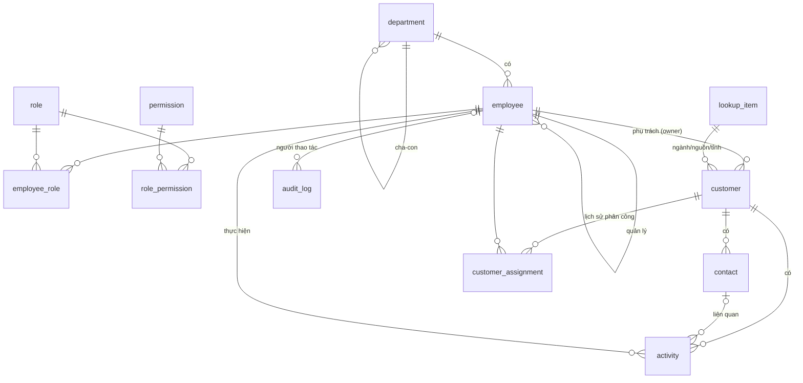

# B1.2 — Thiết kế cơ sở dữ liệu nghiệp vụ CRM SISCOM: Kế hoạch (CHƯA THỰC HIỆN)
Trạng thái: **chỉ thiết kế — chưa sửa mã nguồn, chưa tạo migration, chưa chạy gì.** Chờ phê duyệt.
Ràng buộc: giữ frontend Hybrid Glass; **không đụng localStorage B0**; **không migrate dữ liệu thật** khi chưa được duyệt; không làm Authentication (thuộc B1.3).

Tiền đề: B1.1 đã chạy trên máy bạn (PostgreSQL 18.6, Prisma 7, `app_meta`, health OK — xem `ACCEPTANCE_CHECKLIST.md`). Các phần chưa được xác nhận của B1.1 vẫn mở.

## 1. Phạm vi 6 nhóm
1. Khách hàng + người liên hệ — `customer`, `contact`, `lookup_item`
2. Nhân viên, phòng ban — `employee`, `department`
3. Vai trò & quyền — `role`, `permission`, `role_permission`, `employee_role`
4. Hoạt động chăm sóc — `activity`
5. Phân công khách hàng — `customer_assignment` (lịch sử) + `customer.owner_id` (hiện tại)
6. Nhật ký thay đổi — `audit_log` (chỉ thêm, không sửa/xoá)

## 2. ERD

Quan hệ nghiệp vụ sau này (B2: cơ hội, báo giá, hợp đồng) sẽ tham chiếu `customer.id`.

## 3. Quyết định thiết kế chính
| Chủ đề | Quyết định | Lý do |
|---|---|---|
| Khoá | `id uuid` (`gen_random_uuid()`) + **mã nghiệp vụ** duy nhất (`KH-00001`, `NV-0001`) | Join ổn định; mã giữ nguyên định dạng B0 để import không đổi mã |
| Sinh mã | Sequence PostgreSQL (`customer_code_seq`…) trong cùng transaction | Hết lỗi `Math.max(...[])`/trùng của B0; an toàn đa người dùng |
| Quy tắc B0 giữ nguyên | **Chỉ `name` + `phone` bắt buộc**; MST tuỳ chọn nhưng duy nhất trong khách hàng chưa xoá; MST trống không bị coi là trùng | Ràng buộc ở DB (partial unique) **và** ở service, dùng cùng bộ luật như `customerRules.js` |
| Xoá | Xoá mềm (`deleted_at/by`); chặn xoá khi còn bản ghi mở (sau này: hợp đồng, báo giá…) | Như B0 |
| Danh mục | `tier`, `status` = **enum**; ngành/nguồn/tỉnh = `lookup_item` (sửa được không cần migration) | Tier/status có luồng logic; danh mục thì doanh nghiệp tự thêm |
| Phụ trách | `customer.owner_id` (hiện tại) + `customer_assignment` (lịch sử), cập nhật trong **một transaction** | Lọc nhanh + có lịch sử |
| Điện thoại | Lưu nguyên văn (`phone`) + chuẩn hoá `phone_e164` (nullable) để tìm/phát hiện trùng | Hỗ trợ số VN và quốc tế |
| Thời gian | `timestamptz` (lưu UTC), hiển thị Asia/Ho_Chi_Minh; ngày thuần dùng `date` | |
| Dữ liệu mẫu | Cột `is_demo boolean` trên bảng nghiệp vụ | Phân biệt dữ liệu minh hoạ; không trình bày như bản ghi thật |
| Đồng thời | Cột `version int` (optimistic locking) trên `customer` | Tránh ghi đè khi nhiều người sửa |
| Audit | `audit_log` append-only; role ứng dụng bị thu `UPDATE/DELETE` trên bảng này | Không sửa/xoá nhật ký |
| Quyền | Ma trận B0 là **giả định**; B1.2 chỉ lưu cấu trúc + seed ở trạng thái "chờ SISCOM xác nhận"; **thực thi quyền ở B1.3** | |

## 4. Prisma Schema (bản nháp để duyệt — chưa ghi vào `prisma/schema.prisma`)
```prisma
enum CustomerTier      { STRATEGIC VIP POTENTIAL REGULAR         @@map("customer_tier") }
enum CustomerStatus    { ACTIVE PROSPECT SUSPENDED INACTIVE      @@map("customer_status") }
enum ActivityType      { CALL EMAIL MEETING SITE_SURVEY NOTE     @@map("activity_type") }
enum AssignmentRole    { OWNER SUPPORT                           @@map("assignment_role") }
enum EmployeeStatus    { ACTIVE ON_LEAVE RESIGNED                @@map("employee_status") }
enum PermissionScope   { ALL DEPARTMENT OWN                      @@map("permission_scope") }

model Department {
  id            String   @id @default(dbgenerated("gen_random_uuid()")) @db.Uuid
  code          String   @unique @db.VarChar(30)
  name          String   @db.VarChar(200)
  parentId      String?  @map("parent_id") @db.Uuid
  headId        String?  @map("head_employee_id") @db.Uuid
  isActive      Boolean  @default(true) @map("is_active")
  createdAt     DateTime @default(now()) @map("created_at") @db.Timestamptz(3)
  updatedAt     DateTime @updatedAt @map("updated_at") @db.Timestamptz(3)
  parent        Department?  @relation("DeptTree", fields: [parentId], references: [id])
  children      Department[] @relation("DeptTree")
  head          Employee?    @relation("DeptHead", fields: [headId], references: [id])
  employees     Employee[]   @relation("EmployeeDept")
  @@map("department")
}

model Employee {
  id            String   @id @default(dbgenerated("gen_random_uuid()")) @db.Uuid
  code          String   @unique @db.VarChar(30)               // NV-0001
  fullName      String   @map("full_name") @db.VarChar(200)
  email         String?  @unique @db.VarChar(254)
  phone         String?  @db.VarChar(40)
  departmentId  String?  @map("department_id") @db.Uuid
  positionTitle String?  @map("position_title") @db.VarChar(120)
  managerId     String?  @map("manager_id") @db.Uuid
  status        EmployeeStatus @default(ACTIVE)
  hireDate      DateTime? @map("hire_date") @db.Date
  createdAt     DateTime @default(now()) @map("created_at") @db.Timestamptz(3)
  updatedAt     DateTime @updatedAt @map("updated_at") @db.Timestamptz(3)
  deletedAt     DateTime? @map("deleted_at") @db.Timestamptz(3)
  department    Department? @relation("EmployeeDept", fields: [departmentId], references: [id])
  manager       Employee?   @relation("EmpTree", fields: [managerId], references: [id])
  reports       Employee[]  @relation("EmpTree")
  headOf        Department[] @relation("DeptHead")
  roles         EmployeeRole[]
  ownedCustomers Customer[] @relation("CustomerOwner")
  activities    Activity[]
  assignments   CustomerAssignment[] @relation("AssignmentEmployee")
  auditEntries  AuditLog[]
  @@index([departmentId])
  @@map("employee")
}

model Role {
  id          String @id @default(dbgenerated("gen_random_uuid()")) @db.Uuid
  code        String @unique @db.VarChar(40)       // ADMIN, DIRECTOR, SALES_MANAGER, SALES, ESTIMATOR, ACCOUNTANT
  name        String @db.VarChar(120)
  description String?
  isSystem    Boolean @default(false) @map("is_system")
  permissions RolePermission[]
  employees   EmployeeRole[]
  @@map("role")
}
model Permission {
  id          String @id @default(dbgenerated("gen_random_uuid()")) @db.Uuid
  code        String @unique @db.VarChar(80)       // customer.update ...
  description String?
  roles       RolePermission[]
  @@map("permission")
}
model RolePermission {
  roleId       String @map("role_id") @db.Uuid
  permissionId String @map("permission_id") @db.Uuid
  scope        PermissionScope @default(ALL)
  role         Role       @relation(fields: [roleId], references: [id], onDelete: Cascade)
  permission   Permission @relation(fields: [permissionId], references: [id], onDelete: Cascade)
  @@id([roleId, permissionId])
  @@map("role_permission")
}
model EmployeeRole {
  employeeId String @map("employee_id") @db.Uuid
  roleId     String @map("role_id") @db.Uuid
  grantedAt  DateTime @default(now()) @map("granted_at") @db.Timestamptz(3)
  employee   Employee @relation(fields: [employeeId], references: [id], onDelete: Cascade)
  role       Role     @relation(fields: [roleId], references: [id])
  @@id([employeeId, roleId])
  @@map("employee_role")
}

model LookupItem {
  id        String  @id @default(dbgenerated("gen_random_uuid()")) @db.Uuid
  type      String  @db.VarChar(30)               // industry | source | province
  code      String  @db.VarChar(60)
  labelVi   String  @map("label_vi") @db.VarChar(200)
  sortOrder Int     @default(0) @map("sort_order")
  isActive  Boolean @default(true) @map("is_active")
  industryOf Customer[] @relation("CustIndustry")
  sourceOf   Customer[] @relation("CustSource")
  provinceOf Customer[] @relation("CustProvince")
  @@unique([type, code])
  @@map("lookup_item")
}

model Customer {
  id          String  @id @default(dbgenerated("gen_random_uuid()")) @db.Uuid
  code        String  @unique @db.VarChar(20)      // KH-00128 (từ sequence)
  name        String  @db.VarChar(300)
  shortName   String? @map("short_name") @db.VarChar(120)
  taxId       String? @map("tax_id") @db.VarChar(14)   // duy nhất khi KHÁC NULL và chưa xoá — partial unique (SQL tay)
  industryId  String? @map("industry_id") @db.Uuid
  sourceId    String? @map("source_id") @db.Uuid
  address     String?
  provinceId  String? @map("province_id") @db.Uuid
  phone       String  @db.VarChar(40)                  // BẮT BUỘC
  phoneE164   String? @map("phone_e164") @db.VarChar(20)
  email       String? @db.VarChar(254)
  website     String? @db.VarChar(255)
  tier        CustomerTier   @default(POTENTIAL)
  status      CustomerStatus @default(PROSPECT)
  ownerId     String? @map("owner_id") @db.Uuid
  note        String?
  tags        String[] @default([])
  revenueVnd  BigInt  @default(0) @map("revenue_vnd")  // tạm; sẽ suy ra từ hợp đồng ở B2
  isDemo      Boolean @default(false) @map("is_demo")
  version     Int     @default(1)
  legacyId    String? @unique @map("legacy_id") @db.VarChar(40)  // mã B0, chỉ để đối chiếu khi import
  createdAt   DateTime @default(now()) @map("created_at") @db.Timestamptz(3)
  createdById String?  @map("created_by") @db.Uuid
  updatedAt   DateTime @updatedAt @map("updated_at") @db.Timestamptz(3)
  updatedById String?  @map("updated_by") @db.Uuid
  deletedAt   DateTime? @map("deleted_at") @db.Timestamptz(3)
  deletedById String?  @map("deleted_by") @db.Uuid
  industry    LookupItem? @relation("CustIndustry", fields: [industryId], references: [id])
  source      LookupItem? @relation("CustSource", fields: [sourceId], references: [id])
  province    LookupItem? @relation("CustProvince", fields: [provinceId], references: [id])
  owner       Employee?   @relation("CustomerOwner", fields: [ownerId], references: [id])
  contacts    Contact[]
  activities  Activity[]
  assignments CustomerAssignment[]
  @@index([ownerId]) @@index([status]) @@index([tier]) @@index([deletedAt]) @@index([phoneE164])
  @@map("customer")
}

model Contact {
  id         String  @id @default(dbgenerated("gen_random_uuid()")) @db.Uuid
  code       String  @unique @db.VarChar(20)        // LH-000123
  customerId String  @map("customer_id") @db.Uuid
  fullName   String  @map("full_name") @db.VarChar(200)
  title      String? @db.VarChar(120)
  phone      String? @db.VarChar(40)
  email      String? @db.VarChar(254)
  isPrimary  Boolean @default(false) @map("is_primary")  // 1 liên hệ chính/khách hàng — partial unique (SQL tay)
  note       String?
  isDemo     Boolean @default(false) @map("is_demo")
  createdAt  DateTime @default(now()) @map("created_at") @db.Timestamptz(3)
  updatedAt  DateTime @updatedAt @map("updated_at") @db.Timestamptz(3)
  deletedAt  DateTime? @map("deleted_at") @db.Timestamptz(3)
  customer   Customer @relation(fields: [customerId], references: [id])
  activities Activity[]
  @@index([customerId])
  @@map("contact")
}

model Activity {
  id          String  @id @default(dbgenerated("gen_random_uuid()")) @db.Uuid
  code        String  @unique @db.VarChar(20)       // TT-000456
  customerId  String  @map("customer_id") @db.Uuid
  contactId   String? @map("contact_id") @db.Uuid
  type        ActivityType
  occurredAt  DateTime @map("occurred_at") @db.Timestamptz(3)
  content     String
  outcome     String?
  nextActionAt DateTime? @map("next_action_at") @db.Timestamptz(3)
  performedById String? @map("performed_by") @db.Uuid
  isDemo      Boolean @default(false) @map("is_demo")
  createdAt   DateTime @default(now()) @map("created_at") @db.Timestamptz(3)
  deletedAt   DateTime? @map("deleted_at") @db.Timestamptz(3)
  customer    Customer @relation(fields: [customerId], references: [id])
  contact     Contact? @relation(fields: [contactId], references: [id])
  performedBy Employee? @relation(fields: [performedById], references: [id])
  @@index([customerId, occurredAt(sort: Desc)])
  @@index([nextActionAt])
  @@map("activity")
}

model CustomerAssignment {
  id          String  @id @default(dbgenerated("gen_random_uuid()")) @db.Uuid
  customerId  String  @map("customer_id") @db.Uuid
  employeeId  String  @map("employee_id") @db.Uuid
  role        AssignmentRole @default(OWNER)
  assignedAt  DateTime @default(now()) @map("assigned_at") @db.Timestamptz(3)
  assignedById String? @map("assigned_by") @db.Uuid
  endedAt     DateTime? @map("ended_at") @db.Timestamptz(3)
  reason      String?
  customer    Customer @relation(fields: [customerId], references: [id])
  employee    Employee @relation("AssignmentEmployee", fields: [employeeId], references: [id])
  @@index([customerId]) @@index([employeeId])
  @@map("customer_assignment")   // partial unique: 1 OWNER đang hiệu lực / khách hàng (SQL tay)
}

model AuditLog {
  id          BigInt   @id @default(autoincrement())
  occurredAt  DateTime @default(now()) @map("occurred_at") @db.Timestamptz(3)
  actorId     String?  @map("actor_employee_id") @db.Uuid
  actorRole   String?  @map("actor_role") @db.VarChar(40)
  action      String   @db.VarChar(40)               // create | update | soft-delete | assign | import ...
  entityType  String   @map("entity_type") @db.VarChar(40)
  entityId    String?  @map("entity_id") @db.Uuid
  entityCode  String?  @map("entity_code") @db.VarChar(40)
  summary     String?
  changes     Json?                                    // {before, after} đã loại trường nhạy cảm
  requestId   String?  @map("request_id") @db.VarChar(64)
  actor       Employee? @relation(fields: [actorId], references: [id])
  @@index([entityType, entityId]) @@index([occurredAt]) @@index([actorId])
  @@map("audit_log")
}
```
**SQL viết tay đi kèm migration** (Prisma không mô tả được): partial unique `customer(tax_id) WHERE tax_id IS NOT NULL AND deleted_at IS NULL`; `contact(customer_id) WHERE is_primary AND deleted_at IS NULL`; `customer_assignment(customer_id) WHERE role='OWNER' AND ended_at IS NULL`; sequences + hàm sinh mã; `CHECK` (`btrim(name) <> ''`, `btrim(phone) <> ''`); `pg_trgm` + GIN index trên `name/short_name/phone` cho tìm kiếm tiếng Việt; thu `UPDATE/DELETE` trên `audit_log` khỏi role ứng dụng.

## 5. API dự kiến (REST `/api/v1`, JSON, thông báo lỗi tiếng Việt)
Quy ước chung: phân trang `?page=&pageSize=` (tối đa 100), sắp xếp `?sort=name:asc`, lọc theo tham số, `q=` tìm không dấu; lỗi theo bộ lọc hiện có; `PATCH` kèm `version` (409 khi lệch); mọi thao tác ghi tạo `audit_log`.
| Nhóm | Endpoint |
|---|---|
| Khách hàng | `GET/POST /customers` · `GET/PATCH/DELETE /customers/{code}` (DELETE = xoá mềm; 409 + lý do nếu còn ràng buộc) · `POST /customers/import?dryRun=true` · `GET /customers/export` |
| Liên hệ | `GET/POST /customers/{code}/contacts` · `PATCH/DELETE /contacts/{code}` · `POST /contacts/{code}/make-primary` |
| Hoạt động | `GET/POST /customers/{code}/activities` · `PATCH/DELETE /activities/{code}` · `GET /activities?due=...` |
| Phân công | `GET /customers/{code}/assignments` · `POST /customers/{code}/assign` · `POST /customers/bulk-assign` |
| Tổ chức | `GET/POST /departments` · `GET/POST/PATCH /employees` |
| Vai trò/quyền | `GET /roles` · `GET /permissions` · `PUT /roles/{code}/permissions` · `PUT /employees/{code}/roles` |
| Danh mục | `GET /lookups/{type}` · `POST/PATCH /lookups` |
| Nhật ký | `GET /audit-log?entityType=&entityCode=&actor=&from=&to=` (chỉ đọc) |
**Bảo mật tạm thời:** vì Authentication thuộc B1.3, cần quyết định (mục 8-1) trước khi mở các endpoint này.

## 6. Kế hoạch migration B1.2
**A. Schema (cộng thêm, không phá bỏ):** một migration Prisma mới `..._b1_2_crm_core` chỉ `CREATE` bảng/enum/index/sequence mới; **không** sửa/xoá `app_meta`. Quy trình: `backup-db.bat` → `npm run db:status` → `npm run db:migrate` (`migrate deploy`) → kiểm tra `/health/database` + đếm bảng. Sau B1.2 `app_meta.schema_baseline` = `b1.2`.
**B. Hoàn tác:** Prisma không có "down"; hoàn tác = **khôi phục bản sao lưu `pg_dump`** (đã thử khôi phục vào DB mới trước). Kèm script `rollback_b1_2.sql` chỉ `DROP` **các bảng mới của B1.2** — viết sẵn nhưng **không tự chạy**, chỉ dùng khi bảng còn rỗng và có xác nhận.
**C. Dữ liệu danh mục/seed (cần duyệt riêng):** vai trò, quyền (ma trận B0 – chờ SISCOM xác nhận), danh mục ngành/nguồn/tỉnh từ `demoData.js`, phòng ban/nhân viên **do SISCOM cung cấp**. Chạy bằng script seed idempotent (`upsert` theo mã), có `--dry-run`.
**D. Chuyển dữ liệu B0 (localStorage → DB) — KHÔNG thực hiện khi chưa được duyệt:**
- Nguồn: file JSON "Xuất sao lưu" của frontend (chỉ **đọc**; localStorage không bị chạm, không xoá).
- Công cụ `import-b0`: mặc định **dry-run** — kiểm tra bằng đúng `customerRules` (name+phone bắt buộc, MST tuỳ chọn), đối chiếu chủ sở hữu → `employee`, báo cáo từng dòng; ghi thật chỉ khi `--commit` + gõ xác nhận. Idempotent theo `legacy_id/code` (bỏ qua bản ghi đã có, **không ghi đè**). Bản ghi mẫu gắn `is_demo = true`.
- Ánh xạ: `id→code`, `name`, `short→short_name`, `taxId→tax_id`, `industry/source/city→lookup_item`, `tier/status→enum`, `owner(tên)→owner_id` (không khớp → để trống + báo cáo), `contacts`, `interactions→activity` (`by(tên)→performed_by`), `createdAt`.
- Dữ liệu B0 hiện là **minh hoạ**; chỉ nhập "thật" nếu bạn xác nhận từng bản ghi thuộc loại nào.
**E. Frontend:** không đổi trong B1.2. Kết nối frontend→API (đổi `storage.js` sang API, cờ tính năng, giữ localStorage làm dự phòng) là bước riêng sau B1.3.

## 7. Kiểm thử đề xuất khi thực hiện
Migration trên DB trống + trên bản sao DB; ràng buộc (MST trống nhiều dòng, MST trùng, 1 liên hệ chính, 1 owner hiệu lực, tên/điện thoại trống bị chặn); sinh mã đồng thời 50 luồng không trùng; xoá mềm/chặn xoá; audit không sửa/xoá được bằng role ứng dụng; e2e API; import dry-run đối chiếu với `customer-optional-fields.test`; `/health/database` báo `b1.2`. Chạy trên máy bạn — tôi sẽ ghi rõ những gì chưa kiểm chứng.

## 8. Cần bạn quyết định
1. **Bảo mật endpoint khi chưa có đăng nhập:** (a) B1.2 chỉ làm schema + service + test, **chưa mở endpoint nghiệp vụ** (khuyến nghị); hoặc (b) mở endpoint nhưng chỉ chạy được khi `NODE_ENV=development` + header "người thao tác" giả, tự từ chối khi production.
2. Danh sách **phòng ban và nhân viên thật** của SISCOM (hoặc dùng bộ mẫu gắn `is_demo`).
3. **Ma trận quyền** thật cho 6 vai trò (hoặc giữ ma trận B0 làm "bản nháp").
4. `tier`/`status` là enum cố định (đề xuất) hay cho phép tự thêm?
5. Định dạng mã: `KH-00001`, `NV-0001`, `LH-000001`, `TT-000001` — chấp nhận?
6. `revenue` của khách hàng: giữ tạm cột `revenue_vnd` hay bỏ cho đến khi có hợp đồng?
7. Dữ liệu cá nhân (người liên hệ): thời hạn lưu trữ/xoá theo yêu cầu — có chính sách không?
8. Có cần khôi phục khách hàng đã xoá mềm ngay (API + giao diện) không?

## 9. Rủi ro
| # | Rủi ro | Giảm thiểu |
|---|---|---|
| 1 | Quyền chỉ ở giao diện → backend mở không bảo vệ | Quyết định 8-1; không mở ra mạng/Internet trước B1.3 |
| 2 | Ma trận quyền/phòng ban đoán sai | Seed gắn "chờ xác nhận"; sửa được bằng API/seed |
| 3 | Trùng MST/tên do dữ liệu B0 bẩn | Dry-run báo cáo, không tự sửa |
| 4 | Partial index/trigger viết tay lệch Prisma | Kiểm tra `migrate diff`/`migrate status`; test ràng buộc |
| 5 | Tên chủ sở hữu B0 không khớp nhân viên | Để trống + báo cáo, phân công thủ công |
| 6 | Migration lỗi giữa chừng | Sao lưu trước; `migrate deploy` transactional theo từng migration; khôi phục từ dump |
| 7 | Dữ liệu cá nhân (PII) | Quyền truy cập, audit đọc/ghi, chính sách lưu trữ (quyết định 8-7) |
| 8 | Prisma 7 + partial index + sequence chưa thử trên máy bạn | Làm B1.2 theo từng bước nhỏ, mỗi bước có checklist |

## 10. Trình tự thực hiện sau khi duyệt
1) Cập nhật `schema.prisma` + migration + SQL tay → 2) seed vai trò/quyền/danh mục → 3) service `customers/contacts/activities/assignments` + audit + test e2e → 4) (nếu chọn 8-1b) endpoint → 5) `import-b0` ở chế độ dry-run → 6) checklist nghiệm thu B1.2. **Mỗi bước dừng chờ bạn chạy và báo kết quả.**
