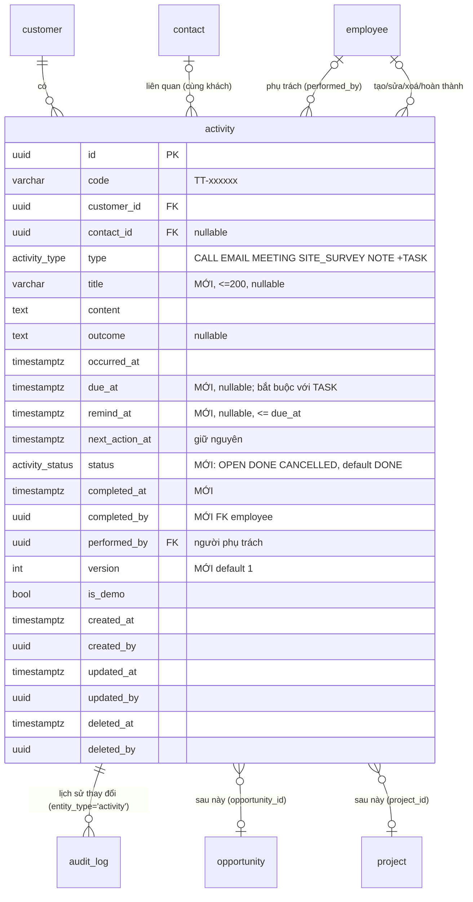

# B3 — Thiết kế module Hoạt động chăm sóc khách hàng (`activities`)

Trạng thái: **THIẾT KẾ — OWNER_DECISION: APPROVED_WITH_CHANGES (03/11/2026), bản này đã áp các điều chỉnh, chờ phê duyệt cuối** — chưa sửa mã, chưa migration, chưa cấp quyền, chưa đụng database nào. Owner đồng ý phương án A và kiến trúc tổng thể; chấp thuận *nghiên cứu* V4 grants + kiểm thử trên PostgreSQL cô lập, **chưa** phê duyệt áp V4 lên demo/production, chưa phê duyệt triển khai A2–A9, merge hay deploy.

Cơ sở: `main` 917f15e; khảo sát `backend/prisma/schema.prisma`, migration `20261012000000_b1_2_crm_core`, `backend/src/modules/customers/*`, `backend/src/common/auth/*`, `backend/docs/B1.3_S1_APP_GRANTS_V3.sql.txt`, `backend/docs/B1.3_S1_VERIFY.sql.txt`, `docs/B1.2_PLAN.md`, `backend/docs/B1.3.1_FINAL_DESIGN.md`, frontend `src/features/customers/*`, `src/pages/CustomerProfile.jsx` (mẫu demo "Lịch sử tương tác"), `src/styles/*` (Liquid Glass).

## 0. Tóm tắt cho người không chuyên
- Mỗi khách hàng có một **dòng thời gian** gồm: cuộc gọi, email, lịch hẹn, khảo sát công trình, ghi chú và **công việc** (việc cần làm, có người phụ trách, hạn, trạng thái).
- Nhân viên thấy việc của mình trong màn hình **"Công việc của tôi"**, có nhắc quá hạn/hôm nay (chuông trên thanh đầu trang). Chưa gửi email/push trong giai đoạn này.
- Ai xem/sửa được gì tính theo **khách hàng** (giống quyền khách hàng hiện nay) và được **kiểm ở máy chủ**; nút mờ trên giao diện chỉ là tiện ích.
- Dữ liệu cũ (nếu có) trong bảng `activity` **không mất, không đổi nghĩa**; chỉ thêm cột/giá trị mới.
- Để máy chủ ghi được hoạt động, phải mở quyền ghi **đúng một bảng** `activity` cho vai trò DB `siscom_app` — đây là thay đổi baseline đã nghiệm thu, làm bằng PR riêng, có rollback, thử trên PostgreSQL tạm trước, **anh duyệt mới chạy**.

## 1. Mục tiêu, phạm vi, ngoài phạm vi
**Trong phạm vi (B3.1):** ghi nhận & xem hoạt động theo khách; công việc có phụ trách/hạn/trạng thái; danh sách việc của tôi + nhắc trong ứng dụng; lịch sử thay đổi của từng hoạt động (audit); RBAC V2 ở backend; PC + điện thoại (PWA hiện có).
**Để sau (đã chừa chỗ):** liên kết **cơ hội kinh doanh** và **dự án** (cột FK nullable thêm khi có bảng); nhắc qua email/push; lịch (calendar view); đính kèm tệp; ghi âm cuộc gọi; lặp lịch; báo cáo KPI hoạt động; đọc `audit_log` của khách hàng (cần `audit.read`).

## 2. Hiện trạng bảng `activity` (đã có từ B1.2, chưa dùng)
| Cột | Kiểu | Ghi chú |
|---|---|---|
| `id` | uuid | |
| `code` | varchar(20) | `TT-000001` từ `fn_next_activity_code()`, bất biến (trigger) |
| `customer_id` | uuid NOT NULL | FK customer, Restrict |
| `contact_id` | uuid NULL | FK contact; trigger `trg_activity_contact` bắt **cùng khách** |
| `type` | enum `activity_type` | CALL, EMAIL, MEETING, SITE_SURVEY, NOTE |
| `occurred_at` | timestamptz | thời điểm diễn ra |
| `content` | text NOT NULL, không rỗng | nội dung |
| `outcome` | text NULL | kết quả |
| `next_action_at` | timestamptz NULL | "việc tiếp theo" (chỉ mục riêng) |
| `performed_by` | uuid NULL | FK employee |
| `is_demo` | bool | |
| `created_*/updated_*/deleted_*` | | xoá mềm; `ck_activity_del` |
Chỉ mục: `(customer_id, occurred_at DESC)`, `next_action_at`, `performed_by`, `contact_id`. **Không có** `version`, trạng thái, hạn, hoàn thành, tiêu đề. Quyền DB: `siscom_app` chỉ SELECT (VERIFY B1b khẳng định).

## 3. Mô hình dữ liệu mở rộng (migration cộng thêm, tương thích ngược)

### 3.1 Sơ đồ

### 3.2 Thay đổi (tất cả **cộng thêm**, không đổi/xoá cột cũ)
| # | Thay đổi | Lý do | Tương thích dữ liệu cũ |
|---|---|---|---|
| 1 | `ALTER TYPE activity_type ADD VALUE 'TASK'` — **migration riêng** `…_b3_activity_type_task` chỉ chứa đúng câu lệnh này (PostgreSQL không cho dùng giá trị enum mới trong cùng transaction — `55P04`; Prisma chạy mỗi file migration như một transaction) | "công việc" | Giá trị mới, dòng cũ không đổi; migration thứ hai `…_b3_activity_tasks` mới được tham chiếu `'TASK'` |
| 2 | `CREATE TYPE activity_status AS ENUM ('OPEN','DONE','CANCELLED')`; cột `status activity_status NOT NULL DEFAULT 'DONE'` | trạng thái | Dòng cũ là sự kiện đã diễn ra ⇒ `DONE` đúng nghĩa; backfill bằng DEFAULT, không UPDATE hàng loạt. **Quy ước:** chỉ `TASK` dùng OPEN/DONE/CANCELLED (service đặt tường minh `OPEN` khi tạo TASK); 5 loại còn lại luôn `DONE`, `due_at`/`remind_at` của MEETING chỉ là thông tin nhắc, không đổi trạng thái |
| 3 | `title varchar(200) NULL` | tiêu đề ngắn cho TASK/MEETING | NULL với dòng cũ; UI hiện 80 ký tự đầu của `content` khi NULL |
| 4 | `due_at timestamptz NULL`, `remind_at timestamptz NULL` | hạn & lịch nhắc | NULL với dòng cũ |
| 5 | `completed_at timestamptz NULL`, `completed_by uuid NULL` FK employee Restrict | ai/khi nào hoàn thành | NULL |
| 6 | `version int NOT NULL DEFAULT 1` | khoá lạc quan như `customer` | 1 |
| 7 | CHECK `ck_activity_task_due`: `type <> 'TASK' OR due_at IS NOT NULL` | TASK phải có hạn | dòng cũ không phải TASK |
| 8 | CHECK `ck_activity_done`: `status <> 'DONE' OR type <> 'TASK' OR completed_at IS NOT NULL` | TASK xong phải có mốc | dòng cũ không phải TASK |
| 9 | CHECK `ck_activity_remind`: `remind_at IS NULL OR due_at IS NULL OR remind_at <= due_at` | nhắc trước hạn | |
| 10 | CHECK `ck_activity_title`: `title IS NULL OR btrim(title) <> ''` | | |
| 11 | Trigger `trg_activity_customer_fixed`: cấm vô điều kiện `NEW.customer_id IS DISTINCT FROM OLD.customer_id` (theo mẫu `fn_forbid_code_change`; `trg_activity_contact` đã bắt `UPDATE OF customer_id`, không xung đột) | hoạt động không "chuyển khách" | |
| 12 | Chỉ mục riêng phần `idx_activity_open_due ON activity(performed_by, due_at) WHERE status = 'OPEN' AND deleted_at IS NULL` | "Công việc của tôi", nhắc | |
| 13 | Chỉ mục `idx_activity_customer_active ON activity(customer_id, occurred_at DESC) WHERE deleted_at IS NULL` | timeline bỏ qua xoá mềm | (có thể thay chỉ mục hiện có — giữ cả hai ở B3.1 để không đổi cái cũ) |
| 14 | `COMMENT ON COLUMN` cho cột mới | tài liệu trong DB | |

**Không** thêm ở B3.1: `priority`, `opportunity_id`, `project_id` (thêm khi có bảng đích; cột nullable + FK Restrict + chỉ mục — migration riêng), nhắc lặp, đính kèm.

### 3.3 Rollback (viết sẵn, không tự chạy) — `backend/docs/B3_ACTIVITY_TASKS_ROLLBACK.sql.txt`
Một transaction; guard tên DB thử + từ chối 2 baseline; tiền kiểm (cột tồn tại); **từ chối nếu còn BẤT KỲ dòng `type='TASK'`** (kể cả đã xoá mềm — đổi kiểu cột thất bại với mọi dòng TASK; xử lý tay trước: đổi sang `NOTE` + ghi audit, không tự xoá dữ liệu); thứ tự gỡ: 4 CHECK (7–10) → `idx_activity_open_due`, `idx_activity_customer_active` → trigger 11 → cột mới (5, 4, 3, 2, 6) → `DROP TYPE activity_status` → tạo lại enum 5 giá trị (`activity_type_old` → `ALTER COLUMN type TYPE … USING type::text::…` → đổi tên; PostgreSQL không có `DROP VALUE`) → `DELETE FROM _prisma_migrations WHERE migration_name IN (<2 migration>)` → hậu kiểm "Rollback chưa sạch" ⇒ lỗi. Đặt **đầu** hai chuỗi rollback trong CI (trước `B1.4_SESSION_REMEMBER_FAMILY_ROLLBACK`).

### 3.4 Prisma
`schema.prisma`: thêm `TASK` vào `ActivityType`; `enum ActivityStatus { OPEN DONE CANCELLED @@map("activity_status") }`; các trường mới với `@map`; quan hệ `completedBy Employee? @relation("ActivityCompletedBy")` (+ ngược chiều ở `Employee`). Chỉ mục riêng phần không mô tả được bằng Prisma ⇒ ghi trong SQL, `migrate diff --exit-code` vẫn 0 (như `ix_auth_session_employee_active`). Bài kiểm cấu trúc `backend/docs/B3_ACTIVITY_STRUCTURE_TESTS.sql.txt` (PASS/FAIL cho 7–13) chạy trong CI bằng `pg-sql-check.sh … res migrator`.

## 4. Quyền DB tối thiểu cho `siscom_app` (thay đổi baseline — PR riêng, anh duyệt mới chạy)
- **Chỉ**: `GRANT INSERT, UPDATE ON public.activity TO siscom_app;` — **không** DELETE (xoá mềm = UPDATE), không bảng nào khác, không cột nào khác. Sequence `activity_code_seq` đã nằm trong `GRANT USAGE, SELECT ON ALL SEQUENCES`. Hàm `fn_next_activity_code()` chạy qua DEFAULT cột (không REVOKE EXECUTE với PUBLIC) — VERIFY E7 bổ sung kiểm EXECUTE cho chắc.
- Cách làm: file **`B1.3_S1_APP_GRANTS_V4.sql.txt`** (V3 + 1 dòng; idempotent "revoke all rồi grant lại"; phần "Tóm tắt" cuối file: `bang_app_INSERT` 4→5, `bang_app_UPDATE` 3→4), V3 giữ làm đường rollback; ghi chú "V3 là nguồn sự thật duy nhất" (header V3, `B1.4_P3C_S3_AUTH_ROLE_DESIGN.md` §7.1) trỏ sang V4.
- `VERIFY.sql.txt` (từng dòng): **B1** nhãn + mảng ghi thêm `activity` (vẫn đòi NOT DELETE/TRUNCATE); **B1b** nhãn + bỏ `activity` khỏi danh sách cấm; **E5** gộp thêm probe `UPDATE public.activity SET status = status WHERE false` vào nhãn hiện có (giữ nguyên số đếm) hoặc tách `E5b` (⇒ `PASS|74`) — **chọn: gộp, giữ `PASS|73`**; **E7** nhãn "4 hàm" → "5 hàm", `count(DISTINCT) = 5` thêm `fn_next_activity_code`. `backend/test/db-roles.int-spec.ts:129–130` bỏ `'activity'` khỏi `forbidden`, thêm ca dương (INSERT/UPDATE `WHERE false` OK; DELETE ⇒ 42501); sửa tiêu đề ca "P3b I-4" và nhãn B1b cho nhất quán.
- **Ngoài CI, các chỗ khác còn trỏ V3 (đưa vào A3; riêng script Windows vào A9):** `backend/scripts/windows/demo-split.ps1` chạy V3 hai lần ở bước split và "BẮT BUỘC chạy lại V3" sau `migrate deploy` — **nếu không đổi sang V4, lần chạy `demo-split -Step migrate` kế tiếp sẽ thu hồi quyền ghi `activity`** (A9 phải dùng V4); thông điệp trong `backend/src/cli/db-role-check.ts`, `test/helpers/test-db.ts`, header 2 file rollback Remember Me, `DB_SECURITY.md`, `VPS_LINUX_NOTES.md`, `.env.example`, `B1.3_S1_VERIFY_AUTH.sql.txt`, `B1.3_S1_AUTH_ROLE.sql.txt` — đổi tham chiếu hoặc ghi "V3 đã được V4 thay thế".
- **CI đang hardcode V3 (phải sửa cùng PR A3, nếu không VERIFY B1 đỏ):** `scripts/ci/pg-temp-db.sh` — `split` và `auth` chạy V4 thay V3; case `grants` thêm `v4`, `wantapp=f` và kiểm `siscom_auth` áp cho cả v3 **và** v4; `.github/workflows/ci.yml` dòng 182, 189, 211 (`grants v3` + VERIFY `res app`) đổi sang `v4`; diễn tập rollback quyền thành **v1 fail → v2 fail → v3 fail (B1 — đúng kỳ vọng rollback) → v4 PASS**. Con số VERIFY ghi vào docs/evidence, **không sửa** kết quả nghiệm thu lịch sử (chỉ ghi chú như #192).
- Rủi ro: `siscom_app` bị chiếm ⇒ có thể ghi/sửa mọi dòng `activity` (không xoá cứng, không chạm bảng khác, `code`/`customer_id` bất biến nhờ trigger, audit append-only). Mức chấp nhận: ngang với `customer`/`contact` hiện nay.

## 5. Quyền ứng dụng (RBAC V2) — kiểm ở **backend**, giao diện chỉ phản ánh
**Cơ chế biểu diễn luật theo vai trò (giữ nguyên hợp đồng `Actor {employeeId, departmentId}` + `scopeFor(actor, permission)` — không đưa vai trò vào actor):** mọi luật "technician chỉ…" được **tách thành mã quyền riêng**, vì service chỉ biết quyền + phạm vi, không biết vai trò. Mã quyền mới (đều khớp regex nhóm `BIZ` của `fn_auth_perm_class`; kiểm thêm CHECK định dạng `permission.code` ở A4):
| Mã | Ý nghĩa |
|---|---|
| `activity.read` | đọc hoạt động của khách trong phạm vi |
| `activity.create` | tạo **6 loại** |
| `activity.create_tech` | tạo **chỉ** `SITE_SURVEY`, `NOTE`, `TASK` (loại khác ⇒ 403 `ACTIVITY_TYPE_NOT_ALLOWED`) |
| `activity.update` | sửa **mọi** hoạt động của khách trong phạm vi (kể cả huỷ/mở lại TASK) |
| `activity.update_own` | sửa **chỉ** hoạt động `created_by = tôi` **hoặc** `performed_by = tôi` |
| `activity.assign` | giao/chuyển người phụ trách |
| `activity.delete` | xoá mềm |
Nhiều vai trò trên một người: hợp quyền "rộng nhất thắng" như `SessionActorProvider` (`RANK`), nên ai có cả `update` và `update_own` thì `update` áp dụng. Phạm vi tính theo **chủ sở hữu khách hàng** (`inScope` sẵn có: ALL / DEPARTMENT = phòng của chủ khách / OWN = chính mình là chủ khách) — **không** gắn với `customer.update` (technician không có quyền đó), chỉ cần khách trong phạm vi `customer.read` (ngoài ⇒ 404) và hoạt động trong phạm vi `activity.*` tương ứng (ngoài ⇒ 403).
**Không nới phạm vi vì được giao việc (quyết định owner 03/11):** phạm vi xem hoạt động **luôn** = phạm vi RBAC V2 trên khách hàng; **không có** luật "phụ trách tự thấy". Hệ quả: chỉ được **giao việc cho người đang đọc được khách đó** — khi tạo/đổi `performedById`, service kiểm `inScope(assignee, scopeFor(assignee,'customer.read'), ownerInfo(cust))` (và `activity.read` của người đó); không đạt ⇒ 400 `ACTIVITY_ASSIGNEE_NO_ACCESS` ("người này chưa có quyền xem khách hàng"). `assignee-candidates` chỉ liệt kê người thoả điều kiện này. Mọi bộ lọc (`assignee`, `status`, `due`, `type`) áp **sau** vị từ phạm vi đọc theo khách; test ma trận bắt buộc có ca `assignee=<uuid khác>` không trả hoạt động trên khách ngoài phạm vi. Fail‑closed với mọi trường hợp khác. Nhu cầu giao việc cho người **ngoài** phạm vi (ví dụ sale giao khảo sát cho kỹ thuật phòng khác) được giải quyết bằng cơ chế **chia sẻ quyền tối thiểu** ở mục 13 — **đề xuất riêng, chờ anh phê duyệt**, không nằm trong B3.1.

| Quyền | crm_admin | sale | technician | accountant | Ghi chú (quyết định owner 03/11) |
|---|---|---|---|---|---|
| `activity.read` | ALL | OWN | DEPARTMENT | ALL | theo khách hàng; không nới vì được giao |
| `activity.create` | ALL | OWN | – | – | 6 loại |
| `activity.create_tech` | – | – | DEPARTMENT | – | technician tạo khảo sát, ghi chú, công việc kỹ thuật; `performedById` mặc định = chính mình |
| `activity.update` | ALL | OWN | – | – | sale sửa mọi hoạt động trên khách mình |
| `activity.update_own` | – | – | DEPARTMENT | – | technician chỉ sửa hoạt động **mình tạo hoặc được giao** |
| `activity.assign` | ALL | OWN | **–** (ngoài quyết định owner; nếu muốn technician tự chuyển việc cùng phòng, anh duyệt thêm) | – | **mọi** giao/chuyển ghi audit `activity.assign` (`changes.performedById: [cũ, mới]`); người nhận ACTIVE, cùng phòng (admin: bất kỳ) và **đã đọc được khách** |
| `activity.delete` (xoá mềm) | ALL | **–** | – | – | **chỉ crm_admin**, có audit `activity.delete`; **không ai xoá vĩnh viễn qua ứng dụng** (DB cũng không cấp DELETE) |
| `lookup.read` | ALL | ALL | ALL | ALL | (đã có) |

Số dòng `role_permission`: crm_admin 5 + sale 4 + technician 3 + accountant 1 = **13**; số mã `permission` mới = **7**.
**Hệ quả thực tế cần anh biết trước demo:** vì người nhận phải *đang đọc được khách*, sale (OWN) **không giao được cho sale khác cùng phòng** (người đó không đọc khách của mình) — chỉ giao được cho technician cùng phòng (DEPARTMENT) hoặc admin; giao chéo phòng cần cơ chế §13.
**Thời gian (TOCTOU):** điều kiện "đọc được khách" chỉ kiểm **lúc giao**. Sau đó khách đổi chủ sang phòng khác, nhân viên chuyển phòng hoặc mất vai trò ⇒ `performed_by` có thể không còn đọc được khách. Hành vi quy định: vị từ phạm vi đọc **áp lại ở mọi request** (người đó không còn thấy việc/chuông/`complete` ⇒ 404); việc OPEN vẫn hiện cho người đọc được khách (chủ mới/admin) với cờ `assigneeLostAccess: true` ("phụ trách không còn quyền xem") để giao lại; **không** tự đổi `performed_by`. Test ma trận bắt buộc: "đổi chủ khách ⇒ assignee cũ không còn thấy việc; chủ mới thấy + cờ".
**Cách tính phạm vi của người khác (phải xây mới ở A5):** `scopeFor` hiện gắn với object `Actor` của phiên, không gọi được cho người nhận. Xây: hàm thuần `mergeScopes(rows)` tách từ `SessionActorProvider.lookup` (RANK ALL>DEPARTMENT>OWN, bỏ vai trò `isConfirmed=false`, chỉ `KNOWN`) dùng chung cho provider và helper `effectiveScopesOf(tx, employeeId)` chạy trên pool nghiệp vụ (`siscom_app` đọc được `employee/employee_role/role/role_permission/permission`); kiểm `inScope({employeeId, departmentId: assignee.departmentId}, scopes['customer.read'], ownerInfo(cust))` và `scopes['activity.read']`. Helper **chỉ dùng làm điều kiện thu hẹp (AND)**, không bao giờ gán vào `RequestCtx.actor` ⇒ không leo thang; cùng một hàm thuần + unit test chung để provider và helper không lệch. `assignee-candidates`: một truy vấn JOIN, cap 500, chỉ trả `id, code, fullName, departmentCode`.
Hoàn thành việc (`/complete`): `activity.update` **hoặc** `activity.update_own` **hoặc** `performed_by` = tôi — luôn trong phạm vi đọc (áp lại mỗi request). Đọc ngoài phạm vi `activity.read` ⇒ **404** (theo mẫu `ContactsService.list`); ghi ngoài phạm vi ⇒ 403.

Quy tắc 403/404 như `customers`: không có quyền ⇒ 403 `FORBIDDEN`; có quyền nhưng khách ngoài phạm vi đọc ⇒ 404 (không lộ tồn tại); trong phạm vi đọc nhưng thiếu phạm vi ghi ⇒ 403. Khách đã xoá mềm ⇒ 409 `CUSTOMER_DELETED` khi ghi, vẫn **đọc** được timeline (lịch sử).

**Cấp quyền cho DB đã bootstrap** (demo 55433, thật): bootstrap đã đóng ⇒ `role_permission` chỉ nhận dòng mới qua **yêu cầu đặc quyền 2 người**; các hàm `fn_auth_api_*` đã `REVOKE … FROM PUBLIC` (chỉ chủ sở hữu `siscom_migrator`/superuser gọi được) ⇒ **script vận hành mới** `backend/docs/B3_ACTIVITY_PERMISSIONS.sql.txt` chạy bằng `siscom_migrator` (chưa có tiền lệ; diễn tập CI bắt buộc). Trình tự chính xác:
1. `INSERT INTO permission(code)` 7 mã (không có trigger chặn INSERT; bỏ qua nếu đã có).
2. **Mỗi dòng** `role_permission` (13 dòng theo ma trận: admin 5, sale 4, technician 3, accountant 1) = **một** yêu cầu riêng: `fn_auth_api_request_create` (người nhóm REQUEST = sysadmin, `ROLE_PERMISSION_CHANGE`, payload `permissionId/op=ADD/scope`) → `fn_auth_api_request_decide` (người có `access.approve` = crm_admin) → `fn_auth_api_role_permission_change` (**cũng do sysadmin** thực thi); cả hai người phải `employee.status=ACTIVE` + credential ACTIVE (`fn_auth_api_actor`). "Idempotent" = **bỏ qua dòng đã tồn tại**, không gọi lại hàm.
3. Script REMOVE (rollback): từng dòng `role_permission` qua yêu cầu `op=REMOVE` (guard chạy cả khi xoá), **rồi mới** `DELETE FROM permission`.
DB bootstrap mới lấy từ ma trận `BIZ` trong `bootstrap.ts`. `admin` (sysadmin) **không** được cấp (SoD, trigger từ chối).

Mã: `Permission` union (`common/auth/actor.ts`), `KNOWN` (`session-actor.provider.ts`), `ALL_PERMS` + preset (`test/helpers/test-app.ts`), `BIZ` (`bootstrap.ts`), FE `grantsFromSession` tự nhận key mới (`can('activity.create') || can('activity.create_tech')` cho nút tạo; danh sách loại hiển thị theo key).

## 6. API (`/api/v1`, `@UseGuards(ActorGuard)`, CSRF/Origin như hiện nay, bọc `{ data }`)
| Method | Đường dẫn | Quyền | Mô tả |
|---|---|---|---|
| GET | `/customers/:customerId/activities` | `activity.read` ∧ `customer.read` | timeline của khách; `type`, `status`, `from`, `to`, `page`, `pageSize` (≤100), `sortBy=occurredAt|dueAt`, `sortOrder` |
| POST | `/customers/:customerId/activities` | `activity.create` **hoặc** `activity.create_tech` (3 loại) — khách trong `customer.read` ⇒ ngoài 404; chủ khách trong phạm vi quyền tạo ⇒ ngoài 403 | tạo; 201; không cần `customer.update`. `performedById` ≠ actor ⇒ cần `activity.assign` và ghi **thêm** dòng audit `activity.assign` (ngoài `activity.create`) |
| GET | `/activities` | `activity.read` | danh sách việc: `assignee=me|<uuid>`, `status`, `due=overdue|today|week|all`, `type`, phân trang; phạm vi = **đúng phạm vi đọc theo khách** (không nới vì được giao) |
| GET | `/activities/reminders/summary` | `activity.read` | `{ overdue, today, upcoming7d }` của **tôi** (phụ trách, trong phạm vi đọc) — chuông |
| GET | `/activities/:id` | `activity.read` | chi tiết |
| PATCH | `/activities/:id` | `activity.update` **hoặc** `activity.update_own` (chỉ `created_by`/`performed_by` = tôi); body chứa `performedById` khác hiện tại ⇒ thêm `activity.assign` | sửa tiêu đề/nội dung/kết quả/thời điểm/hạn/nhắc/liên hệ/người phụ trách; `{status:'CANCELLED'}` chỉ với TASK (loại khác ⇒ 409 `ACTIVITY_NOT_TASK`); body có `version` ⇒ 409 `ACTIVITY_VERSION_CONFLICT {currentVersion}`; đổi phụ trách ⇒ audit `activity.assign` riêng |
| POST | `/activities/:id/assign` | `activity.assign` | `{performedById, version}`; kiểm ACTIVE + cùng phòng (admin: bất kỳ) + người nhận đọc được khách ⇒ 400 `ACTIVITY_ASSIGNEE_NO_ACCESS`/`ACTIVITY_ASSIGNEE_INVALID`; audit `activity.assign` |
| POST | `/activities/:id/complete` | `activity.update` / `activity.update_own` / `performed_by` = tôi (áp lại phạm vi đọc) | `status=DONE`, `completed_at/by`; 409 `ACTIVITY_NOT_OPEN` nếu không OPEN; audit `activity.complete` |
| POST | `/activities/:id/reopen` | `activity.update` hoặc `activity.update_own` | DONE/CANCELLED → OPEN (chỉ TASK); audit `activity.reopen` |
| DELETE | `/activities/:id` | `activity.delete` (**chỉ crm_admin**) | xoá mềm (`deleted_at/by`), không `version` (như `customers`); audit `activity.delete`, `summary` chỉ mã + loại, lý do (tuỳ chọn, query `reason` ≤200) đặt ở `changes.reason` và che `'(đã thay đổi)'` (thêm `reason` vào `SENSITIVE_KEYS`); 200. **Không có** xoá vĩnh viễn ở tầng ứng dụng và DB (`siscom_app` không có DELETE) |
| GET | `/activities/:id/history` | `activity.read` | các dòng `audit_log` `entity_type='activity'` của id này (đã che nội dung) |
| GET | `/activities/assignee-candidates?customerId=` | `activity.assign` | ứng viên người phụ trách: nhân viên ACTIVE, cùng phòng (admin: mọi phòng) **và đọc được khách đó** (endpoint riêng — `owner-candidates` với sale chỉ trả chính mình) |

Thứ tự khai báo route: `assignee-candidates` và `reminders/summary` **trước** `:id` (như ghi chú `owner-candidates` trong `customers.controller.ts`); tập route của controller mới ghim trong `static-guards.spec.ts`.
DTO (class-validator, `whitelist`+`forbidNonWhitelisted`): `type` ∈ 6 giá trị (người chỉ có `activity.create_tech`: 3 loại — kiểm ở service theo **quyền**, không ở DTO); `title` ≤200 (Trim); `content` 1–4000; `outcome` ≤2000; `occurredAt` ISO (mặc định now, không quá +1 ngày trừ MEETING/TASK); `contactId` uuid (phải thuộc khách — kiểm service 400 `ACTIVITY_CONTACT_MISMATCH`, trigger DB là lớp 2); `performedById` uuid (mặc định = actor; khác actor ⇒ cần `activity.assign` + người nhận ACTIVE, cùng phòng (admin: bất kỳ), **đọc được khách**); `dueAt` (bắt buộc TASK), `remindAt ≤ dueAt`; `status` chỉ qua `/complete`, `/reopen` hoặc `PATCH {status:'CANCELLED'}`.
Lỗi: `ACTIVITY_NOT_FOUND` 404, `ACTIVITY_VERSION_CONFLICT` 409, `ACTIVITY_NOT_OPEN` 409, `ACTIVITY_NOT_TASK` 409, `ACTIVITY_CONTACT_MISMATCH` 400, `ACTIVITY_ASSIGNEE_INVALID` 400, `ACTIVITY_ASSIGNEE_NO_ACCESS` 400, `ACTIVITY_TYPE_NOT_ALLOWED` 403, `FORBIDDEN` 403, `CUSTOMER_DELETED` 409, `CONSTRAINT_CONFLICT` 409 (23514/23503), `ACTIVITY_BUSY` 409 (lock timeout). `mapPrismaError` thêm tên ràng buộc activity.
Ghi: transaction `inTx` (lock 5 s / statement 15 s), `SELECT … FOR UPDATE` khách (tạo) hoặc hoạt động (sửa), `updateMany({where:{id, version, deletedAt:null}})` như `customer`.

**Audit (lịch sử thay đổi):** mỗi ghi tạo 1 dòng `audit_log` trong cùng transaction: `activity.create | activity.update | activity.assign | activity.complete | activity.reopen | activity.cancel | activity.delete` (PATCH vừa sửa nội dung vừa đổi phụ trách ⇒ 2 dòng: `update` + `assign`), `entityType='activity'`, `entityCode=TT-…`, `summary` chỉ gồm mã + loại (ví dụ `"Tạo hoạt động TT-000001 (CALL)"` — không chứa tiêu đề/nội dung), `changes` = diff các trường **không nhạy cảm** (`type`, `status`, `dueAt`, `remindAt`, `performedById`, `occurredAt`, `contactId`), còn `title`/`content`/`outcome` ghi `'(đã thay đổi)'`. Guard khoá nhạy cảm của `DbAuditPort` hiện có `title` nhưng **chưa có `content`, `outcome`** ⇒ PR A5 **thêm 2 khoá này vào `SENSITIVE_KEYS`** (`backend/src/common/audit/db-audit.port.ts`, kèm unit test; không caller nào đang dùng 2 khoá đó) để lớp DB tự chặn nếu service sơ suất. Endpoint `history` trả `occurredAt, action, actor{code,fullName}, changes` — không lộ nội dung.

## 7. Nhắc việc
B3.1 chỉ **trong ứng dụng**: `reminders/summary` cho chuông; trang "Công việc của tôi" lọc `due=overdue|today|week`; màu: quá hạn `error`, hôm nay `warning`, sắp tới `info`. `remind_at` lưu để giai đoạn sau gửi email/push (job nền + bảng `notification` — ngoài phạm vi). Không service worker/push trên PWA (giữ nguyên quyết định #197).

## 8. Giao diện (Liquid Glass hiện có; API mode; hash route; 390 px)
**Thành phần tái dùng:** `ActivityFeed` (tone theo loại), `Tabs variant="line"`, `Badge`, `Button`, `Input/Select/Checkbox`, drawer `.sg-solid` (mẫu `CustomerFormDrawer`), `EmptyState`, `ui.toast/confirm`, `can()`; thêm helper `dtVN(iso)` (HH:mm dd/mm/yyyy Asia/Ho_Chi_Minh) + test như `dateVN.test.mjs`.
**Loại ⇒ biểu tượng/tone:** CALL `phone/blue`, EMAIL `mail/neutral`, MEETING `users/success`, SITE_SURVEY `hard-hat/warning`, NOTE `sticky-note/neutral`, TASK `check-square/info` (OPEN) · `success` (DONE) · `neutral` (CANCELLED) · `error` nếu quá hạn.

**PC**
1. *Chi tiết khách* (`CustomerApiDetail`): thêm `Tabs` "Thông tin · **Hoạt động (n)** · Người liên hệ"; tab Hoạt động = thanh lọc (loại, trạng thái, khoảng ngày) + nút "**Ghi nhận hoạt động**" (mờ nếu `!can('activity.create')`; technician chỉ thấy 3 loại) + `ActivityFeed` phân trang "Tải thêm"; mỗi mục: biểu tượng, tiêu đề/nội dung rút gọn, người phụ trách (Avatar nhỏ), thời điểm/hạn, Badge trạng thái, menu ⋯ (Hoàn thành · Sửa · Giao lại (`can('activity.assign')`) · Huỷ · Xoá (chỉ admin) · Lịch sử). Nút mờ là tiện ích; máy chủ luôn kiểm lại.
2. *Drawer "Ghi nhận hoạt động"* (phải, `.sg-solid`, 640 px): chọn loại (chip 6 loại), tiêu đề (TASK/MEETING), nội dung (textarea), người liên hệ (Select từ danh sách khách — chỉ khi `can('contact.read')`), người phụ trách (Select từ `assignee-candidates`), thời điểm (datetime-local), với TASK/MEETING: hạn + nhắc; kết quả (outcome) với CALL/MEETING/SITE_SURVEY. Footer: Huỷ · Lưu. Đóng khi có thay đổi ⇒ `ui.confirm`.
3. *Trang "Công việc của tôi"* (`#/activities`, nav `Kinh doanh → Công việc`, icon `list-checks`): KPI 3 ô (Quá hạn / Hôm nay / 7 ngày tới), `Tabs` pill (Của tôi · Phòng tôi (DEPARTMENT) · Tất cả (ALL)), bộ lọc trạng thái/loại, `DataTable` (Hạn · Tiêu đề · Khách hàng (link) · Phụ trách · Trạng thái) hoặc thẻ khi `ui.mobile`; checkbox "Hoàn thành" ngay trên dòng.
4. *Chuông Topbar*: `notifications = overdue + today` từ `reminders/summary` (poll mỗi 5 phút + sau mỗi thao tác); bấm ⇒ `#/activities/overdue` (`parseRoute` hiện không tách query trong hash ⇒ dùng đoạn đường dẫn, mở rộng `parseRoute` cho `#/activities/:filter`).
5. *Lịch sử thay đổi*: Modal `sm` liệt kê `history` (thời điểm · người · hành động · trường đổi).

**Điện thoại (≤768 px, PWA standalone)**
- Tab Hoạt động dùng thẻ dọc (`CustomerCard`-style), nút **"+" nổi** (FAB, `position:fixed; bottom: calc(16px + env(safe-area-inset-bottom))`, 56 px, `.sg-glass-strong`) mở drawer dạng **bottom sheet** (`width:100%`, `max-height:92dvh`, bo góc trên `--radius-xl24`, kéo xuống để đóng).
- Trang Công việc: 3 KPI dạng chip ngang cuộn được; danh sách thẻ, vuốt không dùng (tránh xung đột cuộn) — thao tác qua nút "Hoàn thành" trên thẻ; lưới `minmax(0,1fr)`, `min-width:0`; đo lại ở 390 px và 320 px (như #197).
- Chuông: giữ icon-only, `aria-label` kèm số.
- Toast: thêm quy tắc ≤768 px `bottom: calc(12px + env(safe-area-inset-bottom)); left/right 12px` (khoảng trống đã ghi nhận ở khảo sát).

**A11y/kiểm thử:** nhãn tiếng Việt ổn định (`aria-label="Ghi nhận hoạt động"`, `role=dialog`), không `data-testid` (theo quy ước repo).

## 9. Kiểm thử & CI (mỗi PR đều có test, chạy trên PostgreSQL tạm của CI)
- **DB:** `B3_ACTIVITY_STRUCTURE_TESTS.sql.txt` (CHECK/trigger/chỉ mục, enum có TASK); diễn tập rollback → áp lại; `migrate diff` = 0; VERIFY (số mới) + VERIFY_AUTH 33; `db-roles.int-spec` (app INSERT/UPDATE activity được, DELETE bị từ chối 42501, không ghi bảng khác).
- **Unit:** DTO; service ma trận 4 vai trò × 7 quyền × (trong/ngoài phạm vi, phụ trách, mình tạo/được giao) + cột "agent" (hiện chỉ 401 — placeholder, chưa phải kiểm RBAC agent) + ca TOCTOU đổi chủ khách; contact mismatch; version conflict; complete/reopen; audit che nội dung; `static-guards` thêm tập route controller mới.
- **Tích hợp (`test/*.int-spec.ts`):** `activities.int-spec.ts` qua `TestActorProvider` + `auth.int-spec.ts` khối RBAC V2 bằng phiên thật 4 vai trò (header Cookie/Origin/CSRF); fixtures `makeActivity` qua `withAdmin` cho đến khi V4 áp trong CI.
- **FE:** miniDom cho drawer/tab/trang (nút mờ theo `can`), test `dtVN`, `mobilePwa.test.mjs` mở rộng FAB/bottom sheet/toast mobile; Chrome harness `sessionRolesChrome.mjs` thêm S10 "hoạt động" (sale tạo trên khách mình, technician 404 trên khách phòng khác, accountant nút mờ + POST 403) và chạy lại qua HTTPS LAN.
- **Demo:** seed vài hoạt động giả bằng script (chỉ DB demo, anh duyệt); checklist nghiệm thu mục 11.

## 10. Danh sách PR đề xuất (Draft, tuần tự, mỗi PR anh duyệt merge; không PR nào đụng DB thật)
| PR | Nội dung | Ghi chú/phụ thuộc |
|---|---|---|
| **A1** docs | Tài liệu này + sơ đồ + ma trận (PR hiện tại) | — |
| **A2** db | **2 migration** (`b3_activity_type_task` chỉ ADD VALUE; `b3_activity_tasks` cột/CHECK/trigger/chỉ mục — mục 3.2) + `schema.prisma` + rollback (gỡ cả 2) + STRUCTURE_TESTS + CI chuỗi rollback; diễn tập PG tạm | không đổi grants; app vẫn chỉ SELECT |
| **A3** db-grants (sau A2) | `APP_GRANTS_V4` + VERIFY (B1/B1b/E5/E7) + `db-roles.int-spec` + `pg-temp-db.sh` (split/auth/grants v4) + `ci.yml` dòng 182/189/211 + diễn tập v1→v2→v3 fail→v4 PASS; ghi số VERIFY vào evidence | **thay đổi baseline — anh duyệt riêng**; chưa áp DB nào |
| **A4** rbac | `activity.*` vào `Permission/KNOWN/ALL_PERMS/BIZ`; script 2 người `B3_ACTIVITY_PERMISSIONS.sql.txt` (+REMOVE) diễn tập PG tạm; runbook cấp quyền cho DB demo | sau A2 |
| **A5** backend-read/create | module `activities` (controller/service/dto/errors/mapper), `mergeScopes` tách từ provider + `effectiveScopesOf(tx, employeeId)` (chỉ AND), GET timeline, POST tạo (kiểm loại theo quyền `create`/`create_tech`, người phụ trách đọc được khách, audit assign khi giao lúc tạo), `assignee-candidates`, audit (+ `content`/`outcome`/`reason` vào `SENSITIVE_KEYS`), ma trận test 4 vai trò × 7 quyền + cột agent (401 placeholder) | sau A3, A4 |
| **A6** backend-tasks | `/activities` danh sách, `reminders/summary`, PATCH (technician chỉ mình tạo/được giao), `assign` (audit), complete/reopen/cancel, DELETE mềm (chỉ admin), `history` | sau A5 (chuẩn bị song song A7 khi A5 có hợp đồng API) |
| **A7** fe-timeline | tab Hoạt động + drawer Ghi nhận (PC + bottom sheet), `dtVN`, miniDom tests | sau A5 (có thể song song A6 với mock) |
| **A8** fe-tasks | trang Công việc của tôi, chuông, mobile polish, Chrome harness S10, HTTPS LAN | sau A6, A7 |
| **A9** demo | `demo-split.ps1` dùng V4 (bước split và sau migrate); áp A2/A3/A4 lên DB demo 55433 (sao lưu trước), seed hoạt động giả, checklist §11, chạy Chrome | **anh duyệt riêng từng bước DB** |
Ước lượng: A2–A4 ~2–3 ngày làm + rà soát; A5–A6 ~3–4 ngày; A7–A8 ~3–4 ngày; A9 ~1 ngày. Mỗi PR: rà soát độc lập trước khi trình merge.

## 11. Rủi ro & đánh giá ảnh hưởng baseline
| Rủi ro | Mức | Giảm thiểu |
|---|---|---|
| Đổi baseline quyền DB (V3→V4, VERIFY 73→N) | Trung bình (quy trình) | PR riêng, chỉ 1 dòng GRANT, V3 là rollback, diễn tập v4→v3→v4 trong CI, ghi số mới không sửa lịch sử |
| `ALTER TYPE … ADD VALUE` không rollback trực tiếp | Thấp–TB | rollback tạo lại kiểu; từ chối khi còn TASK chưa xoá mềm; thử trên PG tạm trong CI |
| Lộ nội dung chăm sóc qua `audit_log`/`history` | TB | che `title/content/outcome`; guard khoá nhạy cảm của `DbAuditPort`; `history` chỉ cho người đọc được hoạt động |
| Giao việc chéo phòng / leo thang qua `performed_by` | TB | người nhận phải ACTIVE + cùng phòng (admin: bất kỳ) **và đã đọc được khách** (không nới phạm vi vì được giao); mọi giao/chuyển có audit `activity.assign`; technician chỉ sửa hoạt động mình tạo/được giao |
| Xoá dữ liệu chăm sóc | Thấp | chỉ crm_admin xoá mềm có audit; không DELETE ở DB cho `siscom_app`; audit append-only |
| Rò tồn tại khách qua 403/404 | Thấp | giữ quy tắc 404 ngoài phạm vi đọc như `customers` |
| Hiệu năng timeline/danh sách việc | Thấp | chỉ mục riêng phần (12, 13), phân trang ≤100, `MAX_OFFSET_WINDOW` |
| Cấp quyền cho DB đã bootstrap sai luồng | TB | chỉ qua yêu cầu 2 người; script idempotent + REMOVE; diễn tập PG tạm |
| Giao diện mobile/PWA hồi quy | Thấp | test `mobilePwa` mở rộng, đo 390/320 px, Chrome HTTPS |
| Dữ liệu cũ trong `activity` (nếu có) | Thấp | chỉ thêm cột có DEFAULT/NULL; không UPDATE hàng loạt; dòng cũ coi là `DONE` |

## 11b. Rà soát độc lập thiết kế (03/11/2026, agent đọc đối chiếu mã thật)
Kết quả lần 1: **NOT READY** — 1 Critical (enum `ADD VALUE` dùng ngay trong cùng migration ⇒ `55P04`), 6 Important (rollback với dòng TASK đã xoá mềm; POST gắn `customer.update` làm technician luôn 403; CI còn hardcode V3 ở `split/auth` và `ci.yml` 182/189/211; luật phụ trách chưa giới hạn dữ liệu lộ; guard audit thiếu `content/outcome`; luồng cấp quyền 2 người thiếu "mỗi dòng một yêu cầu" + INSERT `permission` trước + REMOVE theo thứ tự), 3 Minor (quy ước trạng thái TASK/MEETING; mẫu trigger; `#/activities?due=`/`owner-candidates`). **Tất cả đã sửa trong bản này** (mục 3.2, 3.3, 4, 5, 6, 8, 10).
Lần 2 (xác nhận 8/8 đã sửa, **READY WITH NOTES**): thêm 1 Important (danh sách chỗ trỏ V3 còn thiếu `demo-split.ps1` và tài liệu/script khác — đã bổ sung §4, A3/A9) + 3 Minor (thống nhất câu chữ luật phụ trách §5/§11; thứ tự route; tiêu đề test P3b I-4) — đã sửa.
Lần 3 (sau OWNER_DECISION, **NOT READY** → sửa): 1 Critical — luật theo vai trò không biểu diễn được bằng `Permission + Scope` (Actor không mang vai trò) ⇒ **tách mã quyền** `activity.create_tech`, `activity.update_own` (giữ hợp đồng actor; 7 mã, 13 dòng); 5 Important — bỏ ô technician `assign` (ngoài quyết định owner), TOCTOU "luôn đúng" ⇒ quy định hành vi + cờ `assigneeLostAccess`, xây `mergeScopes`/`effectiveScopesOf` (chỉ AND), bỏ ý header danh tính agent (credential phía máy chủ), §13 đổi `READ`→`TASK` + ai thu hồi + đổi chủ + V5; Minor — DELETE không version/lý do che, audit assign khi giao lúc tạo, đọc ngoài phạm vi ⇒ 404, 7 quyền trong ma trận test, `actor_type` CHECK + `MIGRATION`, A3 sau A2, `CANCELLED` chỉ TASK, cột agent = placeholder — tất cả đã sửa. Đã xác minh đúng: chỉ mục riêng phần không gây lệch `migrate diff`; CSRF/Origin là guard toàn cục; 4 chỗ mã quyền; FE nhận key mới tự động; quy ước PATCH+version/`{data}`/404/409; không service worker; 390/320 px.

## 12. Quyết định owner (03/11/2026, OWNER_DECISION: APPROVED_WITH_CHANGES) — đã áp vào bản này
1. Technician: tạo **khảo sát, ghi chú, công việc kỹ thuật** (`SITE_SURVEY`, `NOTE`, `TASK`) trong phạm vi DEPARTMENT; chỉ sửa hoạt động **mình tạo hoặc được giao**. → §5 (mã `activity.create_tech`, `activity.update_own`), §6. *Câu hỏi mở nhỏ cho anh:* technician có được **tự chuyển** việc của mình cho người cùng phòng không (ô `activity.assign` của technician — hiện để trống)?
2. Sale giao việc cho nhân viên **ACTIVE cùng phòng**; **mọi** giao/chuyển phụ trách có audit (`activity.assign`). → §5, §6.
3. Sale **không** xoá mềm; chỉ crm_admin xoá mềm có lịch sử; **không ai xoá vĩnh viễn qua ứng dụng**. → §5, §6, §11.
4. Chấp thuận **nghiên cứu** V4 grants + kiểm thử trên PostgreSQL cô lập; **chưa** phê duyệt áp V4 lên demo/production. → §4, A3 (chỉ CI/PG tạm).
5. Thứ tự A2 → A3 → A4 → A5; A6/A7 chuẩn bị song song khi đủ phụ thuộc; không tự merge. → §10.
Bổ sung: không nới phạm vi xem khách vì được giao việc (→ §5; cơ chế chia sẻ tối thiểu đề xuất riêng ở §13); sẵn sàng cho AI Agent Level 3 nhưng chưa triển khai (§14).

## 13. Đề xuất riêng — chia sẻ quyền tối thiểu theo khách hàng (CHỜ ANH PHÊ DUYỆT, không thuộc B3.1)
**Vấn đề:** với quy tắc §5, sale (OWN) không thể giao khảo sát cho kỹ thuật **phòng khác**, vì người đó không đọc được khách. **Đề xuất cơ chế hẹp nhất:**
- Bảng mới `customer_share` (`id`, `customer_id`, `employee_id`, `granted_by`, `reason`, `kind` enum **`TASK`** (B3.2 chỉ có mức này — tên đúng bản chất: xem khách + làm việc được giao, **không phải** chỉ đọc), `expires_at` (mặc định +30 ngày, tối đa 180), `revoked_at/by`, `created_at`); partial unique `(customer_id, employee_id) WHERE revoked_at IS NULL`; `siscom_app` INSERT/UPDATE (không DELETE) ⇒ **thêm một lần đổi baseline quyền DB (V5)** — chi phí phải tính.
- Hiệu lực `kind=TASK`: người được chia sẻ có `customer.read`, `contact.read`, `activity.read` trên **đúng khách đó**, và `activity.update_own`/`complete` **chỉ với hoạt động được giao cho mình**; nếu có `activity.create_tech` thì được tạo 3 loại kỹ thuật trên khách đó. **Không** `customer.update/create`, không `history`, không xem khách khác, không chuyển tiếp (`activity.assign` không mở cho người được chia sẻ).
- Ai cấp: chủ khách hiện tại (`customer.update` OWN) hoặc crm_admin. Ai thu hồi: người cấp, chủ khách **hiện tại**, crm_admin. Khách đổi chủ: chia sẻ **giữ nguyên** nhưng chủ mới thấy danh sách và thu hồi được. Mọi cấp/thu hồi ghi audit `customer.share_grant`/`share_revoke`; hết hạn ghi audit khi có job nền (B3.2+). Danh sách chia sẻ hiện trên trang khách.
- Tích hợp với §5: `inScope` giữ nguyên; thêm điều kiện `OR EXISTS customer_share(active, employee = actor)` **chỉ** trong các vị từ đọc khách/liên hệ/hoạt động — code path riêng, test ma trận riêng. Quyền mới: `customer.share` (crm_admin ALL, sale OWN). Người được chia sẻ **không** được nhận chia sẻ tiếp từ chính mình (không chuyển tiếp).
- Rủi ro: lộ khách cho người được chia sẻ (có chủ đích, có thời hạn, có audit); thu hồi tức thì. Khi anh duyệt: thiết kế chi tiết + migration riêng (B3.2), sau A6.

## 14. Sẵn sàng cho AI Agent Level 3 (thiết kế chừa chỗ, CHƯA triển khai AI)
Mục tiêu: về sau một AI Agent có thể *đề xuất* và (khi được cấp) *thực hiện* một số thao tác hoạt động (gợi ý việc tiếp theo, tóm tắt lịch sử, tạo nhắc) **trong đúng phạm vi được cấp, có người duyệt với thao tác nhạy cảm**. Nguyên tắc bắt buộc (owner 03/11): AI Agent **không tự nâng quyền, không xoá lịch sử, không đổi dữ liệu nhạy cảm ngoài phạm vi**.
Những gì B3.1 chừa sẵn (không thêm mã AI):
1. **Danh tính tác nhân:** `audit_log.actor_type` hiện CHECK `ck_audit_actor_type IN ('USER','SYSTEM','MIGRATION','ANONYMOUS')` và `buildAuditRow` ghi cứng `'USER'` ⇒ khi làm AI cần **migration đổi CHECK** thêm `AGENT` (+ quyết định `ck_audit_actor_req` có bắt `actor_employee_id`) và mở rộng `AuditEntry.actorType`; `changes.agent {id, model, requestId, approvedBy}`; mọi ghi của agent bắt buộc qua cùng `AuditPort` (append-only, guard khoá nhạy cảm). **Danh tính agent lấy từ credential phía máy chủ** (API key băm / phiên dịch vụ gắn `employee.kind='AGENT'`) qua một `ActorProvider` riêng trong PR riêng (giả lập chỉ trong `test/`) — **không** qua header hay nội dung request (nguyên tắc AGENTS.md §3). Agent chạy dưới một **nhân viên dịch vụ** với vai trò riêng `agent_assistant` chỉ chứa `activity.read` + mã riêng `activity.create_agent` (chỉ `NOTE`/`TASK`, đánh dấu `source='AGENT'` — cột sau), **không** `assign/update/delete`, không `customer.*` ghi; nhân viên dịch vụ bị loại khỏi `owner-candidates`/`assignee-candidates`, không làm chủ khách, không tính vào LAST_ADMIN/LAST_APPROVER. Nâng quyền chỉ qua luồng 2 người của M1 (trigger SoD giữ nguyên).
2. **Đề xuất trước, thực hiện sau:** mọi thao tác ghi của agent tạo **đề xuất** (bảng `agent_proposal` sau: nội dung, hành động dự kiến, phạm vi, hạn) hiển thị bằng `ApprovalCard` (đã có trong DS) — người có quyền tương ứng bấm duyệt thì server thực hiện **dưới danh nghĩa người duyệt** + audit ghi cả agent lẫn người duyệt. Level 3 = agent được tự thực hiện **chỉ** các hành động trong danh sách trắng (tạo NOTE/TASK cho chính nó, đọc) với hạn mức/ngày; ngoài danh sách ⇒ luôn cần duyệt.
3. **Dữ liệu nhạy cảm:** `content/outcome/title` chỉ cấp cho agent qua endpoint đọc có cùng phạm vi; không có endpoint xuất hàng loạt; `history` không mở cho agent.
4. **Không xoá lịch sử:** `audit_log` append-only (trigger), `activity.delete` không cấp cho agent; soft delete không có "xoá hẳn".
5. **Chuẩn API:** mọi endpoint B3.1 trả `{data}` ổn định, mã lỗi cố định, `requestId` — đủ để agent gọi qua cùng REST (không API riêng, không header danh tính).
6. **Kiểm thử sẵn:** ma trận quyền có cột "agent" ngay từ A5 — khi chưa có provider, cột này chỉ chứng minh 401 (placeholder), **không** phải kiểm RBAC agent; bật từng ô khi có provider và được duyệt.
