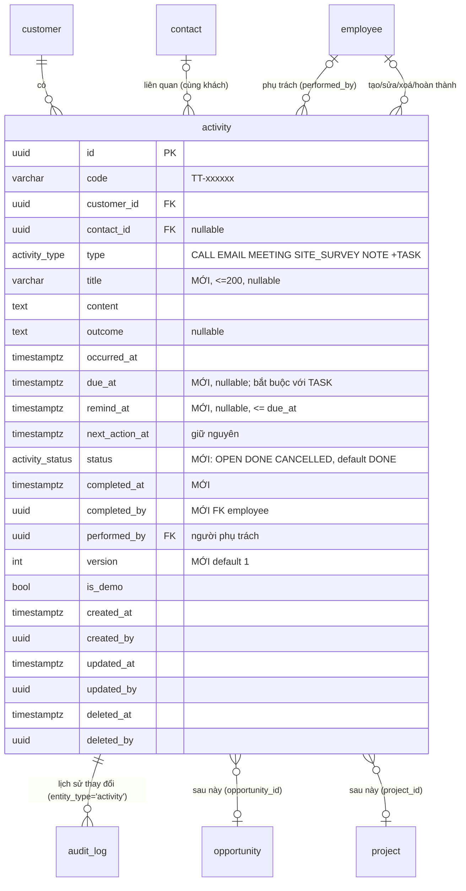

# B3 — Thiết kế module Hoạt động chăm sóc khách hàng (`activities`)

Trạng thái: **THIẾT KẾ, CHỜ OWNER PHÊ DUYỆT** — chưa sửa mã, chưa migration, chưa cấp quyền, chưa đụng database nào. Owner đồng ý nguyên tắc phương án A ngày 03/11/2026 ("mở rộng bảng `activity` hiện có"; chấp thuận *nghiên cứu* V4 grants + VERIFY/CI, **chưa** phê duyệt thực thi).

Cơ sở: `main` 917f15e; khảo sát `backend/prisma/schema.prisma`, migration `20261012000000_b1_2_crm_core`, `backend/src/modules/customers/*`, `backend/src/common/auth/*`, `backend/docs/B1.3_S1_APP_GRANTS_V3.sql.txt`, `backend/docs/B1.3_S1_VERIFY.sql.txt`, `docs/B1.2_PLAN.md`, `backend/docs/B1.3.1_FINAL_DESIGN.md`, frontend `src/features/customers/*`, `src/pages/CustomerProfile.jsx` (mẫu demo "Lịch sử tương tác"), `src/styles/*` (Liquid Glass).

## 0. Tóm tắt cho người không chuyên
- Mỗi khách hàng có một **dòng thời gian** gồm: cuộc gọi, email, lịch hẹn, khảo sát công trình, ghi chú và **công việc** (việc cần làm, có người phụ trách, hạn, trạng thái).
- Nhân viên thấy việc của mình trong màn hình **"Công việc của tôi"**, có nhắc quá hạn/hôm nay (chuông trên thanh đầu trang). Chưa gửi email/push trong giai đoạn này.
- Ai xem/sửa được gì tính theo **khách hàng** (giống quyền khách hàng hiện nay) và được **kiểm ở máy chủ**; nút mờ trên giao diện chỉ là tiện ích.
- Dữ liệu cũ (nếu có) trong bảng `activity` **không mất, không đổi nghĩa**; chỉ thêm cột/giá trị mới.
- Để máy chủ ghi được hoạt động, phải mở quyền ghi **đúng một bảng** `activity` cho vai trò DB `siscom_app` — đây là thay đổi baseline đã nghiệm thu, làm bằng PR riêng, có rollback, thử trên PostgreSQL tạm trước, **anh duyệt mới chạy**.

## 1. Mục tiêu, phạm vi, ngoài phạm vi
**Trong phạm vi (B3.1):** ghi nhận & xem hoạt động theo khách; công việc có phụ trách/hạn/trạng thái; danh sách việc của tôi + nhắc trong ứng dụng; lịch sử thay đổi của từng hoạt động (audit); RBAC V2 ở backend; PC + điện thoại (PWA hiện có).
**Để sau (đã chừa chỗ):** liên kết **cơ hội kinh doanh** và **dự án** (cột FK nullable thêm khi có bảng); nhắc qua email/push; lịch (calendar view); đính kèm tệp; ghi âm cuộc gọi; lặp lịch; báo cáo KPI hoạt động; đọc `audit_log` của khách hàng (cần `audit.read`).

## 2. Hiện trạng bảng `activity` (đã có từ B1.2, chưa dùng)
| Cột | Kiểu | Ghi chú |
|---|---|---|
| `id` | uuid | |
| `code` | varchar(20) | `TT-000001` từ `fn_next_activity_code()`, bất biến (trigger) |
| `customer_id` | uuid NOT NULL | FK customer, Restrict |
| `contact_id` | uuid NULL | FK contact; trigger `trg_activity_contact` bắt **cùng khách** |
| `type` | enum `activity_type` | CALL, EMAIL, MEETING, SITE_SURVEY, NOTE |
| `occurred_at` | timestamptz | thời điểm diễn ra |
| `content` | text NOT NULL, không rỗng | nội dung |
| `outcome` | text NULL | kết quả |
| `next_action_at` | timestamptz NULL | "việc tiếp theo" (chỉ mục riêng) |
| `performed_by` | uuid NULL | FK employee |
| `is_demo` | bool | |
| `created_*/updated_*/deleted_*` | | xoá mềm; `ck_activity_del` |
Chỉ mục: `(customer_id, occurred_at DESC)`, `next_action_at`, `performed_by`, `contact_id`. **Không có** `version`, trạng thái, hạn, hoàn thành, tiêu đề. Quyền DB: `siscom_app` chỉ SELECT (VERIFY B1b khẳng định).

## 3. Mô hình dữ liệu mở rộng (migration cộng thêm, tương thích ngược)

### 3.1 Sơ đồ

### 3.2 Thay đổi (tất cả **cộng thêm**, không đổi/xoá cột cũ)
| # | Thay đổi | Lý do | Tương thích dữ liệu cũ |
|---|---|---|---|
| 1 | `ALTER TYPE activity_type ADD VALUE 'TASK'` — **migration riêng** `…_b3_activity_type_task` chỉ chứa đúng câu lệnh này (PostgreSQL không cho dùng giá trị enum mới trong cùng transaction — `55P04`; Prisma chạy mỗi file migration như một transaction) | "công việc" | Giá trị mới, dòng cũ không đổi; migration thứ hai `…_b3_activity_tasks` mới được tham chiếu `'TASK'` |
| 2 | `CREATE TYPE activity_status AS ENUM ('OPEN','DONE','CANCELLED')`; cột `status activity_status NOT NULL DEFAULT 'DONE'` | trạng thái | Dòng cũ là sự kiện đã diễn ra ⇒ `DONE` đúng nghĩa; backfill bằng DEFAULT, không UPDATE hàng loạt. **Quy ước:** chỉ `TASK` dùng OPEN/DONE/CANCELLED (service đặt tường minh `OPEN` khi tạo TASK); 5 loại còn lại luôn `DONE`, `due_at`/`remind_at` của MEETING chỉ là thông tin nhắc, không đổi trạng thái |
| 3 | `title varchar(200) NULL` | tiêu đề ngắn cho TASK/MEETING | NULL với dòng cũ; UI hiện 80 ký tự đầu của `content` khi NULL |
| 4 | `due_at timestamptz NULL`, `remind_at timestamptz NULL` | hạn & lịch nhắc | NULL với dòng cũ |
| 5 | `completed_at timestamptz NULL`, `completed_by uuid NULL` FK employee Restrict | ai/khi nào hoàn thành | NULL |
| 6 | `version int NOT NULL DEFAULT 1` | khoá lạc quan như `customer` | 1 |
| 7 | CHECK `ck_activity_task_due`: `type <> 'TASK' OR due_at IS NOT NULL` | TASK phải có hạn | dòng cũ không phải TASK |
| 8 | CHECK `ck_activity_done`: `status <> 'DONE' OR type <> 'TASK' OR completed_at IS NOT NULL` | TASK xong phải có mốc | dòng cũ không phải TASK |
| 9 | CHECK `ck_activity_remind`: `remind_at IS NULL OR due_at IS NULL OR remind_at <= due_at` | nhắc trước hạn | |
| 10 | CHECK `ck_activity_title`: `title IS NULL OR btrim(title) <> ''` | | |
| 11 | Trigger `trg_activity_customer_fixed`: cấm vô điều kiện `NEW.customer_id IS DISTINCT FROM OLD.customer_id` (theo mẫu `fn_forbid_code_change`; `trg_activity_contact` đã bắt `UPDATE OF customer_id`, không xung đột) | hoạt động không "chuyển khách" | |
| 12 | Chỉ mục riêng phần `idx_activity_open_due ON activity(performed_by, due_at) WHERE status = 'OPEN' AND deleted_at IS NULL` | "Công việc của tôi", nhắc | |
| 13 | Chỉ mục `idx_activity_customer_active ON activity(customer_id, occurred_at DESC) WHERE deleted_at IS NULL` | timeline bỏ qua xoá mềm | (có thể thay chỉ mục hiện có — giữ cả hai ở B3.1 để không đổi cái cũ) |
| 14 | `COMMENT ON COLUMN` cho cột mới | tài liệu trong DB | |

**Không** thêm ở B3.1: `priority`, `opportunity_id`, `project_id` (thêm khi có bảng đích; cột nullable + FK Restrict + chỉ mục — migration riêng), nhắc lặp, đính kèm.

### 3.3 Rollback (viết sẵn, không tự chạy) — `backend/docs/B3_ACTIVITY_TASKS_ROLLBACK.sql.txt`
Một transaction; guard tên DB thử + từ chối 2 baseline; tiền kiểm (cột tồn tại); **từ chối nếu còn BẤT KỲ dòng `type='TASK'`** (kể cả đã xoá mềm — đổi kiểu cột thất bại với mọi dòng TASK; xử lý tay trước: đổi sang `NOTE` + ghi audit, không tự xoá dữ liệu); thứ tự gỡ: 4 CHECK (7–10) → `idx_activity_open_due`, `idx_activity_customer_active` → trigger 11 → cột mới (5, 4, 3, 2, 6) → `DROP TYPE activity_status` → tạo lại enum 5 giá trị (`activity_type_old` → `ALTER COLUMN type TYPE … USING type::text::…` → đổi tên; PostgreSQL không có `DROP VALUE`) → `DELETE FROM _prisma_migrations WHERE migration_name IN (<2 migration>)` → hậu kiểm "Rollback chưa sạch" ⇒ lỗi. Đặt **đầu** hai chuỗi rollback trong CI (trước `B1.4_SESSION_REMEMBER_FAMILY_ROLLBACK`).

### 3.4 Prisma
`schema.prisma`: thêm `TASK` vào `ActivityType`; `enum ActivityStatus { OPEN DONE CANCELLED @@map("activity_status") }`; các trường mới với `@map`; quan hệ `completedBy Employee? @relation("ActivityCompletedBy")` (+ ngược chiều ở `Employee`). Chỉ mục riêng phần không mô tả được bằng Prisma ⇒ ghi trong SQL, `migrate diff --exit-code` vẫn 0 (như `ix_auth_session_employee_active`). Bài kiểm cấu trúc `backend/docs/B3_ACTIVITY_STRUCTURE_TESTS.sql.txt` (PASS/FAIL cho 7–13) chạy trong CI bằng `pg-sql-check.sh … res migrator`.

## 4. Quyền DB tối thiểu cho `siscom_app` (thay đổi baseline — PR riêng, anh duyệt mới chạy)
- **Chỉ**: `GRANT INSERT, UPDATE ON public.activity TO siscom_app;` — **không** DELETE (xoá mềm = UPDATE), không bảng nào khác, không cột nào khác. Sequence `activity_code_seq` đã nằm trong `GRANT USAGE, SELECT ON ALL SEQUENCES`. Hàm `fn_next_activity_code()` chạy qua DEFAULT cột (không REVOKE EXECUTE với PUBLIC) — VERIFY E7 bổ sung kiểm EXECUTE cho chắc.
- Cách làm: file **`B1.3_S1_APP_GRANTS_V4.sql.txt`** (V3 + 1 dòng; idempotent "revoke all rồi grant lại"; phần "Tóm tắt" cuối file: `bang_app_INSERT` 4→5, `bang_app_UPDATE` 3→4), V3 giữ làm đường rollback; ghi chú "V3 là nguồn sự thật duy nhất" (header V3, `B1.4_P3C_S3_AUTH_ROLE_DESIGN.md` §7.1) trỏ sang V4.
- `VERIFY.sql.txt` (từng dòng): **B1** nhãn + mảng ghi thêm `activity` (vẫn đòi NOT DELETE/TRUNCATE); **B1b** nhãn + bỏ `activity` khỏi danh sách cấm; **E5** gộp thêm probe `UPDATE public.activity SET status = status WHERE false` vào nhãn hiện có (giữ nguyên số đếm) hoặc tách `E5b` (⇒ `PASS|74`) — **chọn: gộp, giữ `PASS|73`**; **E7** nhãn "4 hàm" → "5 hàm", `count(DISTINCT) = 5` thêm `fn_next_activity_code`. `backend/test/db-roles.int-spec.ts:129–130` bỏ `'activity'` khỏi `forbidden`, thêm ca dương (INSERT/UPDATE `WHERE false` OK; DELETE ⇒ 42501).
- **CI đang hardcode V3 (phải sửa cùng PR A3, nếu không VERIFY B1 đỏ):** `scripts/ci/pg-temp-db.sh` — `split` và `auth` chạy V4 thay V3; case `grants` thêm `v4`, `wantapp=f` và kiểm `siscom_auth` áp cho cả v3 **và** v4; `.github/workflows/ci.yml` dòng 182, 189, 211 (`grants v3` + VERIFY `res app`) đổi sang `v4`; diễn tập rollback quyền thành **v1 fail → v2 fail → v3 fail (B1 — đúng kỳ vọng rollback) → v4 PASS**. Con số VERIFY ghi vào docs/evidence, **không sửa** kết quả nghiệm thu lịch sử (chỉ ghi chú như #192).
- Rủi ro: `siscom_app` bị chiếm ⇒ có thể ghi/sửa mọi dòng `activity` (không xoá cứng, không chạm bảng khác, `code`/`customer_id` bất biến nhờ trigger, audit append-only). Mức chấp nhận: ngang với `customer`/`contact` hiện nay.

## 5. Quyền ứng dụng (RBAC V2) — kiểm ở **backend**, giao diện chỉ phản ánh
Mã quyền mới (nhóm `BIZ` theo `fn_auth_perm_class`): `activity.read`, `activity.create`, `activity.update`, `activity.delete`. Phạm vi tính theo **chủ sở hữu khách hàng** (`inScope` sẵn có: ALL / DEPARTMENT = phòng của chủ khách / OWN = chính mình là chủ khách) — **không** gắn với `customer.update` (technician không có quyền đó), chỉ cần khách trong phạm vi `customer.read` (ngoài ⇒ 404) và hoạt động trong phạm vi `activity.*` tương ứng (ngoài ⇒ 403).
**Luật phụ trách (nới phạm vi có chủ đích, giới hạn chặt):** người có `performed_by` = tôi **luôn** được `GET /activities/:id`, thấy hoạt động đó trong `GET /activities`, và `POST /activities/:id/complete` — **chỉ vậy**: không PATCH (kể cả đổi `performedById` — tránh chuyển tiếp dây chuyền), không xoá, không `history`. Với khách **ngoài** phạm vi đọc của người phụ trách, phản hồi chỉ kèm `customer {id, code, name}` (không địa chỉ/điện thoại/liên hệ); link sang trang khách sẽ 404 — chấp nhận. Mọi bộ lọc (`assignee`, `status`, `due`, `type`) áp **sau** vị từ phạm vi `(khách trong phạm vi đọc) OR (performed_by = tôi)`; test ma trận bắt buộc có ca `assignee=<uuid khác>` với OWN không trả hoạt động trên khách ngoài phạm vi. Fail‑closed với mọi trường hợp khác.

| Quyền | crm_admin | sale | technician | accountant | Ghi chú |
|---|---|---|---|---|---|
| `activity.read` | ALL | OWN | DEPARTMENT | ALL | + phụ trách luôn đọc được việc của mình |
| `activity.create` | ALL | OWN | DEPARTMENT | – | technician ghi khảo sát/ghi chú trong phòng (**đề xuất; anh có thể chọn "–"**) |
| `activity.update` | ALL | OWN | DEPARTMENT* | – | *technician chỉ sửa hoạt động **mình tạo hoặc được giao**; người phụ trách luôn đổi được trạng thái việc của mình |
| `activity.delete` (xoá mềm) | ALL | OWN* | – | – | *sale chỉ xoá hoạt động **mình tạo**; admin xoá bất kỳ; không ai xoá cứng |
| `lookup.read` | ALL | ALL | ALL | ALL | (đã có) |

Quy tắc 403/404 như `customers`: không có quyền ⇒ 403 `FORBIDDEN`; có quyền nhưng khách ngoài phạm vi đọc ⇒ 404 (không lộ tồn tại); trong phạm vi đọc nhưng thiếu phạm vi ghi ⇒ 403. Khách đã xoá mềm ⇒ 409 `CUSTOMER_DELETED` khi ghi, vẫn **đọc** được timeline (lịch sử).

**Cấp quyền cho DB đã bootstrap** (demo 55433, thật): bootstrap đã đóng ⇒ `role_permission` chỉ nhận dòng mới qua **yêu cầu đặc quyền 2 người**; các hàm `fn_auth_api_*` đã `REVOKE … FROM PUBLIC` (chỉ chủ sở hữu `siscom_migrator`/superuser gọi được) ⇒ **script vận hành mới** `backend/docs/B3_ACTIVITY_PERMISSIONS.sql.txt` chạy bằng `siscom_migrator` (chưa có tiền lệ; diễn tập CI bắt buộc). Trình tự chính xác:
1. `INSERT INTO permission(code)` 4 mã (không có trigger chặn INSERT; bỏ qua nếu đã có).
2. **Mỗi dòng** `role_permission` (≈13 dòng theo ma trận) = **một** yêu cầu riêng: `fn_auth_api_request_create` (người nhóm REQUEST = sysadmin, `ROLE_PERMISSION_CHANGE`, payload `permissionId/op=ADD/scope`) → `fn_auth_api_request_decide` (người có `access.approve` = crm_admin) → `fn_auth_api_role_permission_change` (**cũng do sysadmin** thực thi); cả hai người phải `employee.status=ACTIVE` + credential ACTIVE (`fn_auth_api_actor`). "Idempotent" = **bỏ qua dòng đã tồn tại**, không gọi lại hàm.
3. Script REMOVE (rollback): từng dòng `role_permission` qua yêu cầu `op=REMOVE` (guard chạy cả khi xoá), **rồi mới** `DELETE FROM permission`.
DB bootstrap mới lấy từ ma trận `BIZ` trong `bootstrap.ts`. `admin` (sysadmin) **không** được cấp (SoD, trigger từ chối).

Mã: `Permission` union (`common/auth/actor.ts`), `KNOWN` (`session-actor.provider.ts`), `ALL_PERMS` + preset (`test/helpers/test-app.ts`), `BIZ` (`bootstrap.ts`), FE `grantsFromSession` tự nhận key mới (`can('activity.create')`).

## 6. API (`/api/v1`, `@UseGuards(ActorGuard)`, CSRF/Origin như hiện nay, bọc `{ data }`)
| Method | Đường dẫn | Quyền | Mô tả |
|---|---|---|---|
| GET | `/customers/:customerId/activities` | `activity.read` ∧ `customer.read` | timeline của khách; `type`, `status`, `from`, `to`, `page`, `pageSize` (≤100), `sortBy=occurredAt|dueAt`, `sortOrder` |
| POST | `/customers/:customerId/activities` | `activity.create` (khách trong `customer.read` ⇒ ngoài 404; chủ khách trong phạm vi `activity.create` ⇒ ngoài 403) | tạo; 201; không cần `customer.update` |
| GET | `/activities` | `activity.read` | danh sách việc: `assignee=me|<uuid>`, `status`, `due=overdue|today|week|all`, `type`, phân trang; phạm vi = hợp của (phạm vi đọc theo khách) ∪ (phụ trách = tôi) |
| GET | `/activities/reminders/summary` | `activity.read` | `{ overdue, today, upcoming7d }` của **tôi** (phụ trách) — chuông |
| GET | `/activities/:id` | `activity.read` | chi tiết |
| PATCH | `/activities/:id` | `activity.update` (theo chủ khách; **không** mở cho phụ trách) | sửa nội dung/hạn/phụ trách/trạng thái; body có `version` ⇒ 409 `ACTIVITY_VERSION_CONFLICT {currentVersion}` |
| POST | `/activities/:id/complete` | `activity.update` **hoặc** phụ trách = tôi | `status=DONE`, `completed_at/by`; 409 `ACTIVITY_NOT_OPEN` nếu không OPEN |
| POST | `/activities/:id/reopen` | `activity.update` | DONE/CANCELLED → OPEN (TASK) |
| DELETE | `/activities/:id` | `activity.delete` | xoá mềm; 200 |
| GET | `/activities/:id/history` | `activity.read` theo chủ khách (**không** mở cho phụ trách ngoài phạm vi) | các dòng `audit_log` `entity_type='activity'` của id này (đã che nội dung) |
| GET | `/activities/assignee-candidates?customerId=` | `activity.create` | ứng viên người phụ trách: admin = mọi nhân viên ACTIVE; sale/technician = nhân viên ACTIVE **cùng phòng** (endpoint riêng — `owner-candidates` với sale chỉ trả chính mình) |

DTO (class-validator, `whitelist`+`forbidNonWhitelisted`): `type` ∈ 6 giá trị; `title` ≤200 (Trim); `content` 1–4000; `outcome` ≤2000; `occurredAt` ISO (mặc định now, không quá +1 ngày trừ MEETING/TASK); `contactId` uuid (phải thuộc khách — kiểm service 400 `ACTIVITY_CONTACT_MISMATCH`, trigger DB là lớp 2); `performedById` uuid (mặc định actor; phải là nhân viên ACTIVE; sale chỉ được giao cho người **cùng phòng** — tránh "giao việc" chéo phòng; admin tự do); `dueAt` (bắt buộc TASK), `remindAt ≤ dueAt`; `status` chỉ qua `/complete`, `/reopen` hoặc `PATCH {status:'CANCELLED'}`.
Lỗi: `ACTIVITY_NOT_FOUND` 404, `ACTIVITY_VERSION_CONFLICT` 409, `ACTIVITY_NOT_OPEN` 409, `ACTIVITY_CONTACT_MISMATCH` 400, `ACTIVITY_ASSIGNEE_INVALID` 400, `CUSTOMER_DELETED` 409, `CONSTRAINT_CONFLICT` 409 (23514/23503), `ACTIVITY_BUSY` 409 (lock timeout). `mapPrismaError` thêm tên ràng buộc activity.
Ghi: transaction `inTx` (lock 5 s / statement 15 s), `SELECT … FOR UPDATE` khách (tạo) hoặc hoạt động (sửa), `updateMany({where:{id, version, deletedAt:null}})` như `customer`.

**Audit (lịch sử thay đổi):** mỗi ghi tạo 1 dòng `audit_log` trong cùng transaction: `activity.create | activity.update | activity.complete | activity.reopen | activity.cancel | activity.delete`, `entityType='activity'`, `entityCode=TT-…`, `summary` chỉ gồm mã + loại (ví dụ `"Tạo hoạt động TT-000001 (CALL)"` — không chứa tiêu đề/nội dung), `changes` = diff các trường **không nhạy cảm** (`type`, `status`, `dueAt`, `remindAt`, `performedById`, `occurredAt`, `contactId`), còn `title`/`content`/`outcome` ghi `'(đã thay đổi)'`. Guard khoá nhạy cảm của `DbAuditPort` hiện có `title` nhưng **chưa có `content`, `outcome`** ⇒ PR A5 **thêm 2 khoá này vào `SENSITIVE_KEYS`** (`backend/src/common/audit/db-audit.port.ts`, kèm unit test; không caller nào đang dùng 2 khoá đó) để lớp DB tự chặn nếu service sơ suất. Endpoint `history` trả `occurredAt, action, actor{code,fullName}, changes` — không lộ nội dung.

## 7. Nhắc việc
B3.1 chỉ **trong ứng dụng**: `reminders/summary` cho chuông; trang "Công việc của tôi" lọc `due=overdue|today|week`; màu: quá hạn `error`, hôm nay `warning`, sắp tới `info`. `remind_at` lưu để giai đoạn sau gửi email/push (job nền + bảng `notification` — ngoài phạm vi). Không service worker/push trên PWA (giữ nguyên quyết định #197).

## 8. Giao diện (Liquid Glass hiện có; API mode; hash route; 390 px)
**Thành phần tái dùng:** `ActivityFeed` (tone theo loại), `Tabs variant="line"`, `Badge`, `Button`, `Input/Select/Checkbox`, drawer `.sg-solid` (mẫu `CustomerFormDrawer`), `EmptyState`, `ui.toast/confirm`, `can()`; thêm helper `dtVN(iso)` (HH:mm dd/mm/yyyy Asia/Ho_Chi_Minh) + test như `dateVN.test.mjs`.
**Loại ⇒ biểu tượng/tone:** CALL `phone/blue`, EMAIL `mail/neutral`, MEETING `users/success`, SITE_SURVEY `hard-hat/warning`, NOTE `sticky-note/neutral`, TASK `check-square/info` (OPEN) · `success` (DONE) · `neutral` (CANCELLED) · `error` nếu quá hạn.

**PC**
1. *Chi tiết khách* (`CustomerApiDetail`): thêm `Tabs` "Thông tin · **Hoạt động (n)** · Người liên hệ"; tab Hoạt động = thanh lọc (loại, trạng thái, khoảng ngày) + nút "**Ghi nhận hoạt động**" (mờ nếu `!can('activity.create')`) + `ActivityFeed` phân trang "Tải thêm"; mỗi mục: biểu tượng, tiêu đề/nội dung rút gọn, người phụ trách (Avatar nhỏ), thời điểm/hạn, Badge trạng thái, menu ⋯ (Hoàn thành · Sửa · Huỷ · Xoá · Lịch sử).
2. *Drawer "Ghi nhận hoạt động"* (phải, `.sg-solid`, 640 px): chọn loại (chip 6 loại), tiêu đề (TASK/MEETING), nội dung (textarea), người liên hệ (Select từ danh sách khách — chỉ khi `can('contact.read')`), người phụ trách (Select từ `assignee-candidates`), thời điểm (datetime-local), với TASK/MEETING: hạn + nhắc; kết quả (outcome) với CALL/MEETING/SITE_SURVEY. Footer: Huỷ · Lưu. Đóng khi có thay đổi ⇒ `ui.confirm`.
3. *Trang "Công việc của tôi"* (`#/activities`, nav `Kinh doanh → Công việc`, icon `list-checks`): KPI 3 ô (Quá hạn / Hôm nay / 7 ngày tới), `Tabs` pill (Của tôi · Phòng tôi (DEPARTMENT) · Tất cả (ALL)), bộ lọc trạng thái/loại, `DataTable` (Hạn · Tiêu đề · Khách hàng (link) · Phụ trách · Trạng thái) hoặc thẻ khi `ui.mobile`; checkbox "Hoàn thành" ngay trên dòng.
4. *Chuông Topbar*: `notifications = overdue + today` từ `reminders/summary` (poll mỗi 5 phút + sau mỗi thao tác); bấm ⇒ `#/activities/overdue` (`parseRoute` hiện không tách query trong hash ⇒ dùng đoạn đường dẫn, mở rộng `parseRoute` cho `#/activities/:filter`).
5. *Lịch sử thay đổi*: Modal `sm` liệt kê `history` (thời điểm · người · hành động · trường đổi).

**Điện thoại (≤768 px, PWA standalone)**
- Tab Hoạt động dùng thẻ dọc (`CustomerCard`-style), nút **"+" nổi** (FAB, `position:fixed; bottom: calc(16px + env(safe-area-inset-bottom))`, 56 px, `.sg-glass-strong`) mở drawer dạng **bottom sheet** (`width:100%`, `max-height:92dvh`, bo góc trên `--radius-xl24`, kéo xuống để đóng).
- Trang Công việc: 3 KPI dạng chip ngang cuộn được; danh sách thẻ, vuốt không dùng (tránh xung đột cuộn) — thao tác qua nút "Hoàn thành" trên thẻ; lưới `minmax(0,1fr)`, `min-width:0`; đo lại ở 390 px và 320 px (như #197).
- Chuông: giữ icon-only, `aria-label` kèm số.
- Toast: thêm quy tắc ≤768 px `bottom: calc(12px + env(safe-area-inset-bottom)); left/right 12px` (khoảng trống đã ghi nhận ở khảo sát).

**A11y/kiểm thử:** nhãn tiếng Việt ổn định (`aria-label="Ghi nhận hoạt động"`, `role=dialog`), không `data-testid` (theo quy ước repo).

## 9. Kiểm thử & CI (mỗi PR đều có test, chạy trên PostgreSQL tạm của CI)
- **DB:** `B3_ACTIVITY_STRUCTURE_TESTS.sql.txt` (CHECK/trigger/chỉ mục, enum có TASK); diễn tập rollback → áp lại; `migrate diff` = 0; VERIFY (số mới) + VERIFY_AUTH 33; `db-roles.int-spec` (app INSERT/UPDATE activity được, DELETE bị từ chối 42501, không ghi bảng khác).
- **Unit:** DTO; service ma trận 4 vai trò × 4 quyền × (trong/ngoài phạm vi, phụ trách); contact mismatch; version conflict; complete/reopen; audit che nội dung; `static-guards` thêm tập route controller mới.
- **Tích hợp (`test/*.int-spec.ts`):** `activities.int-spec.ts` qua `TestActorProvider` + `auth.int-spec.ts` khối RBAC V2 bằng phiên thật 4 vai trò (header Cookie/Origin/CSRF); fixtures `makeActivity` qua `withAdmin` cho đến khi V4 áp trong CI.
- **FE:** miniDom cho drawer/tab/trang (nút mờ theo `can`), test `dtVN`, `mobilePwa.test.mjs` mở rộng FAB/bottom sheet/toast mobile; Chrome harness `sessionRolesChrome.mjs` thêm S10 "hoạt động" (sale tạo trên khách mình, technician 404 trên khách phòng khác, accountant nút mờ + POST 403) và chạy lại qua HTTPS LAN.
- **Demo:** seed vài hoạt động giả bằng script (chỉ DB demo, anh duyệt); checklist nghiệm thu mục 11.

## 10. Danh sách PR đề xuất (Draft, tuần tự, mỗi PR anh duyệt merge; không PR nào đụng DB thật)
| PR | Nội dung | Ghi chú/phụ thuộc |
|---|---|---|
| **A1** docs | Tài liệu này + sơ đồ + ma trận (PR hiện tại) | — |
| **A2** db | **2 migration** (`b3_activity_type_task` chỉ ADD VALUE; `b3_activity_tasks` cột/CHECK/trigger/chỉ mục — mục 3.2) + `schema.prisma` + rollback (gỡ cả 2) + STRUCTURE_TESTS + CI chuỗi rollback; diễn tập PG tạm | không đổi grants; app vẫn chỉ SELECT |
| **A3** db-grants | `APP_GRANTS_V4` + VERIFY (B1/B1b/E5/E7) + `db-roles.int-spec` + `pg-temp-db.sh` (split/auth/grants v4) + `ci.yml` dòng 182/189/211 + diễn tập v1→v2→v3 fail→v4 PASS; ghi số VERIFY vào evidence | **thay đổi baseline — anh duyệt riêng**; chưa áp DB nào |
| **A4** rbac | `activity.*` vào `Permission/KNOWN/ALL_PERMS/BIZ`; script 2 người `B3_ACTIVITY_PERMISSIONS.sql.txt` (+REMOVE) diễn tập PG tạm; runbook cấp quyền cho DB demo | sau A2 |
| **A5** backend-read/create | module `activities` (controller/service/dto/errors/mapper), GET timeline, POST tạo, `assignee-candidates`, audit (+ `content`/`outcome` vào `SENSITIVE_KEYS`), unit + int | sau A3, A4 |
| **A6** backend-tasks | `/activities` danh sách, `reminders/summary`, PATCH, complete/reopen/cancel, DELETE mềm, `history` | sau A5 |
| **A7** fe-timeline | tab Hoạt động + drawer Ghi nhận (PC + bottom sheet), `dtVN`, miniDom tests | sau A5 (có thể song song A6 với mock) |
| **A8** fe-tasks | trang Công việc của tôi, chuông, mobile polish, Chrome harness S10, HTTPS LAN | sau A6, A7 |
| **A9** demo | áp A2/A3/A4 lên DB demo 55433 (sao lưu trước), seed hoạt động giả, checklist §11, chạy Chrome | **anh duyệt riêng từng bước DB** |
Ước lượng: A2–A4 ~2–3 ngày làm + rà soát; A5–A6 ~3–4 ngày; A7–A8 ~3–4 ngày; A9 ~1 ngày. Mỗi PR: rà soát độc lập trước khi trình merge.

## 11. Rủi ro & đánh giá ảnh hưởng baseline
| Rủi ro | Mức | Giảm thiểu |
|---|---|---|
| Đổi baseline quyền DB (V3→V4, VERIFY 73→N) | Trung bình (quy trình) | PR riêng, chỉ 1 dòng GRANT, V3 là rollback, diễn tập v4→v3→v4 trong CI, ghi số mới không sửa lịch sử |
| `ALTER TYPE … ADD VALUE` không rollback trực tiếp | Thấp–TB | rollback tạo lại kiểu; từ chối khi còn TASK chưa xoá mềm; thử trên PG tạm trong CI |
| Lộ nội dung chăm sóc qua `audit_log`/`history` | TB | che `title/content/outcome`; guard khoá nhạy cảm của `DbAuditPort`; `history` chỉ cho người đọc được hoạt động |
| Giao việc chéo phòng / leo thang qua `performed_by` | TB | kiểm người phụ trách ACTIVE + cùng phòng (trừ admin); phụ trách chỉ được **đọc/đổi trạng thái**, không sửa nội dung/xoá nếu ngoài phạm vi |
| Rò tồn tại khách qua 403/404 | Thấp | giữ quy tắc 404 ngoài phạm vi đọc như `customers` |
| Hiệu năng timeline/danh sách việc | Thấp | chỉ mục riêng phần (12, 13), phân trang ≤100, `MAX_OFFSET_WINDOW` |
| Cấp quyền cho DB đã bootstrap sai luồng | TB | chỉ qua yêu cầu 2 người; script idempotent + REMOVE; diễn tập PG tạm |
| Giao diện mobile/PWA hồi quy | Thấp | test `mobilePwa` mở rộng, đo 390/320 px, Chrome HTTPS |
| Dữ liệu cũ trong `activity` (nếu có) | Thấp | chỉ thêm cột có DEFAULT/NULL; không UPDATE hàng loạt; dòng cũ coi là `DONE` |

## 11b. Rà soát độc lập thiết kế (03/11/2026, agent đọc đối chiếu mã thật)
Kết quả lần 1: **NOT READY** — 1 Critical (enum `ADD VALUE` dùng ngay trong cùng migration ⇒ `55P04`), 6 Important (rollback với dòng TASK đã xoá mềm; POST gắn `customer.update` làm technician luôn 403; CI còn hardcode V3 ở `split/auth` và `ci.yml` 182/189/211; luật phụ trách chưa giới hạn dữ liệu lộ; guard audit thiếu `content/outcome`; luồng cấp quyền 2 người thiếu "mỗi dòng một yêu cầu" + INSERT `permission` trước + REMOVE theo thứ tự), 3 Minor (quy ước trạng thái TASK/MEETING; mẫu trigger; `#/activities?due=`/`owner-candidates`). **Tất cả đã sửa trong bản này** (mục 3.2, 3.3, 4, 5, 6, 8, 10). Đã xác minh đúng: chỉ mục riêng phần không gây lệch `migrate diff`; CSRF/Origin là guard toàn cục; 4 chỗ mã quyền; FE nhận key mới tự động; quy ước PATCH+version/`{data}`/404/409; không service worker; 390/320 px.

## 12. Quyết định cần anh chốt trước khi làm A2
1. Ma trận quyền mục 5 — đặc biệt **technician được `activity.create`/`update` DEPARTMENT** (đề xuất: có) và **accountant chỉ đọc** (đề xuất: có).
2. Sale được **giao việc cho người cùng phòng** (đề xuất: có) hay chỉ cho chính mình.
3. Xoá mềm: sale chỉ xoá hoạt động **mình tạo** (đề xuất) hay mọi hoạt động của khách mình.
4. Chấp nhận thay đổi baseline V3→V4 theo mục 4 khi đến PR A3 (chưa chạy).
5. Thứ tự PR và việc chạy song song A6/A7.
