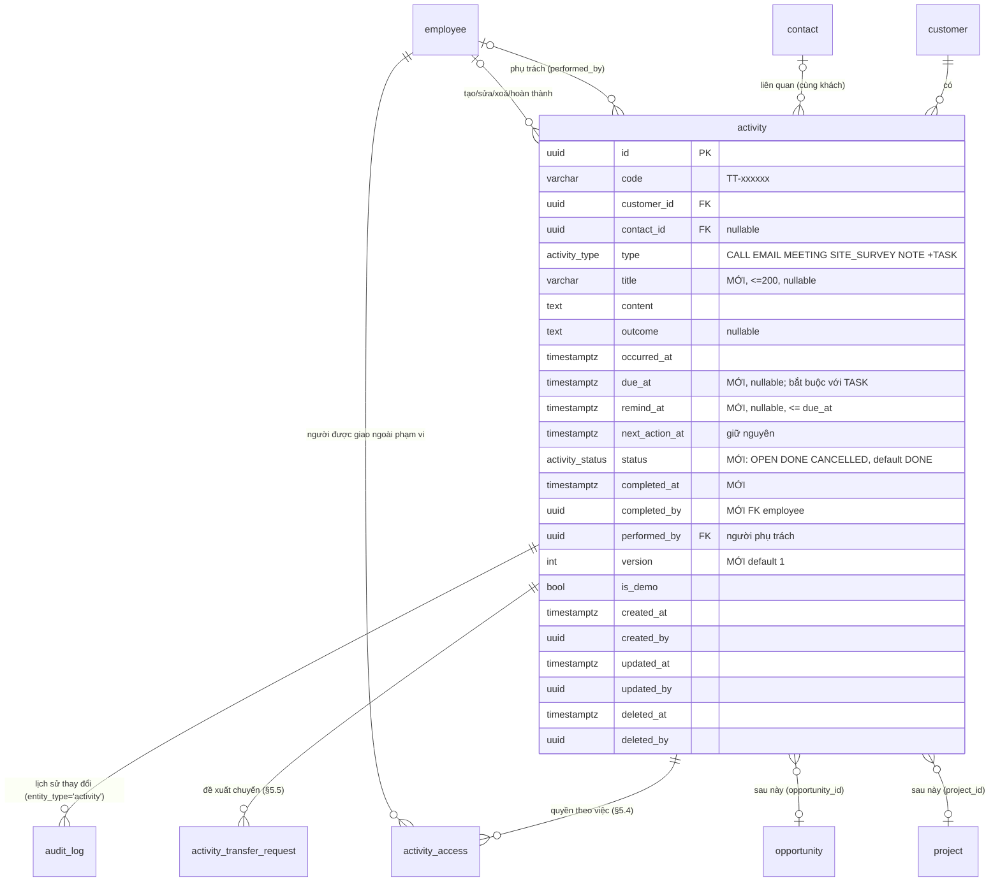

# B3 — Thiết kế module Hoạt động chăm sóc khách hàng (`activities`)

Trạng thái: **THIẾT KẾ v5.3 — OWNER_DECISION 03/11 và 04/11/2026 (APPROVED_WITH_CHANGES); bản này đã áp cả hai, chờ rà soát độc lập + phê duyệt cuối** — v5.3 (04/11 tối): xử lý báo cáo rà soát v5.2 đối chiếu `main` 917f15e (`B3_V52_RA_SOAT_VA_KE_HOACH_A2_20261104.md`): 2 mức Critical về quy trình/khả năng hoàn tác (D1 đổi baseline quyền V3→V4; enum `ADD VALUE` không hoàn tác trực tiếp + nguy cơ mất dữ liệu cột mới khi rollback) và 2 Important (B1 rollback chưa gỡ hàm trigger mới; B2 thiếu đường rollback cho trạng thái "chỉ migration 1 đã áp") + 6 Minor (B3–B7, chỗ trỏ V3) — đối chiếu từng điểm ở §15 #20–#27; v5.2: đã sửa 6 Important + 7 Minor của rà soát độc lập lần 6 và 1 Important + 6 Minor của lần 7 (§15) — chưa sửa mã, chưa migration, chưa cấp quyền, chưa đụng database nào. Owner đồng ý phương án A và kiến trúc tổng thể; chấp thuận *nghiên cứu* V4 grants + kiểm thử trên PostgreSQL cô lập, **chưa** phê duyệt áp V4 lên demo/production, chưa phê duyệt triển khai A2–A9, merge hay deploy.

Cơ sở: `main` 917f15e; khảo sát `backend/prisma/schema.prisma`, migration `20261012000000_b1_2_crm_core`, `backend/src/modules/customers/*`, `backend/src/common/auth/*`, `backend/docs/B1.3_S1_APP_GRANTS_V3.sql.txt`, `backend/docs/B1.3_S1_VERIFY.sql.txt`, `docs/B1.2_PLAN.md`, `backend/docs/B1.3.1_FINAL_DESIGN.md`, frontend `src/features/customers/*`, `src/pages/CustomerProfile.jsx` (mẫu demo "Lịch sử tương tác"), `src/styles/*` (Liquid Glass).

**Cập nhật 06/11/2026 (OWNER_DECISION PR #211, quyết định #2 và #3):** §6 thêm route `POST /activities/:id/access/revoke` và mã `ACTIVITY_ALREADY_OPEN`; `ACTIVITY_EXTERNAL_NOT_ALLOWED` tách 400 (việc không phải TASK OPEN) / 403 (người nhận thiếu `activity.update_own`). Không đổi nội dung khác.

## 0. Tóm tắt cho người không chuyên
- Mỗi khách hàng có một **dòng thời gian** gồm: cuộc gọi, email, lịch hẹn, khảo sát công trình, ghi chú và **công việc** (việc cần làm, có người phụ trách, hạn, trạng thái).
- Nhân viên thấy việc của mình trong màn hình **"Công việc của tôi"**, có nhắc quá hạn/hôm nay (chuông trên thanh đầu trang). Chưa gửi email/push trong giai đoạn này.
- Ai xem/sửa được gì tính theo **khách hàng** (giống quyền khách hàng hiện nay) và được **kiểm ở máy chủ**; nút mờ trên giao diện chỉ là tiện ích.
- Dữ liệu cũ (nếu có) trong bảng `activity` **không mất, không đổi nghĩa**; chỉ thêm cột/giá trị mới.
- Để máy chủ ghi được hoạt động, phải mở quyền ghi **đúng 3 bảng** (`activity`, `activity_access`, `activity_transfer_request`) cho vai trò DB `siscom_app` — đây là thay đổi baseline đã nghiệm thu, làm bằng PR riêng, có rollback, thử trên PostgreSQL tạm trước, **anh duyệt mới chạy**.
- **Kỹ thuật khác phòng làm việc được giao (quyết định 04/11):** sale giao **công việc** cho kỹ thuật phòng khác. Kỹ thuật chỉ thấy **đúng công việc đó** và một **thẻ khách hàng tối thiểu** (tên, địa chỉ, điện thoại, người liên hệ của việc) — không xem hồ sơ khách, hoạt động khác, người liên hệ khác hay khách khác. Quyền tự hết khi việc xong, huỷ, chuyển người, hoặc hết thời hạn quyền (hạn việc + 7 ngày, tối đa 30 ngày kể từ cấp).
- **Kỹ thuật đề xuất chuyển việc** cho người cùng phòng có thẩm quyền; người được quyền giao việc **duyệt** thì mới chuyển; có lịch sử và báo trên chuông. Kỹ thuật **không** tự mở thêm quyền xem khách.
- Mọi bộ lọc ngày, hạn công việc và chuông tính theo **giờ Việt Nam (Asia/Ho_Chi_Minh)**.

## 1. Mục tiêu, phạm vi, ngoài phạm vi
**Trong phạm vi (B3.1):** ghi nhận & xem hoạt động theo khách; công việc có phụ trách/hạn/trạng thái; danh sách việc của tôi + nhắc trong ứng dụng; lịch sử thay đổi của từng hoạt động (audit); RBAC V2 ở backend; PC + điện thoại (PWA hiện có). **Thêm (04/11):** truy cập theo công việc được giao cho người ngoài phạm vi khách (§5.4); đề xuất chuyển việc có duyệt (§5.5); thông báo trong ứng dụng qua chuông (§7).
**Để sau (đã chừa chỗ):** liên kết **cơ hội kinh doanh** và **dự án** (cột FK nullable thêm khi có bảng); nhắc qua email/push; lịch (calendar view); đính kèm tệp; ghi âm cuộc gọi; lặp lịch; báo cáo KPI hoạt động; đọc `audit_log` của khách hàng (cần `audit.read`).

## 2. Hiện trạng bảng `activity` (đã có từ B1.2, chưa dùng)
| Cột | Kiểu | Ghi chú |
|---|---|---|
| `id` | uuid | |
| `code` | varchar(20) | `TT-000001` từ `fn_next_activity_code()`, bất biến (trigger) |
| `customer_id` | uuid NOT NULL | FK customer, Restrict |
| `contact_id` | uuid NULL | FK contact; trigger `trg_activity_contact` bắt **cùng khách** |
| `type` | enum `activity_type` | CALL, EMAIL, MEETING, SITE_SURVEY, NOTE |
| `occurred_at` | timestamptz | thời điểm diễn ra |
| `content` | text NOT NULL, không rỗng | nội dung |
| `outcome` | text NULL | kết quả |
| `next_action_at` | timestamptz NULL | "việc tiếp theo" (chỉ mục riêng) |
| `performed_by` | uuid NULL | FK employee |
| `is_demo` | bool | |
| `created_*/updated_*/deleted_*` | | xoá mềm; `ck_activity_del` |
Chỉ mục: `(customer_id, occurred_at DESC)`, `next_action_at`, `performed_by`, `contact_id`. **Không có** `version`, trạng thái, hạn, hoàn thành, tiêu đề. Quyền DB: `siscom_app` chỉ SELECT (VERIFY B1b khẳng định).

## 3. Mô hình dữ liệu mở rộng (migration cộng thêm, tương thích ngược)

### 3.1 Sơ đồ

### 3.2 Thay đổi (tất cả **cộng thêm**, không đổi/xoá cột cũ)
| # | Thay đổi | Lý do | Tương thích dữ liệu cũ |
|---|---|---|---|
| 1 | `ALTER TYPE activity_type ADD VALUE 'TASK'` — **migration riêng** `…_b3_activity_type_task` chỉ chứa đúng câu lệnh này (PostgreSQL không cho dùng giá trị enum mới trong cùng transaction — `55P04`; Prisma gửi cả file migration như một khối giao dịch ngầm, không thêm `BEGIN/COMMIT` tường minh) | "công việc" | Giá trị mới, dòng cũ không đổi; migration thứ hai `…_b3_activity_tasks` mới được tham chiếu `'TASK'` |
| 2 | `CREATE TYPE activity_status AS ENUM ('OPEN','DONE','CANCELLED')`; cột `status activity_status NOT NULL DEFAULT 'DONE'` | trạng thái | Dòng cũ là sự kiện đã diễn ra ⇒ `DONE` đúng nghĩa; backfill bằng DEFAULT, không UPDATE hàng loạt. **Quy ước:** chỉ `TASK` dùng OPEN/DONE/CANCELLED (service đặt tường minh `OPEN` khi tạo TASK); 5 loại còn lại luôn `DONE`, `due_at`/`remind_at` của MEETING chỉ là thông tin nhắc, không đổi trạng thái |
| 3 | `title varchar(200) NULL` | tiêu đề ngắn cho TASK/MEETING | NULL với dòng cũ; UI hiện 80 ký tự đầu của `content` khi NULL |
| 4 | `due_at timestamptz NULL`, `remind_at timestamptz NULL` | hạn & lịch nhắc | NULL với dòng cũ |
| 5 | `completed_at timestamptz NULL`, `completed_by uuid NULL` FK employee Restrict | ai/khi nào hoàn thành | NULL |
| 6 | `version int NOT NULL DEFAULT 1` | khoá lạc quan như `customer` | 1 |
| 7 | CHECK `ck_activity_task_due`: `type <> 'TASK' OR due_at IS NOT NULL` | TASK phải có hạn | dòng cũ không phải TASK |
| 8 | CHECK `ck_activity_done`: `status <> 'DONE' OR type <> 'TASK' OR completed_at IS NOT NULL` | TASK xong phải có mốc | dòng cũ không phải TASK |
| 9 | CHECK `ck_activity_remind`: `remind_at IS NULL OR due_at IS NULL OR remind_at <= due_at` | nhắc trước hạn | |
| 10 | CHECK `ck_activity_title`: `title IS NULL OR btrim(title) <> ''` | | |
| 11 | Trigger `trg_activity_customer_fixed`: cấm vô điều kiện `NEW.customer_id IS DISTINCT FROM OLD.customer_id` (theo mẫu `fn_forbid_code_change`; `trg_activity_contact` đã bắt `UPDATE OF customer_id`, không xung đột) | hoạt động không "chuyển khách" | |
| 12 | Chỉ mục riêng phần `idx_activity_open_due ON activity(performed_by, due_at) WHERE status = 'OPEN' AND deleted_at IS NULL` | "Công việc của tôi", nhắc | |
| 13 | Chỉ mục `idx_activity_customer_active ON activity(customer_id, occurred_at DESC) WHERE deleted_at IS NULL` | timeline bỏ qua xoá mềm | (có thể thay chỉ mục hiện có — giữ cả hai ở B3.1 để không đổi cái cũ) |
| 14 | `COMMENT ON COLUMN` cho cột mới | tài liệu trong DB | |
| 15 | CHECK `ck_activity_status_type`: `type = 'TASK' OR status = 'DONE'` | chỉ TASK được OPEN/CANCELLED (quy ước §3.2#2 đưa xuống DB — `siscom_app` sẽ có UPDATE) | dòng cũ: DEFAULT `DONE` ⇒ thoả |
| 16 | CHECK `ck_activity_completed`: `(status = 'DONE' AND type = 'TASK') OR (completed_at IS NULL AND completed_by IS NULL)` | mốc hoàn thành chỉ tồn tại khi TASK đã xong; `/reopen` và huỷ **phải xoá** `completed_at/by` | cột mới NULL ⇒ thoả |
| 17 | CHECK `ck_activity_completed_pair`: `(completed_at IS NULL) = (completed_by IS NULL)` | luôn biết ai hoàn thành | NULL/NULL ⇒ thoả |
| 18 | Bảng mới `activity_access` (§5.4): `id` uuid PK, `activity_id` FK activity Restrict, `employee_id` FK employee Restrict, `granted_by` FK employee, `created_at` DEFAULT now() (trigger BEFORE INSERT ép `created_at := now()`), `expires_at` NOT NULL, `revoked_at`, `revoked_by` FK employee, `revoke_reason` enum `activity_access_revoke_reason` (`REASSIGNED`,`COMPLETED`,`CANCELLED`,`DELETED`,`CUSTOMER_DELETED`,`EXPIRED`,`ROLE_LOST`,`DUE_CHANGED`,`MANUAL`); unique riêng phần `(activity_id, employee_id) WHERE revoked_at IS NULL`; chỉ mục `(employee_id) WHERE revoked_at IS NULL`; CHECK `expires_at > created_at`, `expires_at <= created_at + interval '720 hours'` (không phụ thuộc TimeZone của phiên), `(revoked_at IS NULL) = (revoked_by IS NULL)`, `(revoked_at IS NULL) = (revoke_reason IS NULL)`; trigger cấm sửa `activity_id/employee_id/granted_by/created_at` (append-only trừ cột thu hồi) | quyền theo việc, có hạn, có dấu vết | bảng mới, rỗng |
| 19 | Bảng mới `activity_transfer_request` (§5.5): `id`, `activity_id` FK, `from_employee_id` FK, `to_employee_id` FK (người đề xuất = `from_employee_id`, không có cột `requested_by` riêng), `reason` varchar(200) NOT NULL, `status` enum `activity_transfer_status` (`PENDING`,`APPROVED`,`REJECTED`,`WITHDRAWN`) DEFAULT `PENDING`, `decided_by` FK, `decided_at`, `decision_note` varchar(200), `created_at`; unique riêng phần `(activity_id) WHERE status = 'PENDING'` (mỗi việc tối đa 1 đề xuất chờ); CHECK `from_employee_id <> to_employee_id`, `(status = 'PENDING') = (decided_at IS NULL)`, `(decided_at IS NULL) = (decided_by IS NULL)`; trigger cấm sửa cột khoá, chỉ cho `PENDING` → trạng thái khác một lần | đề xuất chuyển việc có duyệt | bảng mới, rỗng |
| 20 | Enum `activity_access_revoke_reason`, `activity_transfer_status` | | mới |

**Tương thích ngược & kiểm dữ liệu hiện có (quyết định 04/11 #3):** mọi cột mới có DEFAULT/NULL nên dòng cũ thoả 15–17 ngay khi thêm (status `DONE`, type ≠ TASK, `completed_*` NULL). Migration `b3_activity_tasks` có **khối tiền kiểm phòng hờ** trước `ADD CONSTRAINT`: đếm dòng vi phạm từng CHECK 7–10, 15–17 ⇒ khác 0 thì `RAISE EXCEPTION` với thông điệp nêu rõ CHECK nào, bao nhiêu dòng (không sửa dữ liệu, không bỏ qua). *Ghi rõ (rà soát v5.2 B6):* với cột mới NULL/DEFAULT, số vi phạm **luôn 0** ngay sau `ADD COLUMN` và PostgreSQL `ADD CONSTRAINT … CHECK` tự quét toàn bảng — khối này chỉ có giá trị **thông điệp dễ đọc** khi có dữ liệu bất thường (ví dụ áp lên bản sao đã bị sửa tay), không thay cho CHECK. *Ba CHECK trạng thái không trùng nhau (B7):* #8 "TASK DONE ⇒ có mốc", #16 "có mốc ⇒ TASK DONE", #17 "hai cột mốc đi đôi" — ba chiều khác nhau, giữ cả ba. Trước khi áp lên DB demo (A9, anh duyệt riêng) chạy **truy vấn chỉ đọc** `backend/docs/B3_PREFLIGHT_READONLY.sql.txt`: tổng dòng `activity` theo `type`, theo `deleted_at`, số dòng có `next_action_at`, `performed_by` NULL, `contact_id` sai khách (phải 0) — ghi kết quả vào evidence. CI chạy migration trên DB tạm rỗng **và** trên DB tạm có seed hoạt động mẫu đủ 5 loại cũ (kiểm tương thích).

**Không** thêm ở B3.1: `priority`, `opportunity_id`, `project_id` (thêm khi có bảng đích; cột nullable + FK Restrict + chỉ mục — migration riêng), nhắc lặp, đính kèm.

### 3.3 Rollback (viết sẵn, không tự chạy) — `backend/docs/B3_ACTIVITY_TASKS_ROLLBACK.sql.txt`
Mẫu: `B1.4_SESSION_REMEMBER_FAMILY_ROLLBACK.sql.txt` (một transaction; `SELECT current_database(), current_user` in ra trước; guard; hậu kiểm "Rollback chua sach"). Một file gỡ **cả hai** migration, chạy được bằng `siscom_app` (chuỗi 1 của CI, sau khi gộp role lại — chủ sở hữu) **hoặc** `siscom_migrator` (chuỗi 2, sau tách role) — như các rollback hiện có, script **không** kiểm vai trò tường minh: `DROP`/`ALTER` tự thất bại `42501` nếu người chạy không phải chủ sở hữu, transaction huỷ, không để lại trạng thái dở.

**(a) Guard & nhận diện trạng thái (rà soát v5.2 B2):** guard tên DB `^siscom_crm_(restore|test)_\d{8}_\d{6}$` + từ chối 2 baseline (y hệt mẫu). Sau đó xác định trạng thái bằng 2 vị từ: `has_task := EXISTS (SELECT 1 FROM pg_enum WHERE enumtypid = 'public.activity_type'::regtype AND enumlabel = 'TASK')`, `has_cols := to_regclass('public.activity_access') IS NOT NULL OR EXISTS (SELECT 1 FROM information_schema.columns WHERE table_schema='public' AND table_name='activity' AND column_name='status')` (lọc schema như mẫu `…FAMILY_ROLLBACK.sql.txt:22`); mọi `DROP TABLE/INDEX/TRIGGER/FUNCTION/TYPE` dùng `IF EXISTS` để trạng thái sửa tay nửa chừng không làm transaction dừng giữa đường, hậu kiểm (e) mới là nơi kết luận "sạch":
| Trạng thái | `has_task` | `has_cols` | Hành động |
|---|---|---|---|
| S0 chưa áp gì | f | f | `RAISE EXCEPTION 'Chua ap migration B3. Khong co gi de rollback.'` (như mẫu) |
| S1 **chỉ** `…_b3_activity_type_task` đã áp (migration 2 chưa chạy, hoặc chạy **thất bại** — Prisma gửi cả file như một khối giao dịch ngầm (multi-statement) nên thất bại ⇒ không còn vết schema, chỉ còn dòng `_prisma_migrations` có `finished_at IS NULL`; **điều kiện:** migration của A2 không được có `BEGIN/COMMIT` tường minh) | t | f | vẫn áp điều kiện từ chối (b)1 (TASK chèn tay) rồi chỉ làm bước (d) tạo lại enum + (e) xoá dòng `_prisma_migrations` của **cả 2 tên** (dòng thất bại của migration 2 cũng bị xoá — `DELETE … WHERE migration_name IN (…)` không lọc theo `finished_at`; sau rollback `migrate deploy` áp lại từ đầu, không cần `migrate resolve`) |
| S2 cả 2 đã áp | t | t | đủ (b)→(e) |
| S3 bất thường (có cột mà enum thiếu TASK) | f | t | `RAISE EXCEPTION` "trang thai khong nhat quan — xu ly tay", không làm gì |

**(b) Từ chối để không mất dữ liệu (Critical "không mất dữ liệu" — v5.3):** rollback **không bao giờ** tự xoá/sửa dữ liệu. Từ chối (RAISE, transaction huỷ) nếu **bất kỳ** điều kiện sau đúng, thông điệp nêu số dòng và tên bảng/cột:
1. còn dòng `activity.type = 'TASK'` **kể cả đã xoá mềm** (đổi kiểu cột `USING type::text::activity_type` thất bại với mọi dòng TASK);
2. `activity_access` hoặc `activity_transfer_request` còn dòng (kể cả đã thu hồi/đã quyết định);
3. **mới (v5.3):** còn dòng `activity` có giá trị ở cột sắp gỡ: `title IS NOT NULL OR due_at IS NOT NULL OR remind_at IS NOT NULL OR completed_at IS NOT NULL OR completed_by IS NOT NULL OR status <> 'DONE'` (vế `status` để không phụ thuộc CHECK #15 còn hay đã bị gỡ tay) — ví dụ MEETING có `due_at`/`remind_at`; `DROP COLUMN` sẽ mất giá trị đó. (`status` luôn `DONE` với dòng không phải TASK nhờ CHECK #15 và `version` chỉ là bộ đếm ⇒ hai cột này gỡ không mất thông tin.)
Quy trình tay **trước** rollback (anh duyệt riêng, làm trên bản sao, ghi evidence): (1) xuất `\copy (SELECT id, code, type, status, title, due_at, remind_at, completed_at, completed_by, version FROM public.activity WHERE type='TASK' OR title IS NOT NULL OR due_at IS NOT NULL OR remind_at IS NOT NULL OR completed_at IS NOT NULL) TO 'b3_activity_backup_<stamp>.csv' CSV HEADER` + `\copy` 2 bảng mới; (2) đổi TASK → `NOTE` bằng UPDATE tường minh có ghi `audit_log` (`actor_type='MIGRATION'`, `changes` ghi cột cũ) và đặt NULL các cột mới (chỉ sau khi đã xuất); (3) chạy rollback. Script rollback **không** chứa bước (1)(2); không có cờ "ép buộc".

**(c) Thứ tự gỡ (S2):** 2 bảng mới (18, 19) kèm trigger/chỉ mục của chúng → 2 enum (20) → 7 CHECK (7–10, 15–17) → `idx_activity_open_due`, `idx_activity_customer_active` → trigger `trg_activity_customer_fixed` (11) → **4 hàm trigger mới** (rà soát v5.2 B1): `fn_activity_customer_fixed()` (#11), `fn_activity_access_created_at()` + `fn_activity_access_append_only()` (#18), `fn_activity_transfer_state()` (#19) — `DROP FUNCTION IF EXISTS` sau khi trigger đã gỡ (hàm trigger không gỡ được khi còn trigger phụ thuộc) → cột mới (5, 4, 3, 2, 6) → `DROP TYPE activity_status`. *Đối chiếu `main`:* `20261012000000_b1_2_crm_core` dùng `CREATE OR REPLACE FUNCTION` cho mọi hàm ⇒ A2 **cũng dùng `OR REPLACE`** (áp lại sau rollback không lỗi 42723 dù có sót), **và** rollback vẫn gỡ hàm để hậu kiểm "sạch" là thật; `fn_check_activity_contact`/`trg_activity_contact`/`fn_next_activity_code` **của B1.2 không đụng**.
**(d) Tạo lại enum 5 giá trị** (S1 và S2; PostgreSQL không có `DROP VALUE`): `ALTER TYPE public.activity_type RENAME TO activity_type_old` → `CREATE TYPE public.activity_type AS ENUM ('CALL','EMAIL','MEETING','SITE_SURVEY','NOTE')` → `ALTER TABLE public.activity ALTER COLUMN type TYPE public.activity_type USING type::text::public.activity_type` (cột `type` không có DEFAULT và chỉ `activity.type` dùng enum này — `schema.prisma:325`; chỉ mục hiện có không phụ thuộc enum) → `DROP TYPE public.activity_type_old`. Dùng giá trị của enum vừa `CREATE TYPE` trong cùng transaction là hợp lệ (55P04 chỉ áp cho `ADD VALUE`).
**(e) `DELETE FROM public._prisma_migrations WHERE migration_name IN ('<…_b3_activity_type_task>', '<…_b3_activity_tasks>')`** (tên chốt ở A2) → **hậu kiểm** ⇒ `RAISE EXCEPTION 'Rollback chua sach.'` nếu còn bất kỳ: enum có `TASK`; `to_regtype('public.activity_status')`/`activity_access_revoke_reason`/`activity_transfer_status` khác NULL; `to_regclass` của 2 bảng, 2 chỉ mục khác NULL; cột `status/title/due_at/remind_at/completed_at/completed_by/version` còn trên `activity`; `to_regproc` của 4 hàm khác NULL; trigger 11 còn trong `pg_trigger`; còn dòng `_prisma_migrations` của 2 tên. `COMMIT`.
**(f) Vị trí trong CI:** đặt **đầu** hai chuỗi rollback (`ci.yml` hiện tại: trước `B1.4_SESSION_REMEMBER_FAMILY_ROLLBACK.sql.txt … run app` ở chuỗi đầy đủ và `… run migrator` ở chuỗi Remember Me — số dòng chốt khi viết A2), rồi `migrate deploy` áp lại, `migrate diff --exit-code` = 0, STRUCTURE_TESTS lại. Thêm **2 ca "từ chối đúng kỳ vọng"** trên DB tạm: `B3_ROLLBACK_REFUSE_TASK_TEST.sql.txt` (seed 1 dòng TASK đã xoá mềm) và `B3_ROLLBACK_REFUSE_COLS_TEST.sql.txt` (seed 1 dòng MEETING có `due_at`). *Cơ chế (rà soát v5.3 I-1 — đã đối chiếu mã):* `pg-sql-check.sh` mode `fail` nghĩa là "psql thoát 0 **và** có dòng `FAIL|n`" (`pg-sql-check.sh:46` bắt mọi exit ≠ 0 **trước** khi xét mode), còn rollback từ chối bằng `RAISE EXCEPTION` dưới `ON_ERROR_STOP=1` ⇒ psql thoát 3 ⇒ **không dùng được mode `fail`**. Làm theo tiền lệ `pg-temp-db.sh:166–170` (ca (C) của AUTH_ROLE_ROLLBACK): trong bước CI, (1) chạy file seed (`run migrator`), (2) `rc=0; psql … -f B3_ACTIVITY_TASKS_ROLLBACK.sql.txt … || rc=$?`, (3) kiểm `rc ≠ 0` **và** `grep` đúng thông điệp từ chối **và** trạng thái còn nguyên (enum còn TASK, cột còn, dòng seed còn), (4) chạy file dọn seed (`run migrator`, `DELETE` đúng dòng seed theo `code` cố định). Hai file REFUSE_TEST = seed + dọn (không gọi rollback từ bên trong vì rollback là file psql riêng có `BEGIN/COMMIT`); bước CI này viết thẳng trong `ci.yml` (A2 **không** thêm mode mới vào `pg-sql-check.sh`). Ca S1 diễn tập bằng cách áp **chỉ** migration 1 (`prisma migrate deploy` không chạy được từng file ⇒ dùng `psql -f` file migration 1 + `INSERT _prisma_migrations` giả lập như Prisma ghi) rồi chạy rollback ⇒ sạch ⇒ `migrate deploy` áp lại đủ 2.

### 3.4 Prisma
`schema.prisma`: thêm `TASK` vào `ActivityType`; `enum ActivityStatus { OPEN DONE CANCELLED @@map("activity_status") }`; các trường mới với `@map`; quan hệ `completedBy Employee? @relation("ActivityCompletedBy")` (+ ngược chiều ở `Employee`). Chỉ mục riêng phần không mô tả được bằng Prisma ⇒ ghi trong SQL, `migrate diff --exit-code` vẫn 0 (như `ix_auth_session_employee_active`). Bài kiểm cấu trúc `backend/docs/B3_ACTIVITY_STRUCTURE_TESTS.sql.txt` (PASS/FAIL cho **7–20**: 7 CHECK, trigger 11, 2 chỉ mục 12–13, enum có TASK, 2 bảng 18–19 với unique riêng phần/CHECK/trigger, 2 enum 20; mỗi ca `expect_err`/`expect_true` trong savepoint, không để lại dữ liệu — rà soát v5.2 B3) chạy trong CI bằng `pg-sql-check.sh … res migrator` ngay sau `migrate deploy` lần đầu và sau mỗi lần áp lại.

## 4. Quyền DB tối thiểu cho `siscom_app` (thay đổi baseline — PR riêng, anh duyệt mới chạy)
- **Chỉ**: `GRANT INSERT, UPDATE ON public.activity, public.activity_access, public.activity_transfer_request TO siscom_app;` — **không** DELETE (xoá mềm/thu hồi/quyết định = UPDATE), không bảng nào khác, không cột nào khác. *(04/11: 2 bảng của §5.4/§5.5 vào **cùng** V4 — một lần đổi baseline, không tách V5.)*
- **V4 cấp quyền có điều kiện cho 2 bảng mới (rà soát lần 6 I-2):** `activity_access`/`activity_transfer_request` có thể **chưa tồn tại** khi V4 chạy (CI chạy rollback rồi `grants` ngay sau — `ci.yml:180–182`; bước `split` của `demo-split.ps1` có thể chạy trước migrate). Theo đúng mẫu `remember_device` của V3 (`APP_GRANTS_V3.sql.txt:122–123`): `SELECT CASE WHEN to_regclass('public.activity_access') IS NULL THEN 'SELECT ''activity_access: chua co bang (bo qua)''' ELSE 'GRANT INSERT, UPDATE ON public.activity_access TO siscom_app' END \gexec` (tương tự bảng còn lại); `activity` luôn có từ B1.2 nên cấp thẳng. Phần "Tóm tắt" và VERIFY B1 đặt kỳ vọng **theo trạng thái bảng** (có bảng ⇒ phải có INSERT/UPDATE, không DELETE; chưa có ⇒ bỏ qua). A3 thêm ca CI "rollback B3 → V4 chạy được → migrate → V4 → VERIFY PASS". Sequence `activity_code_seq` đã nằm trong `GRANT USAGE, SELECT ON ALL SEQUENCES`. Hàm `fn_next_activity_code()` chạy qua DEFAULT cột (không REVOKE EXECUTE với PUBLIC) — VERIFY E7 bổ sung kiểm EXECUTE cho chắc.
- Cách làm: file **`B1.3_S1_APP_GRANTS_V4.sql.txt`** = V3 + **3 câu lệnh** (1 `GRANT INSERT, UPDATE ON public.activity` + 2 câu `\gexec` có điều kiện cho 2 bảng mới — rà soát v5.2 B4; không phải "1 dòng") + sửa phần "Tóm tắt" cuối file (`bang_app_INSERT` 4→7, `bang_app_UPDATE` 3→6); idempotent "revoke all rồi grant lại"; V3 giữ nguyên làm đường rollback; ghi chú "V3 là nguồn sự thật duy nhất" (header V3, `B1.4_P3C_S3_AUTH_ROLE_DESIGN.md` §7.1) trỏ sang V4.
- **Quy trình đổi baseline (D1 — Critical quy trình, v5.3):** V3→V4 chỉ xảy ra trong **một** PR A3, với checklist anh duyệt bằng văn bản: (1) diff V3→V4 đúng 3 câu lệnh + Tóm tắt, không REVOKE/GRANT nào khác; (2) VERIFY vẫn `PASS|73` và VERIFY_AUTH `PASS|33` trên CI (số đếm giữ nguyên, nhãn đổi); (3) chuỗi diễn tập `v1 fail → v2 fail → v3 fail (B1) → v4 PASS` xanh; (4) ca "rollback B3 → V4 chạy được (bảng mới chưa có) → migrate → V4 → PASS"; (5) A3 **không** áp lên DB nào ngoài DB tạm CI/PG cô lập; áp demo là A9, áp thật chưa có lịch. A2 **không** đổi quyền: rollback/migration của A2 chạy bằng chủ sở hữu, độc lập với V3/V4.
- `VERIFY.sql.txt` (từng dòng): **B1** nhãn + mảng ghi thêm `activity`, `activity_access`, `activity_transfer_request` (vẫn đòi NOT DELETE/TRUNCATE) — *lưu ý mã thật* `VERIFY.sql.txt:59–62` gọi `has_table_privilege('siscom_app', 'public.' || w, …)` trực tiếp ⇒ với bảng **chưa tồn tại** (ca rollback B3 → V4) sẽ lỗi `42P01` thay vì FAIL/PASS ⇒ A3 bọc 2 bảng mới bằng `to_regclass(...) IS NULL OR has_table_privilege(...)` (theo đúng tinh thần "kỳ vọng theo trạng thái bảng" ở trên); **B1b** nhãn + bỏ `activity` khỏi danh sách cấm; **E5** gộp thêm probe `UPDATE … WHERE false` cho 3 bảng vào nhãn hiện có (giữ nguyên số đếm) hoặc tách `E5b` (⇒ `PASS|74`) — **chọn: gộp, giữ `PASS|73`**; **E7** nhãn "4 hàm" → "5 hàm", `count(DISTINCT) = 5` thêm `fn_next_activity_code`. `backend/test/db-roles.int-spec.ts:129–130` bỏ `'activity'` khỏi `forbidden`, thêm ca dương (INSERT/UPDATE `WHERE false` OK; DELETE ⇒ 42501); sửa tiêu đề ca "P3b I-4" và nhãn B1b cho nhất quán.
- **Ngoài CI, các chỗ khác còn trỏ V3 (đưa vào A3; riêng script Windows vào A9):** `backend/scripts/windows/demo-split.ps1` chạy V3 hai lần ở bước split và "BẮT BUỘC chạy lại V3" sau `migrate deploy` — **nếu không đổi sang V4, lần chạy `demo-split -Step migrate` kế tiếp sẽ thu hồi quyền ghi `activity`** (A9 phải dùng V4); thông điệp trong `backend/src/prisma/db-role-check.ts:26, 96–97` (**kèm** `db-role-check.spec.ts:135` đang `toContain('APP_GRANTS_V3')` — đổi thông điệp thì spec đỏ, A3 sửa cùng), chú thích `backend/src/prisma/prisma.service.ts:16`, `auth-prisma.service.ts:10`, `test/helpers/test-db.ts`, header 2 file rollback Remember Me, `DB_SECURITY.md`, `VPS_LINUX_NOTES.md`, `.env.example`, `B1.3_S1_VERIFY_AUTH.sql.txt`, `B1.3_S1_AUTH_ROLE.sql.txt`, `backend/test/db-roles.int-spec.ts:210, 235`, `docs/B1.4_REMEMBER_ME_90D_DESIGN.md:32, 67, 87` (số dòng đã grep `main` 917f15e); A3 chạy lại `grep -rn "APP_GRANTS_V3\|\bV3\b" backend/src backend/test backend/docs docs` để không sót — đổi tham chiếu hoặc ghi "V3 đã được V4 thay thế".
- **CI đang hardcode V3 (phải sửa cùng PR A3, nếu không VERIFY B1 đỏ):** `scripts/ci/pg-temp-db.sh` — `split` và `auth` chạy V4 thay V3; case `grants` thêm `v4`, `wantapp=f` và kiểm `siscom_auth` áp cho cả v3 **và** v4; `.github/workflows/ci.yml` dòng 182, 189, 211 (`grants v3` + VERIFY `res app`) đổi sang `v4`; diễn tập rollback quyền thành **v1 fail → v2 fail → v3 fail (B1 — đúng kỳ vọng rollback) → v4 PASS**. Con số VERIFY ghi vào docs/evidence, **không sửa** kết quả nghiệm thu lịch sử (chỉ ghi chú như #192).
- Rủi ro: `siscom_app` bị chiếm ⇒ có thể ghi/sửa mọi dòng `activity` (không xoá cứng, không chạm bảng khác, `code`/`customer_id` bất biến nhờ trigger, audit append-only). Mức chấp nhận: ngang với `customer`/`contact` hiện nay.

## 5. Quyền ứng dụng (RBAC V2) — kiểm ở **backend**, giao diện chỉ phản ánh
**Cơ chế biểu diễn luật theo vai trò (giữ nguyên hợp đồng `Actor {employeeId, departmentId}` + `scopeFor(actor, permission)` — không đưa vai trò vào actor):** mọi luật "technician chỉ…" được **tách thành mã quyền riêng**, vì service chỉ biết quyền + phạm vi, không biết vai trò. Mã quyền mới (đều khớp regex nhóm `BIZ` của `fn_auth_perm_class`; đã xác minh **không có** CHECK định dạng trên `permission.code` — chỉ unique + trigger cấm đổi mã):
| Mã | Ý nghĩa |
|---|---|
| `activity.read` | đọc hoạt động của khách trong phạm vi |
| `activity.create` | tạo **6 loại** |
| `activity.create_tech` | tạo **chỉ** `SITE_SURVEY`, `NOTE`, `TASK` (loại khác ⇒ 403 `ACTIVITY_TYPE_NOT_ALLOWED`) |
| `activity.update` | sửa **mọi** hoạt động của khách trong phạm vi (kể cả huỷ/mở lại TASK) |
| `activity.update_own` | sửa **chỉ** hoạt động `created_by = tôi` **hoặc** `performed_by = tôi` |
| `activity.assign` | giao/chuyển người phụ trách |
| `activity.delete` | xoá mềm |
| `activity.assign_external` | giao **TASK đang OPEN** cho người **ngoài** phạm vi đọc khách, kèm cấp quyền theo việc (§5.4) |
| `activity.transfer_request` | **đề xuất** chuyển việc mình đang phụ trách cho người cùng phòng (§5.5) — không tự chuyển |
Nhiều vai trò trên một người: hợp quyền "rộng nhất thắng" như `SessionActorProvider` (`RANK`), nên ai có cả `update` và `update_own` thì `update` áp dụng. Phạm vi tính theo **chủ sở hữu khách hàng** (`inScope` sẵn có: ALL / DEPARTMENT = phòng của chủ khách / OWN = chính mình là chủ khách) — **không** gắn với `customer.update` (technician không có quyền đó), chỉ cần khách trong phạm vi `customer.read` (ngoài ⇒ 404) và hoạt động trong phạm vi `activity.*` tương ứng (ngoài ⇒ 403).
**Không nới phạm vi vì được giao việc (quyết định owner 03/11):** phạm vi xem hoạt động **luôn** = phạm vi RBAC V2 trên khách hàng; **không có** luật "phụ trách tự thấy". Hệ quả: chỉ được **giao việc cho người đang đọc được khách đó** — khi tạo/đổi `performedById`, service kiểm `inScope(assignee, scopeFor(assignee,'customer.read'), ownerInfo(cust))` (và `activity.read` của người đó); không đạt ⇒ 400 `ACTIVITY_ASSIGNEE_NO_ACCESS` ("người này chưa có quyền xem khách hàng"). `assignee-candidates` chỉ liệt kê người thoả điều kiện này. Mọi bộ lọc (`assignee`, `status`, `due`, `type`) áp **sau** vị từ phạm vi đọc theo khách; test ma trận bắt buộc có ca `assignee=<uuid khác>` không trả hoạt động trên khách ngoài phạm vi. Fail‑closed với mọi trường hợp khác. Nhu cầu giao việc cho người **ngoài** phạm vi (ví dụ sale giao khảo sát cho kỹ thuật phòng khác) được giải quyết bằng **truy cập theo công việc** (§5.4, quyết định 04/11) — thay cho đề xuất `customer_share` ở §13.

| Quyền | crm_admin | sale | technician | accountant | Ghi chú (quyết định owner 03/11) |
|---|---|---|---|---|---|
| `activity.read` | ALL | OWN | DEPARTMENT | ALL | theo khách hàng; không nới vì được giao |
| `activity.create` | ALL | OWN | – | – | 6 loại |
| `activity.create_tech` | – | – | DEPARTMENT | – | technician tạo khảo sát, ghi chú, công việc kỹ thuật; `performedById` mặc định = chính mình |
| `activity.update` | ALL | OWN | – | – | sale sửa mọi hoạt động trên khách mình |
| `activity.update_own` | – | – | DEPARTMENT | – | technician chỉ sửa hoạt động **mình tạo hoặc được giao** |
| `activity.assign` | ALL | OWN | **–** (04/11: technician chỉ **đề xuất** chuyển — `activity.transfer_request`, §5.5) | – | **mọi** giao/chuyển ghi audit `activity.assign` (`changes.performedById: [cũ, mới]`); người nhận ACTIVE, cùng phòng (admin: bất kỳ) và **đã đọc được khách** |
| `activity.delete` (xoá mềm) | ALL | **–** | – | – | **chỉ crm_admin**, có audit `activity.delete`; **không ai xoá vĩnh viễn qua ứng dụng** (DB cũng không cấp DELETE) |
| `activity.assign_external` | ALL | OWN | – | – | (04/11) sale giao khảo sát/công việc cho kỹ thuật phòng khác trên khách **của mình**; người nhận phải có `activity.update_own` (thẩm quyền kỹ thuật) |
| `activity.transfer_request` | – | – | DEPARTMENT | – | (04/11) kỹ thuật đề xuất chuyển việc cho người cùng phòng; người duyệt = người có `activity.assign` (+ `assign_external` nếu người nhận ngoài phạm vi) trên khách đó |
| `lookup.read` | ALL | ALL | ALL | ALL | (đã có) |

Số dòng `role_permission`: crm_admin 6 + sale 5 + technician 4 + accountant 1 = **16**; số mã `permission` mới = **9**.
**Hệ quả thực tế (rà soát lần 5, đã xử lý 04/11):** bootstrap đặt sale ở phòng **KD**, kỹ thuật ở phòng **KT** ⇒ với chỉ quy tắc "người nhận đọc được khách", kỹ thuật không thấy khách của sale và sale không giao được việc cho kỹ thuật. B3.1 giải quyết bằng **truy cập theo công việc** (§5.4) — không nới phạm vi xem khách. Giao **nội bộ** (người nhận đã đọc được khách) giữ nguyên quy tắc trên.
**Thời gian (TOCTOU):** điều kiện "đọc được khách" chỉ kiểm **lúc giao**. Sau đó khách đổi chủ sang phòng khác, nhân viên chuyển phòng hoặc mất vai trò ⇒ `performed_by` có thể không còn đọc được khách. Hành vi quy định: vị từ phạm vi đọc **áp lại ở mọi request** (người đó không còn thấy việc/chuông/`complete` ⇒ 404); việc OPEN vẫn hiện cho người đọc được khách (chủ mới/admin) với cờ `assigneeLostAccess: true` ("phụ trách không còn quyền xem") để giao lại; **không** tự đổi `performed_by`. Test ma trận bắt buộc: "đổi chủ khách ⇒ assignee cũ không còn thấy việc; chủ mới thấy + cờ".
**Cách tính phạm vi của người khác (phải xây mới ở A5):** `scopeFor` hiện gắn với object `Actor` của phiên, không gọi được cho người nhận. Xây: hàm thuần `mergeScopes(rows)` tách từ `SessionActorProvider.lookup` (RANK ALL>DEPARTMENT>OWN, bỏ vai trò `isConfirmed=false`, chỉ `KNOWN`) dùng chung cho provider và helper `effectiveScopesOf(tx, employeeId)` chạy trên pool nghiệp vụ (`siscom_app` đọc được `employee/employee_role/role/role_permission/permission`); kiểm `inScope({employeeId, departmentId: assignee.departmentId}, scopes['customer.read'], ownerInfo(cust))` và `scopes['activity.read']`. Helper **chỉ dùng làm điều kiện thu hẹp (AND)**, không bao giờ gán vào `RequestCtx.actor` ⇒ không leo thang; cùng một hàm thuần + unit test chung để provider và helper không lệch. `assignee-candidates`: một truy vấn JOIN, cap 500, chỉ trả `id, code, fullName, departmentCode`.
Hoàn thành việc (`/complete`): `activity.update` **hoặc** `activity.update_own` **hoặc** `performed_by` = tôi — luôn trong phạm vi đọc **hoặc** quyền theo việc còn hiệu lực (§5.4) (áp lại mỗi request). Đường "`performed_by` = tôi" là **chủ đích**: người được giao (kể cả accountant chỉ có `activity.read`) tự đánh dấu xong việc của mình, nhưng không sửa nội dung; có ca test riêng trong ma trận.
Mã vai trò thật trong DB: `crm_admin`, `sales`, `technician`, `accountant` (`admin` = sysadmin kỹ thuật, **không** cấp BIZ — SoD) — script `B3_ACTIVITY_PERMISSIONS.sql.txt` dùng đúng mã này; tài liệu viết "sale" là `sales`. Người nhận giao việc: helper chỉ kiểm `employee.status=ACTIVE` (pool nghiệp vụ không đọc `employee_credential`) — credential bị khoá vẫn có thể được giao; chấp nhận (người đó không đăng nhập được nên không làm gì được). Đọc ngoài phạm vi `activity.read` ⇒ **404** (theo mẫu `ContactsService.list` trong `customers/customers.contacts.service.ts`); ghi ngoài phạm vi ⇒ 403.

Quy tắc 403/404 như `customers`: không có quyền ⇒ 403 `FORBIDDEN`; có quyền nhưng khách ngoài phạm vi đọc ⇒ 404 (không lộ tồn tại); trong phạm vi đọc nhưng thiếu phạm vi ghi ⇒ 403. **Khách đã xoá mềm (rà soát lần 5 M-3):** mọi ghi ⇒ 409 `CUSTOMER_DELETED`; xoá mềm khách **thu hồi** mọi `activity_access` của khách đó (`CUSTOMER_DELETED`) và đóng đề xuất chuyển đang chờ (`WITHDRAWN`) trong cùng transaction. **Đọc** timeline khách đã xoá là **đường mới** (hiện không có endpoint chi tiết khách đã xoá: `GET /customers/:id` gọi `loadVisible` không kèm `includeDeleted` — `customers.service.ts:161`; `includeDeleted` chỉ dùng khi khôi phục, dòng 373): `GET /customers/:customerId/activities?includeDeleted=true` yêu cầu `customer.restore` **và** phạm vi đọc khách (như danh sách khách đã xoá, dòng 172–175); người khác ⇒ 404. Danh sách việc/chuông **không** gồm hoạt động của khách đã xoá.

**Cấp quyền cho DB đã bootstrap** (demo 55433, thật): bootstrap đã đóng ⇒ `role_permission` chỉ nhận dòng mới qua **yêu cầu đặc quyền 2 người**; các hàm `fn_auth_api_*` đã `REVOKE … FROM PUBLIC` (chỉ chủ sở hữu `siscom_migrator`/superuser gọi được) ⇒ **script vận hành mới** `backend/docs/B3_ACTIVITY_PERMISSIONS.sql.txt` chạy bằng `siscom_migrator` (chưa có tiền lệ; diễn tập CI bắt buộc). Trình tự chính xác:
1. `INSERT INTO permission(code)` 9 mã (không có trigger chặn INSERT; bỏ qua nếu đã có).
2. **Mỗi dòng** `role_permission` (16 dòng theo ma trận: crm_admin 6, sale 5, technician 4, accountant 1) = **một** yêu cầu riêng: `fn_auth_api_request_create` (người nhóm REQUEST = sysadmin, `ROLE_PERMISSION_CHANGE`, payload `permissionId/op=ADD/scope`) → `fn_auth_api_request_decide` (người có `access.approve` = crm_admin) → `fn_auth_api_role_permission_change` (**cũng do sysadmin** thực thi); cả hai người phải `employee.status=ACTIVE` + credential ACTIVE (`fn_auth_api_actor`). "Idempotent" = **bỏ qua dòng đã tồn tại**, không gọi lại hàm.
3. Script REMOVE (rollback): từng dòng `role_permission` qua yêu cầu `op=REMOVE` (guard chạy cả khi xoá), **rồi mới** `DELETE FROM permission`.
DB bootstrap mới lấy từ ma trận `BIZ` trong `bootstrap.ts`. `admin` (sysadmin) **không** được cấp (SoD, trigger từ chối).

Mã: `Permission` union (`common/auth/actor.ts`), `KNOWN` (`session-actor.provider.ts`), `ALL_PERMS` + preset (`test/helpers/test-app.ts`), `BIZ` (`bootstrap.ts`), FE `grantsFromSession` tự nhận key mới (`can('activity.create') || can('activity.create_tech')` cho nút tạo; danh sách loại hiển thị theo key).

### 5.4 Truy cập theo công việc được giao (quyết định 04/11 #2) — thay cho `customer_share` cấp khách
**Mục tiêu:** sale giao khảo sát/công việc cho kỹ thuật **phòng khác**; kỹ thuật chỉ thấy **thông tin cần cho đúng việc đó**, không mở rộng xem khách.
- **Khi nào cấp:** chỉ qua giao việc (tạo TASK có `performedById`, `POST /activities/:id/assign`, hoặc duyệt đề xuất chuyển §5.5) khi người nhận **không** đọc được khách; chỉ cho **TASK `OPEN`**. Người giao cần `activity.assign` **và** `activity.assign_external` trong phạm vi khách; người nhận phải ACTIVE và có `activity.update_own` (thẩm quyền làm việc kỹ thuật). Không có endpoint cấp quyền độc lập.
- **Dữ liệu:** một dòng `activity_access` (§3.2#18), cùng transaction với việc giao, audit `activity.access_grant` (`changes: {employeeId, expiresAt}`). `expires_at` **tính trong chính câu INSERT bằng SQL**, cùng `now()` của transaction với `created_at` (rà soát lần 7 N-1): `INSERT INTO activity_access (activity_id, employee_id, granted_by, expires_at) SELECT a.id, $2, $3, least(greatest(a.due_at, now()) + interval '168 hours', now() + interval '720 hours') FROM activity a WHERE a.id = $1` — **không** tính bằng giờ Node (lệch đồng hồ ⇒ 23514). Việc đã quá hạn vẫn cấp được (không vi phạm `expires_at > created_at`). Test biên: hạn ở quá khứ, hạn = now + 23 ngày, hạn = now + 60 ngày.
  - **Cấp lại cho cùng người** (rà soát lần 6 I-3): trước khi INSERT, trong cùng transaction, thu hồi dòng cũ còn `revoked_at IS NULL` của cặp (việc, người) — lý do `EXPIRED` nếu đã hết hạn, ngược lại `REASSIGNED` — rồi mới cấp mới; không bao giờ 23505.
  - **Đổi `due_at`** (PATCH, chỉ người có quyền sửa nội dung): nếu việc đang có quyền theo việc còn hiệu lực **và** người PATCH có `activity.assign_external` trong phạm vi khách ⇒ thu hồi (lý do `DUE_CHANGED`) + cấp lại theo câu SQL trên trong cùng transaction (`granted_by` = người PATCH), audit `activity.access_revoke` + `activity.access_grant`. Người PATCH **không** có `assign_external` ⇒ giữ nguyên quyền cũ (hạn quyền không đổi) và phản hồi kèm `accessExpiresAt` để giao diện cảnh báo. Không gia hạn ngầm.
  - Cờ `assigneeLostAccess` (§5 TOCTOU) = người phụ trách **không** còn đọc được khách **và không** còn quyền theo việc hiệu lực (gồm cả hết hạn/thu hồi).
- **Người được cấp được làm:** xem **chi tiết đúng TASK đó** (`GET /activities/:id`); xem **thẻ khách tối thiểu** `GET /activities/:id/work-card` = khách: `code`, `name`, `shortName`, `address`, tên tỉnh, `phone`; người liên hệ **của chính việc** (nếu có): `fullName`, `title`, `phone` — **không** `email`, `taxId`, doanh thu, ghi chú, thẻ, người phụ trách, hoạt động khác, người liên hệ khác; cập nhật `outcome` + **hoàn thành** việc; **đề xuất chuyển** (§5.5). Việc hiện trong "Công việc của tôi" và chuông của họ.
- **Không được:** xem/tìm khách, timeline, `history`, người liên hệ khác; tạo hoạt động khác trên khách; sửa nội dung/hạn/người liên hệ; giao lại; cấp tiếp. Khi người gọi **chỉ** có quyền theo việc (không đọc được khách), `PATCH` chỉ nhận trường `outcome` (+ `version`) — trường khác ⇒ 403 `FORBIDDEN`, dù có `activity.update_own`.
- **Tự hết hiệu lực (cùng transaction, `revoked_*` + audit `activity.access_revoke`):** TASK `DONE`/`CANCELLED`/xoá mềm; đổi người phụ trách; khách bị xoá mềm; người cấp/chủ khách/crm_admin thu hồi thủ công. **Hết hạn** không cần job: mọi vị từ kiểm `revoked_at IS NULL AND expires_at > now()`.
- **Vị từ:** đọc hoạt động = phạm vi theo khách (§5) **OR** (`EXISTS activity_access(revoked_at IS NULL, expires_at > now(), activity_id = a.id, employee_id = actor)` **AND** người gọi **hiện vẫn** có `activity.update_own` trong `scopes` của phiên **AND** `customer.deleted_at IS NULL` **AND** `a.deleted_at IS NULL`) — áp lại ở **mọi** request (rà soát lần 6 I-5: gỡ vai trò/kỹ thuật bị khoá ⇒ mất ngay, không chờ hết hạn; dòng truy cập được đánh dấu `ROLE_LOST` ở **lần ghi kế tiếp trên chính hoạt động đó** do người khác thực hiện (giao lại, sửa, huỷ, duyệt chuyển…), `revoked_by` = người thực hiện lần ghi đó; trước thời điểm ấy chỉ chặn bằng vị từ (rà soát lần 7 N-4)); **chỉ** cho chính hoạt động đó; không bao giờ áp vào truy vấn `customer`/`contact`. Code path riêng `ActivityAccessPolicy`, test ma trận riêng.
- **Đổi chủ khách:** quyền theo việc giữ nguyên (gắn với việc, không với chủ cũ); chủ mới thấy việc + người được cấp và thu hồi được.
- **Xoá mềm khách:** thu hồi (`CUSTOMER_DELETED`) + rút đề xuất chờ phải thêm vào `CustomersService.softDelete` (`customers.service.ts:354`) — việc này nằm trong **A6** (§10). Hiện xoá khách luôn bị chặn bởi `UnverifiedLinksChecker` (`customers.deletion-guard.ts`), nên đường thu hồi này chưa xảy ra trong thực tế; vị từ trên (điều kiện `customer.deleted_at IS NULL`) là lớp bảo vệ độc lập.

### 5.5 Đề xuất chuyển việc (quyết định 04/11 #4)
- **Ai đề xuất:** người **đang phụ trách** TASK `OPEN` có `activity.transfer_request` (kỹ thuật), cả khi họ chỉ có quyền theo việc (§5.4). Người nhận đề xuất: ACTIVE, **cùng phòng với người đề xuất**, có `activity.update_own`. Lý do bắt buộc (≤200, che trong audit).
- **Ai duyệt:** người có `activity.assign` trong phạm vi khách (chủ khách/crm_admin); nếu người nhận **không** đọc được khách thì người duyệt cần thêm `activity.assign_external` ⇒ duyệt xong mới cấp `activity_access` cho người nhận (§5.4). Nếu người nhận **đọc được** khách: áp đúng quy tắc giao nội bộ của `assign` (cùng phòng **người duyệt**, trừ crm_admin). **Người đề xuất không bao giờ tự mở quyền xem khách.**
- **Khi duyệt (một transaction):** `performed_by` = người nhận; `activity.assign` (`changes.performedById: [cũ, mới]`, `changes.transferRequestId`); thu hồi `activity_access` của người cũ (`REASSIGNED`); cấp mới nếu cần; đề xuất → `APPROVED`. Từ chối ⇒ `REJECTED` (cột `decision_note`; trong audit/service dùng khoá `decisionNote`). Người đề xuất rút ⇒ `WITHDRAWN`. TASK đóng/đổi người/khách xoá mềm ⇒ đề xuất chờ tự `WITHDRAWN`.
- **Thông báo (B3.1 chỉ trong ứng dụng):** người duyệt thấy số **đề xuất chờ duyệt** trên chuông; người đề xuất thấy kết quả trong 3 ngày; người nhận thấy việc mới trong "Công việc của tôi". Email/push để sau (§7).
- **Audit:** `activity.transfer_request`, `activity.transfer_approve`, `activity.transfer_reject`, `activity.transfer_withdraw` (`entityType='activity'`, khoá `reason`/`decisionNote` che `'(đã thay đổi)'`).

## 6. API (`/api/v1`, `@UseGuards(ActorGuard)`, CSRF/Origin như hiện nay, bọc `{ data }`)
| Method | Đường dẫn | Quyền | Mô tả |
|---|---|---|---|
| GET | `/customers/:customerId/activities` | `activity.read` ∧ `customer.read` | timeline của khách; `type`, `status`, `from`, `to`, `page`, `pageSize` (≤100), `sortBy=occurredAt|dueAt`, `sortOrder`; `includeDeleted=true` (khách đã xoá mềm) **chỉ** khi có thêm `customer.restore` ∧ phạm vi đọc khách (§5), không có ⇒ 404 |
| POST | `/customers/:customerId/activities` | `activity.create` **hoặc** `activity.create_tech` (3 loại) — khách trong `customer.read` ⇒ ngoài 404; chủ khách trong phạm vi quyền tạo ⇒ ngoài 403 | tạo; 201; không cần `customer.update`. `performedById` ≠ actor ⇒ cần `activity.assign` và ghi **thêm** dòng audit `activity.assign` (ngoài `activity.create`) |
| GET | `/activities` | `activity.read` | danh sách việc: `assignee=me|<uuid>`, `status`, `due=overdue|today|week|all`, `type`, phân trang; phạm vi = **đúng phạm vi đọc theo khách** (không nới vì được giao) **cộng** đúng các việc tôi có quyền theo việc §5.4 |
| GET | `/activities/reminders/summary` | `activity.read` | `{ overdue, today, upcoming7d, pendingApprovals, transferDecisions }` của **tôi** (phụ trách, trong phạm vi đọc **hoặc** quyền theo việc §5.4; định nghĩa đúng §7) — chuông |
| GET | `/activities/:id` | `activity.read` (phạm vi theo khách) **hoặc** quyền theo việc §5.4 | chi tiết |
| PATCH | `/activities/:id` | `activity.update` **hoặc** `activity.update_own` (chỉ `created_by`/`performed_by` = tôi); body chứa `performedById` khác hiện tại ⇒ thêm `activity.assign` | sửa tiêu đề/nội dung/kết quả/thời điểm/hạn/nhắc/liên hệ/người phụ trách; `{status:'CANCELLED'}` chỉ với TASK (loại khác ⇒ 409 `ACTIVITY_NOT_TASK`); body có `version` ⇒ 409 `ACTIVITY_VERSION_CONFLICT {currentVersion}`; đổi phụ trách ⇒ audit `activity.assign` riêng |
| POST | `/activities/:id/assign` | `activity.assign` | `{performedById, version}`; kiểm ACTIVE + cùng phòng (admin: bất kỳ) + người nhận đọc được khách ⇒ 400 `ACTIVITY_ASSIGNEE_NO_ACCESS`/`ACTIVITY_ASSIGNEE_INVALID`; audit `activity.assign` |
| POST | `/activities/:id/complete` | `activity.update` / `activity.update_own` / `performed_by` = tôi (áp lại phạm vi đọc **hoặc** quyền theo việc §5.4) | `status=DONE`, `completed_at/by`; 409 `ACTIVITY_NOT_OPEN` nếu không OPEN; audit `activity.complete` |
| POST | `/activities/:id/reopen` | `activity.update` hoặc `activity.update_own` | DONE/CANCELLED → OPEN (chỉ TASK); đang OPEN ⇒ 409 `ACTIVITY_ALREADY_OPEN`; audit `activity.reopen` |
| POST | `/activities/:id/access/revoke` | `activity.assign` trong phạm vi khách | (06/11, OWNER_DECISION PR #211 #3) thu hồi thủ công quyền theo việc §5.4 của một người: body `{employeeId}`; lý do `MANUAL` (dòng đã quá hạn ghi `EXPIRED`); audit `activity.access_revoke` với khoá `revokeReason`; người đó không còn dòng chưa thu hồi ⇒ 404 `ACTIVITY_NOT_FOUND` |
| DELETE | `/activities/:id` | `activity.delete` (**chỉ crm_admin**) | xoá mềm (`deleted_at/by`), không `version` (như `customers`); audit `activity.delete`, `summary` chỉ mã + loại, lý do (tuỳ chọn, **body** `{reason}` ≤200 — không dùng query để tránh lọt vào URL/access log) đặt ở `changes.reason` và che `'(đã thay đổi)'` (thêm `reason` vào `SENSITIVE_KEYS`); 200. **Không có** xoá vĩnh viễn ở tầng ứng dụng và DB (`siscom_app` không có DELETE) |
| GET | `/activities/:id/history` | `activity.read` — **chỉ** theo phạm vi khách, **không** qua quyền theo việc §5.4 | các dòng `audit_log` `entity_type='activity'` của id này (đã che nội dung) |
| GET | `/activities/assignee-candidates?customerId=` | `activity.assign` | ứng viên người phụ trách: nhân viên ACTIVE, cùng phòng (admin: mọi phòng) **và đọc được khách đó** (endpoint riêng — `owner-candidates` với sale chỉ trả chính mình) |
| GET | `/activities/assignee-candidates?customerId=&external=true` | `activity.assign_external` | (04/11) ứng viên **ngoài** phạm vi: ACTIVE, có `activity.update_own`, mọi phòng; chỉ `id, code, fullName, departmentCode` |
| GET | `/activities/:id/work-card` | phạm vi đọc hoạt động **hoặc** `activity_access` còn hiệu lực | (04/11) thẻ khách tối thiểu (§5.4); ngoài ⇒ 404 |
| POST | `/activities/:id/transfer-requests` | `activity.transfer_request` + đang phụ trách | `{toEmployeeId, reason}`; 409 `ACTIVITY_TRANSFER_PENDING` nếu đã có đề xuất chờ |
| GET | `/activity-transfer-requests?box=inbox|outbox` | `activity.read` | inbox: chờ tôi duyệt (theo §5.5); outbox: tôi đã gửi (kết quả 3 ngày) |
| POST | `/activity-transfer-requests/:id/approve` · `/reject` · `/withdraw` | duyệt/từ chối: `activity.assign` (+ `assign_external` khi cần); rút: người đề xuất | `{version của hoạt động, decisionNote?}`; audit §5.5 |

Thứ tự khai báo route: `assignee-candidates` và `reminders/summary` **trước** `:id` (như ghi chú `owner-candidates` trong `customers.controller.ts`); tập route của controller mới ghim trong `static-guards.spec.ts`.
DTO (class-validator, `whitelist`+`forbidNonWhitelisted`): `type` ∈ 6 giá trị (người chỉ có `activity.create_tech`: 3 loại — kiểm ở service theo **quyền**, không ở DTO); `title` ≤200 (Trim); `content` 1–4000; `outcome` ≤2000; `occurredAt` ISO — **TASK: không nhận** (server đặt = thời điểm tạo, không sửa được — rà soát lần 5 M-2); loại khác mặc định now, không quá +1 ngày trừ MEETING; `contactId` uuid (phải thuộc khách — kiểm service 400 `ACTIVITY_CONTACT_MISMATCH`, trigger DB là lớp 2); `performedById` uuid (mặc định = actor; khác actor ⇒ cần `activity.assign` + người nhận ACTIVE, cùng phòng (admin: bất kỳ), **đọc được khách**); `dueAt` (bắt buộc TASK), `remindAt ≤ dueAt`; `status` chỉ qua `/complete`, `/reopen` hoặc `PATCH {status:'CANCELLED'}`.
Lỗi: `ACTIVITY_NOT_FOUND` 404, `ACTIVITY_VERSION_CONFLICT` 409, `ACTIVITY_NOT_OPEN` 409, `ACTIVITY_ALREADY_OPEN` 409 (reopen việc đang mở), `ACTIVITY_NOT_TASK` 409, `ACTIVITY_CONTACT_MISMATCH` 400, `ACTIVITY_ASSIGNEE_INVALID` 400, `ACTIVITY_ASSIGNEE_NO_ACCESS` 400, `ACTIVITY_TYPE_NOT_ALLOWED` 403, `FORBIDDEN` 403, `CUSTOMER_DELETED` 409, `CONSTRAINT_CONFLICT` 409 (23514/23503), `ACTIVITY_BUSY` 409 (lock timeout), `ACTIVITY_EXTERNAL_NOT_ALLOWED` — 400 khi việc giao ngoài phạm vi không phải TASK `OPEN`, **403** khi người nhận ngoài phạm vi thiếu `activity.update_own` (06/11, OWNER_DECISION PR #211 #2; người giao thiếu `activity.assign_external` ⇒ 403 `FORBIDDEN`), `ACTIVITY_TRANSFER_PENDING` 409, `ACTIVITY_TRANSFER_NOT_ALLOWED` 403, `ACTIVITY_TRANSFER_NOT_PENDING` 409. `mapPrismaError` thêm tên ràng buộc activity.
Ghi: transaction `inTx` (lock 5 s / statement 15 s), `SELECT … FOR UPDATE` khách (tạo) hoặc hoạt động (sửa), `updateMany({where:{id, version, deletedAt:null}})` như `customer`.

**Audit (lịch sử thay đổi):** mỗi ghi tạo 1 dòng `audit_log` trong cùng transaction: `activity.create | activity.update | activity.assign | activity.complete | activity.reopen | activity.cancel | activity.delete | activity.access_grant | activity.access_revoke | activity.transfer_request | activity.transfer_approve | activity.transfer_reject | activity.transfer_withdraw` (PATCH vừa sửa nội dung vừa đổi phụ trách ⇒ 2 dòng: `update` + `assign`), `entityType='activity'`, `entityCode=TT-…`, `summary` chỉ gồm mã + loại (ví dụ `"Tạo hoạt động TT-000001 (CALL)"` — không chứa tiêu đề/nội dung), `changes` = diff các trường **không nhạy cảm** (`type`, `status`, `dueAt`, `remindAt`, `performedById`, `occurredAt`, `contactId`), còn `title`/`content`/`outcome` ghi `'(đã thay đổi)'`. Guard khoá nhạy cảm của `DbAuditPort` hiện có `title` nhưng **chưa có `content`, `outcome`, `reason`** ⇒ PR A5 **thêm 4 khoá `content`, `outcome`, `reason`, `decisionNote` vào `SENSITIVE_KEYS`** (`backend/src/common/audit/db-audit.port.ts`, kèm unit test; không caller nào đang dùng 2 khoá đó) để lớp DB tự chặn nếu service sơ suất. Endpoint `history` trả `occurredAt, action, actor{code,fullName}, changes` — không lộ nội dung.

## 7. Nhắc việc, múi giờ và chuông
**Múi giờ (quyết định 04/11 #5):** mọi mốc lưu UTC (`timestamptz`); mọi **ranh giới ngày** tính ở **server** theo `Asia/Ho_Chi_Minh` (UTC+7, không giờ mùa hè): ba nhóm **không chồng nhau** (rà soát lần 6 I-6): `overdue` = `due_at < now()`; `today` = `[now(), 00:00 VN ngày mai)` (phần hôm nay **chưa** quá hạn); `upcoming7d`/`week` = `[00:00 VN ngày mai, 00:00 VN ngày mai + 7 ngày)` — cùng định nghĩa cho bộ lọc `due=overdue|today|week` của trang Công việc; bộ lọc `from/to` (ngày) hiểu là ngày VN, nửa mở. Một helper duy nhất `vnDayRange(date)` + test biên 23:59, 00:00, 06:59 giờ VN; FE hiển thị bằng `dtVN`. Hạn nhập trên giao diện là giờ VN, gửi ISO có offset.
**Cách đếm chuông (rà soát lần 5 M-4):** `GET /activities/reminders/summary` trả `{ overdue, today, upcoming7d, pendingApprovals, transferDecisions }` cho **tôi**: 3 số đầu **chỉ đếm TASK `OPEN`** mà tôi phụ trách, chưa xoá mềm, khách chưa xoá, và tôi **còn** đọc được (phạm vi theo khách hoặc `activity_access` còn hiệu lực); MEETING có `due_at/remind_at` **không** vào chuông ở B3.1. `pendingApprovals` = đề xuất chuyển chờ tôi duyệt; `transferDecisions` = đề xuất của tôi được quyết trong 3 ngày. Số trên chuông = `overdue + today + pendingApprovals`.
B3.1 chỉ **trong ứng dụng**: `reminders/summary` cho chuông; trang "Công việc của tôi" lọc `due=overdue|today|week`; màu: quá hạn `error`, hôm nay `warning`, sắp tới `info`. `remind_at` lưu để giai đoạn sau gửi email/push (job nền + bảng `notification` — ngoài phạm vi). Không service worker/push trên PWA (giữ nguyên quyết định #197).

## 8. Giao diện (Liquid Glass hiện có; API mode; hash route; 390 px)
**Thành phần tái dùng:** `ActivityFeed` (tone theo loại), `Tabs variant="line"`, `Badge`, `Button`, `Input/Select/Checkbox`, drawer `.sg-solid` (mẫu `CustomerFormDrawer`), `EmptyState`, `ui.toast/confirm`, `can()`; thêm helper `dtVN(iso)` (HH:mm dd/mm/yyyy Asia/Ho_Chi_Minh) + test như `dateVN.test.mjs`.
**Loại ⇒ biểu tượng/tone:** CALL `phone/blue`, EMAIL `mail/neutral`, MEETING `users/success`, SITE_SURVEY `hard-hat/warning`, NOTE `sticky-note/neutral`, TASK `check-square/info` (OPEN) · `success` (DONE) · `neutral` (CANCELLED) · `error` nếu quá hạn.

**PC**
1. *Chi tiết khách* (`CustomerApiDetail`): thêm `Tabs` "Thông tin · **Hoạt động (n)** · Người liên hệ"; tab Hoạt động = thanh lọc (loại, trạng thái, khoảng ngày) + nút "**Ghi nhận hoạt động**" (mờ nếu `!(can('activity.create') || can('activity.create_tech'))`; chỉ có `create_tech` ⇒ chip loại chỉ 3) + `ActivityFeed` phân trang "Tải thêm"; mỗi mục: biểu tượng, tiêu đề/nội dung rút gọn, người phụ trách (Avatar nhỏ), thời điểm/hạn, Badge trạng thái, menu ⋯ (Hoàn thành · Sửa · Giao lại (`can('activity.assign')`) · Huỷ · Xoá (chỉ admin) · Lịch sử). Nút mờ là tiện ích; máy chủ luôn kiểm lại.
2. *Drawer "Ghi nhận hoạt động"* (phải, `.sg-solid`, 640 px): chọn loại (chip theo quyền: 6 loại với `activity.create`, 3 loại với `activity.create_tech`), tiêu đề (TASK/MEETING), nội dung (textarea), người liên hệ (Select từ danh sách khách — chỉ khi `can('contact.read')`), người phụ trách (Select từ `assignee-candidates`), thời điểm (datetime-local), với TASK/MEETING: hạn + nhắc; kết quả (outcome) với CALL/MEETING/SITE_SURVEY. Footer: Huỷ · Lưu. Đóng khi có thay đổi ⇒ `ui.confirm`.
3. *Trang "Công việc của tôi"* (`#/activities`, nav `Kinh doanh → Công việc`, icon `list-checks`): KPI 3 ô (Quá hạn / Hôm nay / 7 ngày tới), `Tabs` pill (Của tôi · Phòng tôi (DEPARTMENT) · Tất cả (ALL)), bộ lọc trạng thái/loại, `DataTable` (Hạn · Tiêu đề · Khách hàng (link) · Phụ trách · Trạng thái) hoặc thẻ khi `ui.mobile`; checkbox "Hoàn thành" ngay trên dòng.
4. *Chuông Topbar*: `notifications = overdue + today + pendingApprovals` từ `reminders/summary` (đúng §7) (poll mỗi 5 phút + sau mỗi thao tác); bấm ⇒ `#/activities/overdue` (`parseRoute` hiện không tách query trong hash ⇒ dùng đoạn đường dẫn, mở rộng `parseRoute` cho `#/activities/:filter`).
5. *Lịch sử thay đổi*: Modal `sm` liệt kê `history` (thời điểm · người · hành động · trường đổi).
6. *(04/11) Người có quyền theo việc:* mở việc từ "Công việc của tôi" ⇒ trang việc tối giản: thẻ khách tối thiểu (§5.4) + nội dung việc + ô kết quả + nút **Hoàn thành** + **Đề xuất chuyển**; không có link sang hồ sơ khách. Drawer giao việc: công tắc "Giao cho người phòng khác" (chỉ khi `can('activity.assign_external')`) ⇒ danh sách ứng viên `external=true` + cảnh báo "người này chỉ thấy việc và thẻ khách tối thiểu".
7. *(04/11) Đề xuất chuyển:* dialog chọn người cùng phòng + lý do; hộp "Chờ duyệt" cho người duyệt (từ chuông) với Duyệt/Từ chối.

**Điện thoại (≤768 px, PWA standalone)**
- Tab Hoạt động dùng thẻ dọc (`CustomerCard`-style), nút **"+" nổi** (FAB, `position:fixed; bottom: calc(16px + env(safe-area-inset-bottom))`, 56 px, `.sg-glass-strong`) mở drawer dạng **bottom sheet** (`width:100%`, `max-height:92dvh`, bo góc trên `--radius-xl24`, kéo xuống để đóng).
- Trang Công việc: 3 KPI dạng chip ngang cuộn được; danh sách thẻ, vuốt không dùng (tránh xung đột cuộn) — thao tác qua nút "Hoàn thành" trên thẻ; lưới `minmax(0,1fr)`, `min-width:0`; đo lại ở 390 px và 320 px (như #197).
- Chuông: giữ icon-only, `aria-label` kèm số.
- Toast: thêm quy tắc ≤768 px `bottom: calc(12px + env(safe-area-inset-bottom)); left/right 12px` (khoảng trống đã ghi nhận ở khảo sát).

**A11y/kiểm thử:** nhãn tiếng Việt ổn định (`aria-label="Ghi nhận hoạt động"`, `role=dialog`), không `data-testid` (theo quy ước repo).

## 9. Kiểm thử & CI (mỗi PR đều có test, chạy trên PostgreSQL tạm của CI)
- **DB:** `B3_ACTIVITY_STRUCTURE_TESTS.sql.txt` (7–20: CHECK/trigger/chỉ mục/enum/2 bảng mới); diễn tập rollback S2 → áp lại, diễn tập S1 (chỉ migration 1) → rollback → áp lại, 2 ca rollback **từ chối đúng kỳ vọng** (TASK xoá mềm; MEETING có `due_at`) — §3.3; `migrate diff` = 0; VERIFY **giữ `PASS|73`** (gộp probe vào E5, nhãn đổi — rà soát v5.2 B5) + VERIFY_AUTH `PASS|33`; `db-roles.int-spec` (app INSERT/UPDATE activity được, DELETE bị từ chối 42501, không ghi bảng khác).
- **Unit:** DTO; service ma trận 4 vai trò × 9 quyền (+ người chỉ có quyền theo việc §5.4) × (trong/ngoài phạm vi, phụ trách, mình tạo/được giao) + cột "agent" (hiện chỉ 401 — placeholder, chưa phải kiểm RBAC agent) + ca TOCTOU đổi chủ khách; contact mismatch; version conflict; complete/reopen; audit che nội dung; `static-guards` thêm tập route controller mới.
- **Tích hợp (`test/*.int-spec.ts`):** `activities.int-spec.ts` qua `TestActorProvider` + `auth.int-spec.ts` khối RBAC V2 bằng phiên thật 4 vai trò (header Cookie/Origin/CSRF); fixtures `makeActivity` qua `withAdmin` cho đến khi V4 áp trong CI.
- **FE:** miniDom cho drawer/tab/trang (nút mờ theo `can`), test `dtVN`, `mobilePwa.test.mjs` mở rộng FAB/bottom sheet/toast mobile; Chrome harness `sessionRolesChrome.mjs` thêm S10 "hoạt động" (sale tạo trên khách mình, technician 404 trên khách phòng khác, accountant nút mờ + POST 403) và chạy lại qua HTTPS LAN.
- **Demo:** seed vài hoạt động giả bằng script (chỉ DB demo, anh duyệt); checklist nghiệm thu mục 11.
- **(04/11) Bổ sung bắt buộc:** ma trận quyền theo việc (người được cấp: chi tiết việc 200, work-card 200, timeline/khách/liên hệ/việc khác 404, sửa nội dung 403, hết hạn/thu hồi ⇒ 404); thu hồi tự động ở các sự kiện ở §5.4; đề xuất chuyển (cùng phòng, người duyệt thiếu `assign_external` ⇒ 403, chỉ 1 PENDING, tự `WITHDRAWN`); CHECK 15–17 (cập nhật trái quy ước ⇒ 23514); ranh giới ngày VN; chuông không đếm MEETING/khách đã xoá.

## 10. Danh sách PR đề xuất (Draft, tuần tự, mỗi PR anh duyệt merge; không PR nào đụng DB thật)
| PR | Nội dung | Ghi chú/phụ thuộc |
|---|---|---|
| **A1** docs | Tài liệu này + sơ đồ + ma trận (PR hiện tại) | — |
| **A2** db | **2 migration** (`b3_activity_type_task` chỉ `ALTER TYPE … ADD VALUE IF NOT EXISTS 'TASK'`; `b3_activity_tasks` cột/CHECK 7–10, 15–17/trigger/chỉ mục + 2 bảng §3.2#18–20 + khối tiền kiểm; hàm dùng `CREATE OR REPLACE`) + `B3_PREFLIGHT_READONLY.sql.txt` + `schema.prisma` + rollback **2 trạng thái S1/S2, gỡ 4 hàm, 3 điều kiện từ chối** (§3.3) + 2 file REFUSE_TEST + STRUCTURE_TESTS 7–20 + CI: STRUCTURE sau `migrate deploy`, rollback B3 đầu 2 chuỗi, 2 ca `fail migrator`, ca S1; diễn tập PG tạm 5 ca/4 nhóm (rỗng; seed 5 loại cũ; S1 — đặt ngay sau ca rollback S2 + áp lại của chuỗi 2 `run migrator`; 2 ca từ chối) + evidence | không đổi grants, không VERIFY/`pg-temp-db.sh`; app vẫn chỉ SELECT; tên migration chốt khi anh duyệt A2 |
| **A3** db-grants (sau A2) | `APP_GRANTS_V4` (3 bảng; 2 bảng mới cấp **có điều kiện** `to_regclass`) + ca CI "rollback B3 → V4 chạy được" + VERIFY (B1/B1b/E5/E7) + `db-roles.int-spec` + `pg-temp-db.sh` (split/auth/grants v4) + `ci.yml` dòng 182/189/211 + diễn tập v1→v2→v3 fail→v4 PASS; ghi số VERIFY vào evidence | **thay đổi baseline — anh duyệt riêng**; chưa áp DB nào |
| **A4** rbac | 9 mã `activity.*` (16 dòng) vào `Permission/KNOWN/ALL_PERMS/BIZ`; script 2 người `B3_ACTIVITY_PERMISSIONS.sql.txt` (+REMOVE) diễn tập PG tạm; runbook cấp quyền cho DB demo. *Đối chiếu `main` (v5.3):* các hàm `fn_auth_api_*` RAISE `BOOTSTRAP_OPEN` khi khoá khởi tạo chưa đóng (`20261020180000_…_priv_api/migration.sql:77`) ⇒ trên DB tạm CI phải chạy bootstrap + `fn_auth_bootstrap_close` trước khi diễn tập script 2 người; trên DB demo đã đóng ⇒ chạy thẳng | sau A2 |
| **A5** backend-read/create | module `activities` (controller/service/dto/errors/mapper), `mergeScopes` tách từ provider + `effectiveScopesOf(tx, employeeId)` (chỉ AND), GET timeline, POST tạo (kiểm loại theo quyền `create`/`create_tech`, người phụ trách đọc được khách, audit assign khi giao lúc tạo), `assignee-candidates`, audit (+ `content`/`outcome`/`reason`/`decisionNote` vào `SENSITIVE_KEYS`), ma trận test 4 vai trò × 9 quyền (+ người chỉ có quyền theo việc §5.4) + cột agent (401 placeholder) | sau A3, A4 |
| **A6** backend-tasks | `/activities` danh sách, `reminders/summary` (múi giờ VN, §7), quyền theo việc §5.4 (`work-card`, cấp lại/gia hạn, thu hồi, `CustomersService.softDelete` thu hồi + rút đề xuất), đề xuất chuyển §5.5, *(lưu ý triển khai — rà soát lần 8: khi PATCH đổi `due_at`, UPDATE `activity.due_at` **trước** câu `INSERT … SELECT a.due_at`; kiểm câu INSERT cấp quyền trả **đúng 1 dòng**, khác ⇒ lỗi, không im lặng)* PATCH (technician chỉ mình tạo/được giao), `assign` (audit), complete/reopen/cancel, DELETE mềm (chỉ admin), `history` | sau A5 (chuẩn bị song song A7 khi A5 có hợp đồng API) |
| **A7** fe-timeline | tab Hoạt động + drawer Ghi nhận (PC + bottom sheet), `dtVN`, miniDom tests | sau A5 (có thể song song A6 với mock) |
| **A8** fe-tasks | trang Công việc của tôi, chuông, mobile polish, Chrome harness S10, HTTPS LAN | sau A6, A7 |
| **A9** demo | `demo-split.ps1` dùng V4 (bước split và sau migrate); áp A2/A3/A4 lên DB demo 55433 (sao lưu trước), seed hoạt động giả, checklist §11, chạy Chrome | **anh duyệt riêng từng bước DB** |
Ước lượng: A2–A4 ~2–3 ngày làm + rà soát; A5–A6 ~3–4 ngày; A7–A8 ~3–4 ngày; A9 ~1 ngày. Mỗi PR: rà soát độc lập trước khi trình merge.

## 11. Rủi ro & đánh giá ảnh hưởng baseline
| Rủi ro | Mức | Giảm thiểu |
|---|---|---|
| Đổi baseline quyền DB (V3→V4; VERIFY giữ 73 nhờ gộp probe vào E5) | Trung bình (quy trình) | PR riêng A3, V4 = V3 + 3 câu lệnh (§4), V3 là rollback, diễn tập **v1→v2→v3 (fail B1, đúng kỳ vọng) → v4 PASS** trong CI, ghi số vào evidence không sửa lịch sử |
| `ALTER TYPE … ADD VALUE` không rollback trực tiếp; `DROP COLUMN` có thể mất giá trị cột mới | **TB (Critical về khả năng hoàn tác — v5.3)** | rollback 2 trạng thái S1/S2, tạo lại kiểu, gỡ 4 hàm; **3 điều kiện từ chối** (TASK kể cả xoá mềm; 2 bảng mới có dòng; cột mới có giá trị) — không bao giờ tự xoá/sửa dữ liệu, quy trình tay xuất CSV + ghi audit trước; 2 ca từ chối + ca S1 trong CI (§3.3) |
| Lộ nội dung chăm sóc qua `audit_log`/`history` | TB | che `title/content/outcome`; guard khoá nhạy cảm của `DbAuditPort`; `history` chỉ cho người đọc được hoạt động |
| Giao việc chéo phòng / leo thang qua `performed_by` | TB | người nhận phải ACTIVE + cùng phòng (admin: bất kỳ) **và đã đọc được khách**; giao **ra ngoài** phạm vi chỉ cho TASK OPEN qua `activity.assign_external` + quyền theo việc §5.4 (không nới phạm vi xem khách); mọi giao/chuyển có audit `activity.assign`; technician chỉ sửa hoạt động mình tạo/được giao |
| Xoá dữ liệu chăm sóc | Thấp | chỉ crm_admin xoá mềm có audit; không DELETE ở DB cho `siscom_app`; audit append-only |
| Rò tồn tại khách qua 403/404 | Thấp | giữ quy tắc 404 ngoài phạm vi đọc như `customers` |
| Hiệu năng timeline/danh sách việc | Thấp | chỉ mục riêng phần (12, 13), phân trang ≤100, `MAX_OFFSET_WINDOW` |
| Cấp quyền cho DB đã bootstrap sai luồng | TB | chỉ qua yêu cầu 2 người; script idempotent + REMOVE; diễn tập PG tạm |
| Giao diện mobile/PWA hồi quy | Thấp | test `mobilePwa` mở rộng, đo 390/320 px, Chrome HTTPS |
| Dữ liệu cũ trong `activity` (nếu có) | Thấp | chỉ thêm cột có DEFAULT/NULL; không UPDATE hàng loạt; dòng cũ coi là `DONE` |
| (04/11) Lộ thông tin khách cho kỹ thuật phòng khác | TB | chỉ thẻ tối thiểu, chỉ TASK OPEN, hết hạn ≤30 ngày, thu hồi tự động các sự kiện ở §5.4, audit cấp/thu hồi, vị từ không bao giờ áp vào `customer`/`contact` |
| (04/11) Leo thang qua đề xuất chuyển | TB | người đề xuất không cấp quyền; người duyệt cần `assign` (+ `assign_external`); cùng phòng; 1 PENDING/việc; audit |
| (04/11) Đổi baseline lớn hơn (3 bảng ghi trong V4) | TB | vẫn một PR A3, không DELETE, VERIFY gộp probe, diễn tập v1→v4 |
| (04/11) Lệch ngày ở ranh giới nửa đêm | Thấp | một helper `vnDayRange`, test biên |

## 11b. Rà soát độc lập thiết kế (03/11/2026, agent đọc đối chiếu mã thật)
Kết quả lần 1: **NOT READY** — 1 Critical (enum `ADD VALUE` dùng ngay trong cùng migration ⇒ `55P04`), 6 Important (rollback với dòng TASK đã xoá mềm; POST gắn `customer.update` làm technician luôn 403; CI còn hardcode V3 ở `split/auth` và `ci.yml` 182/189/211; luật phụ trách chưa giới hạn dữ liệu lộ; guard audit thiếu `content/outcome`; luồng cấp quyền 2 người thiếu "mỗi dòng một yêu cầu" + INSERT `permission` trước + REMOVE theo thứ tự), 3 Minor (quy ước trạng thái TASK/MEETING; mẫu trigger; `#/activities?due=`/`owner-candidates`). **Tất cả đã sửa trong bản này** (mục 3.2, 3.3, 4, 5, 6, 8, 10).
Lần 2 (xác nhận 8/8 đã sửa, **READY WITH NOTES**): thêm 1 Important (danh sách chỗ trỏ V3 còn thiếu `demo-split.ps1` và tài liệu/script khác — đã bổ sung §4, A3/A9) + 3 Minor (thống nhất câu chữ luật phụ trách §5/§11; thứ tự route; tiêu đề test P3b I-4) — đã sửa.
Lần 3 (sau OWNER_DECISION, **NOT READY** → sửa): 1 Critical — luật theo vai trò không biểu diễn được bằng `Permission + Scope` (Actor không mang vai trò) ⇒ **tách mã quyền** `activity.create_tech`, `activity.update_own` (giữ hợp đồng actor; 7 mã, 13 dòng); 5 Important — bỏ ô technician `assign` (ngoài quyết định owner), TOCTOU "luôn đúng" ⇒ quy định hành vi + cờ `assigneeLostAccess`, xây `mergeScopes`/`effectiveScopesOf` (chỉ AND), bỏ ý header danh tính agent (credential phía máy chủ), §13 đổi `READ`→`TASK` + ai thu hồi + đổi chủ + V5; Minor — DELETE không version/lý do che, audit assign khi giao lúc tạo, đọc ngoài phạm vi ⇒ 404, 7 quyền trong ma trận test, `actor_type` CHECK + `MIGRATION`, A3 sau A2, `CANCELLED` chỉ TASK, cột agent = placeholder — tất cả đã sửa. Đã xác minh đúng: chỉ mục riêng phần không gây lệch `migrate diff`; CSRF/Origin là guard toàn cục; 4 chỗ mã quyền; FE nhận key mới tự động; quy ước PATCH+version/`{data}`/404/409; không service worker; 390/320 px.
Lần 4 (xác minh lần 3, **READY WITH NOTES**): 1 Important — §8.1 còn dùng `can('activity.create')` đơn lẻ (technician bị mờ nút) ⇒ sửa theo §5; Minor — 3 khoá nhạy cảm (`content/outcome/reason`), `reason` qua body, đường `/complete` cho người được giao là chủ đích, thống nhất diễn tập rollback quyền, mã vai trò thật `sales`/`crm_admin`, §12.2 thêm "đọc được khách", `employee.kind` cần migration — đã sửa; CHECK định dạng `permission.code`: đã xác minh không có.
Lần 5 (04/11/2026, Claude đối chiếu mã thật — `B3_RA_SOAT_THIET_KE_LAN5.md`, **READY WITH NOTES**): 3 Important — kỹ thuật KT không thấy khách KD (ca dùng chính không làm được) ⇒ §5.4; chưa quy định múi giờ ⇒ §7; thiếu CHECK trạng thái ở DB ⇒ §3.2#15–17; 4 Minor — §11 lệch §3.3, nghĩa `occurred_at` của TASK, timeline khách xoá mềm, cách đếm chuông ⇒ §11, §6, §5, §7. Owner quyết định 04/11 (§12) — đã áp.
Lần 6 (04/11/2026, tác tử độc lập không viết v5, đối chiếu mã tại `3457ec8`, **NOT READY**): 0 Critical, 6 Important — §5 cấp quyền DB còn 7 mã/13 dòng và các chỗ cũ (§0, §5, §9, §10, §11, §12); V4 cấp quyền vô điều kiện làm hỏng CI/`demo-split` khi bảng chưa có; quyền theo việc hết hạn không cấp lại được + thiếu `EXPIRED`; công thức hạn vi phạm CHECK khi việc đã quá hạn, đổi `due_at` không gia hạn, §0 lệch §5.4; vị từ không kiểm lại quyền hiện tại; chuông đếm trùng + §8 lệch §7. 7 Minor — đường đọc khách đã xoá chưa có; `decisionNote`; `history` không qua quyền theo việc; quy tắc cùng phòng khi duyệt; `interval '720 hours'` + khoá `created_at`; cột `requested_by` thừa; số §15; đường dẫn `ContactsService`. **Tất cả đã sửa trong v5.1.**
Lần 7 (04/11/2026, cùng tác tử độc lập, `888c9c1`, **READY WITH NOTES**): 6/6 Important lần 6 FIXED; 2 Minor sửa một nửa (§6 timeline/`includeDeleted`, `decisionNote`); mới: 1 Important N-1 (`expires_at` phải tính bằng SQL cùng `now()` với `created_at`), 6 Minor (§6 `reminders/summary` 5 trường; ai đánh dấu `ROLE_LOST`; lý do + quyền khi đổi `due_at`; "5 sự kiện"; `decision_note`/`decisionNote`). **Tất cả đã sửa trong v5.2.**
Lần 8 (04/11/2026, cùng tác tử độc lập, `76354f9`, **READY**): 9/9 điểm FIXED, không lỗi mới; 2 lưu ý triển khai đưa vào A6 (§10).
Rà soát v5.2 đối chiếu `main` 917f15e (04/11/2026 tối, agent, `B3_V52_RA_SOAT_VA_KE_HOACH_A2_20261104.md`, **READY WITH NOTES**): không sai lệch Critical với mã; 2 Important nội bộ B1 (rollback không gỡ hàm trigger mới) + B2 (không có đường rollback cho S1); 5 Minor B3–B7; 1 Critical quy trình D1 (đổi baseline V3→V4) + 6 cờ baseline D2–D7; chỗ trỏ V3 thiếu. **Xử lý trong v5.3** (§3.2, §3.3, §3.4, §4, §9, §10, §11; đối chiếu §15 #20–#27); phát hiện thêm khi viết v5.3: rollback cũ sẽ **mất giá trị cột mới** của dòng không phải TASK ⇒ thêm điều kiện từ chối thứ 3 (§3.3b).
Lần 9 (04/11/2026 tối, tác tử độc lập mới, đối chiếu `743e6a3` với mã, **READY WITH NOTES**): B1, B2, B3, B5, B6, B7, D1, VERIFY 42P01, BOOTSTRAP_OPEN = FIXED; B4 và chỗ trỏ V3 = PARTIAL; đã xác minh đúng: thứ tự gỡ (c)→(d) an toàn (cột `type` không DEFAULT, không chỉ mục/CHECK/hàm B1.2 phụ thuộc enum), chủ sở hữu ở 2 chuỗi CI (`ROLE_SPLIT_ROLLBACK:53` REASSIGN về app), `CREATE OR REPLACE` 15/15 hàm B1.2. **1 Important I-1:** mode `fail` của `pg-sql-check.sh` không bắt được RAISE (`:46` bắt exit ≠ 0 trước) ⇒ 2 ca từ chối phải làm theo mẫu `pg-temp-db.sh:166–170` — **đã sửa §3.3f**. 6 Minor (§11 "1 dòng GRANT"; 3 file src có `APP_GRANTS_V3` + `db-role-check.spec.ts:135` + đường dẫn `src/prisma/`; trích V3 `:122–123`; `table_schema`, `IF EXISTS`, S1 vẫn kiểm (b)1; "khối giao dịch ngầm"; "5 ca/4 nhóm" + vị trí ca S1) — **đã sửa hết trong cùng v5.3**. Chưa kiểm bằng chạy thật (A2 chứng minh): Prisma 7.10.1 `migrate deploy` sau khi xoá dòng `finished_at NULL`; `migrate diff` = 0 sau rollback với schema cũ.

## 12. Quyết định owner (03/11/2026, OWNER_DECISION: APPROVED_WITH_CHANGES) — đã áp vào bản này
1. Technician: tạo **khảo sát, ghi chú, công việc kỹ thuật** (`SITE_SURVEY`, `NOTE`, `TASK`) trong phạm vi DEPARTMENT; chỉ sửa hoạt động **mình tạo hoặc được giao**. → §5 (mã `activity.create_tech`, `activity.update_own`), §6. *Câu hỏi mở nhỏ cho anh:* technician có được **tự chuyển** việc của mình cho người cùng phòng không (ô `activity.assign` của technician — hiện để trống)?
2. Sale giao việc cho nhân viên **ACTIVE cùng phòng** (và — theo yêu cầu "không nới phạm vi" — người đó phải **đang đọc được khách**; nên thực tế là technician cùng phòng hoặc admin); **mọi** giao/chuyển phụ trách có audit (`activity.assign`). → §5, §6.
3. Sale **không** xoá mềm; chỉ crm_admin xoá mềm có lịch sử; **không ai xoá vĩnh viễn qua ứng dụng**. → §5, §6, §11.
4. Chấp thuận **nghiên cứu** V4 grants + kiểm thử trên PostgreSQL cô lập; **chưa** phê duyệt áp V4 lên demo/production. → §4, A3 (chỉ CI/PG tạm).
5. Thứ tự A2 → A3 → A4 → A5; A6/A7 chuẩn bị song song khi đủ phụ thuộc; không tự merge. → §10.
**Quyết định 04/11/2026 (OWNER_DECISION APPROVED_WITH_CHANGES):**
6. A1 cập nhật theo 3 Important + 4 Minor của rà soát lần 5 → §15.
7. B3.1 **bổ sung chia sẻ theo công việc được giao**: sale giao khảo sát cho kỹ thuật khác phòng; kỹ thuật chỉ truy cập thông tin cần cho việc, không mở rộng xem toàn bộ khách → §5.4 (thay `customer_share` §13).
8. CHECK ngăn trạng thái không hợp lệ; kiểm dữ liệu hiện có + tương thích ngược trước khi triển khai → §3.2#15–17 + tiền kiểm.
9. Kỹ thuật **đề xuất** chuyển việc cho người cùng phòng có thẩm quyền; kiểm quyền, audit, thông báo; không tự mở rộng quyền → §5.5 (trả lời câu hỏi mở 1 ở trên: **không** cho kỹ thuật tự `assign`, chỉ đề xuất).
10. Múi giờ Asia/Ho_Chi_Minh cho bộ lọc ngày, hạn, thông báo → §7.
11. Làm rõ `occurred_at`, khách xoá mềm, quy tắc rollback, cách đếm chuông → §6, §5, §3.3/§11, §7.
Bổ sung: không nới phạm vi xem khách vì được giao việc (→ §5; giao ra ngoài phạm vi qua quyền theo việc §5.4 — §13 đã được thay thế); sẵn sàng cho AI Agent Level 3 nhưng chưa triển khai (§14).

## 13. ~~Đề xuất riêng — chia sẻ quyền tối thiểu theo khách hàng~~ — **THAY THẾ bởi §5.4 (04/11)**
> Owner chọn chia sẻ **theo công việc** (hẹp hơn: một việc + thẻ tối thiểu), không phải theo khách. Nội dung dưới giữ để tham khảo; **không** triển khai `customer_share`, không V5.

**Vấn đề:** với quy tắc §5, sale (OWN) không thể giao khảo sát cho kỹ thuật **phòng khác**, vì người đó không đọc được khách. **Đề xuất cơ chế hẹp nhất:**
- Bảng mới `customer_share` (`id`, `customer_id`, `employee_id`, `granted_by`, `reason`, `kind` enum **`TASK`** (B3.2 chỉ có mức này — tên đúng bản chất: xem khách + làm việc được giao, **không phải** chỉ đọc), `expires_at` (mặc định +30 ngày, tối đa 180), `revoked_at/by`, `created_at`); partial unique `(customer_id, employee_id) WHERE revoked_at IS NULL`; `siscom_app` INSERT/UPDATE (không DELETE) ⇒ **thêm một lần đổi baseline quyền DB (V5)** — chi phí phải tính.
- Hiệu lực `kind=TASK`: người được chia sẻ có `customer.read`, `contact.read`, `activity.read` trên **đúng khách đó**, và `activity.update_own`/`complete` **chỉ với hoạt động được giao cho mình**; nếu có `activity.create_tech` thì được tạo 3 loại kỹ thuật trên khách đó. **Không** `customer.update/create`, không `history`, không xem khách khác, không chuyển tiếp (`activity.assign` không mở cho người được chia sẻ).
- Ai cấp: chủ khách hiện tại (`customer.update` OWN) hoặc crm_admin. Ai thu hồi: người cấp, chủ khách **hiện tại**, crm_admin. Khách đổi chủ: chia sẻ **giữ nguyên** nhưng chủ mới thấy danh sách và thu hồi được. Mọi cấp/thu hồi ghi audit `customer.share_grant`/`share_revoke`; hết hạn ghi audit khi có job nền (B3.2+). Danh sách chia sẻ hiện trên trang khách.
- Tích hợp với §5: `inScope` giữ nguyên; thêm điều kiện `OR EXISTS customer_share(active, employee = actor)` **chỉ** trong các vị từ đọc khách/liên hệ/hoạt động — code path riêng, test ma trận riêng. Quyền mới: `customer.share` (crm_admin ALL, sale OWN). Người được chia sẻ **không** được nhận chia sẻ tiếp từ chính mình (không chuyển tiếp).
- Rủi ro: lộ khách cho người được chia sẻ (có chủ đích, có thời hạn, có audit); thu hồi tức thì. Khi anh duyệt: thiết kế chi tiết + migration riêng (B3.2), sau A6.

## 14. Sẵn sàng cho AI Agent Level 3 (thiết kế chừa chỗ, CHƯA triển khai AI)
Mục tiêu: về sau một AI Agent có thể *đề xuất* và (khi được cấp) *thực hiện* một số thao tác hoạt động (gợi ý việc tiếp theo, tóm tắt lịch sử, tạo nhắc) **trong đúng phạm vi được cấp, có người duyệt với thao tác nhạy cảm**. Nguyên tắc bắt buộc (owner 03/11): AI Agent **không tự nâng quyền, không xoá lịch sử, không đổi dữ liệu nhạy cảm ngoài phạm vi**.
Những gì B3.1 chừa sẵn (không thêm mã AI):
1. **Danh tính tác nhân:** `audit_log.actor_type` hiện CHECK `ck_audit_actor_type IN ('USER','SYSTEM','MIGRATION','ANONYMOUS')` và `buildAuditRow` ghi cứng `'USER'` ⇒ khi làm AI cần **migration đổi CHECK** thêm `AGENT` (+ quyết định `ck_audit_actor_req` có bắt `actor_employee_id`) và mở rộng `AuditEntry.actorType`; `changes.agent {id, model, requestId, approvedBy}`; mọi ghi của agent bắt buộc qua cùng `AuditPort` (append-only, guard khoá nhạy cảm). **Danh tính agent lấy từ credential phía máy chủ** (API key băm / phiên dịch vụ gắn `employee.kind='AGENT'`) qua một `ActorProvider` riêng trong PR riêng (giả lập chỉ trong `test/`) — **không** qua header hay nội dung request (nguyên tắc AGENTS.md §3). Agent chạy dưới một **nhân viên dịch vụ** (cột `employee.kind` **chưa tồn tại** — migration mới khi làm AI; cùng lúc sửa trigger LAST_ADMIN/LAST_APPROVER để loại nhân viên dịch vụ) với vai trò riêng `agent_assistant` chỉ chứa `activity.read` + mã riêng `activity.create_agent` (chỉ `NOTE`/`TASK`, đánh dấu `source='AGENT'` — cột sau), **không** `assign/update/delete`, không `customer.*` ghi; nhân viên dịch vụ bị loại khỏi `owner-candidates`/`assignee-candidates`, không làm chủ khách, không tính vào LAST_ADMIN/LAST_APPROVER. Nâng quyền chỉ qua luồng 2 người của M1 (trigger SoD giữ nguyên).
2. **Đề xuất trước, thực hiện sau:** mọi thao tác ghi của agent tạo **đề xuất** (bảng `agent_proposal` sau: nội dung, hành động dự kiến, phạm vi, hạn) hiển thị bằng `ApprovalCard` (đã có trong DS) — người có quyền tương ứng bấm duyệt thì server thực hiện **dưới danh nghĩa người duyệt** + audit ghi cả agent lẫn người duyệt. Level 3 = agent được tự thực hiện **chỉ** các hành động trong danh sách trắng (tạo NOTE/TASK cho chính nó, đọc) với hạn mức/ngày; ngoài danh sách ⇒ luôn cần duyệt.
3. **Dữ liệu nhạy cảm:** `content/outcome/title` chỉ cấp cho agent qua endpoint đọc có cùng phạm vi; không có endpoint xuất hàng loạt; `history` không mở cho agent.
4. **Không xoá lịch sử:** `audit_log` append-only (trigger), `activity.delete` không cấp cho agent; soft delete không có "xoá hẳn".
5. **Chuẩn API:** mọi endpoint B3.1 trả `{data}` ổn định, mã lỗi cố định, `requestId` — đủ để agent gọi qua cùng REST (không API riêng, không header danh tính).
6. **Kiểm thử sẵn:** ma trận quyền có cột "agent" ngay từ A5 — khi chưa có provider, cột này chỉ chứng minh 401 (placeholder), **không** phải kiểm RBAC agent; bật từng ô khi có provider và được duyệt.

## 15. Bảng đối chiếu — quyết định owner 04/11 và rà soát lần 5
| # | Nguồn | Vấn đề / yêu cầu | Xử lý trong bản này | Mục |
|---|---|---|---|---|
| 1 | Lần 5 I-1 · §12 #7 | Kỹ thuật (KT) không thấy khách của sale (KD); sale không giao được khảo sát cho kỹ thuật | Truy cập theo công việc: một TASK + thẻ khách tối thiểu, hết hạn ≤30 ngày, thu hồi tự động; quyền `activity.assign_external`; không nới phạm vi xem khách | §0, §1, §3.2#18, §5, §5.4, §6, §8, §11 |
| 2 | Lần 5 I-2 · §12 #10 | Chưa quy định múi giờ cho hôm nay/quá hạn/7 ngày | Ranh giới ngày tính ở server theo Asia/Ho_Chi_Minh, nửa mở, helper `vnDayRange` + test biên | §7, §9 |
| 3 | Lần 5 I-3 · §12 #8 | DB không chặn trạng thái sai khi `siscom_app` có UPDATE | CHECK 15–17 + khối tiền kiểm trong migration + truy vấn chỉ đọc trước khi áp demo + CI trên DB có dữ liệu mẫu | §3.2#15–17, §3.3, §9, §10 |
| 4 | Lần 5 M-1 · §12 #11 | §11 lệch §3.3 về điều kiện từ chối rollback | Thống nhất: từ chối khi còn **bất kỳ** TASK (kể cả xoá mềm) hoặc dữ liệu ở 2 bảng mới | §3.3, §11 |
| 5 | Lần 5 M-2 · §12 #11 | Nghĩa `occurred_at` của TASK | TASK: server đặt = thời điểm tạo, không nhận từ client, không sửa | §6 (DTO) |
| 6 | Lần 5 M-3 · §12 #11 | Ai đọc timeline khách đã xoá mềm | Đường mới `includeDeleted=true` cần `customer.restore` ∧ phạm vi đọc; người khác 404; xoá mềm khách thu hồi quyền theo việc + rút đề xuất | §5 |
| 7 | Lần 5 M-4 · §12 #11 | Chuông đếm gì | Chỉ TASK OPEN của tôi (còn quyền đọc, khách chưa xoá) + đề xuất chờ duyệt; MEETING không vào chuông | §7 |
| 8 | §12 #9 | Kỹ thuật chuyển việc cho người cùng phòng | Đề xuất → người có `activity.assign` duyệt (+ `assign_external` khi cần); audit 4 hành động; thông báo trong ứng dụng; người đề xuất không cấp quyền | §5.5, §6, §7, §8 |
| 9 | §12 #6 | Cập nhật A1 theo rà soát lần 5 | Bản v5 này; báo cáo rà soát lần 5 ở hồ sơ owner | toàn tài liệu |
| 10 | Hệ quả | Thêm 2 bảng, 2 mã quyền | V4 ghi 3 bảng (INSERT 4→7, UPDATE 3→6); 9 mã, 16 dòng `role_permission`; §13 không triển khai | §4, §5, §10, §13 |
| 11 | Lần 6 I-1 | Con số cũ 7 mã/13 dòng và chỗ "một bảng", "§13 chờ duyệt", "× 7 quyền" | Đổi hết sang 9 mã/16 dòng, 3 bảng, × 9 quyền, §13 đã thay thế | §0, §5, §9, §10, §11, §12 |
| 12 | Lần 6 I-2 | V4 vô điều kiện lỗi 42P01 khi bảng mới chưa có | Cấp có điều kiện `to_regclass` + `\gexec` theo mẫu V3; VERIFY theo trạng thái bảng; ca CI rollback→V4 | §4, §10 |
| 13 | Lần 6 I-3 | Hết hạn không cấp lại được (23505), thiếu `EXPIRED` | Thu hồi dòng cũ trước khi cấp; enum thêm `EXPIRED`, `ROLE_LOST` | §3.2#18, §5.4 |
| 14 | Lần 6 I-4 | Công thức hạn vi phạm CHECK; đổi `due_at` không gia hạn; §0 lệch | `least(greatest(due_at, now()) + '168 hours', now() + '720 hours')` tính trong SQL INSERT; đổi hạn ⇒ cấp lại có audit; cờ `assigneeLostAccess` tính cả hết hạn; sửa §0 | §0, §5.4 |
| 15 | Lần 6 I-5 | Vị từ không kiểm lại quyền hiện tại; thu hồi khi xoá khách chưa có PR | Vị từ AND `update_own` hiện tại + khách/việc chưa xoá; `softDelete` thu hồi trong A6; ghi chú `UnverifiedLinksChecker` | §5.4, §10 |
| 16 | Lần 6 I-6 | Chuông đếm trùng; §8 lệch §7 | 3 nhóm không chồng nhau; chuông = overdue + today + pendingApprovals ở cả §7 và §8 | §7, §8 |
| 17 | Lần 6 Minor (7) | Đường đọc khách xoá; `decisionNote`; `history`; cùng phòng khi duyệt; `720 hours`/`created_at`; `requested_by`; số §15; `ContactsService` | Đã sửa từng điểm | §3.2, §5, §5.5, §6, §15 |
| 18 | Lần 7 N-1 | `expires_at` tính ở Node có thể lệch `created_at` (DB) ⇒ 23514 | Tính trong câu INSERT bằng SQL, `interval '168 hours'`/`'720 hours'`; test biên 3 ca | §5.4 |
| 19 | Lần 7 Minor (N-2..N-7 + 2 Minor lần 6 sửa nửa) | §6 timeline thiếu `includeDeleted`; `summary` 3 trường; `ROLE_LOST` ai đánh dấu; đổi `due_at` sai lý do/thiếu quyền; "5 sự kiện"; `decisionNote` | `includeDeleted` cần `customer.restore` ∧ phạm vi đọc; 5 trường; lần ghi kế tiếp + `revoked_by`; `DUE_CHANGED` + cần `assign_external`; "các sự kiện ở §5.4"; khoá `decisionNote` cả §5.5/§6/A5 | §3.2#18, §5.4, §5.5, §6, §9, §10, §11 |
| 20 | Rà soát v5.2 **D1 (Critical quy trình)** | V3 là baseline đã nghiệm thu "nguồn sự thật duy nhất"; V4 ghi 3 bảng | Quy trình đổi baseline chốt trong 1 PR A3 với checklist 5 điểm anh duyệt bằng văn bản; A2 độc lập với V3/V4; không áp DB nào ngoài CI/PG cô lập | §4 |
| 21 | Rà soát v5.2 + v5.3 **(Critical khả năng hoàn tác)** | Enum `ADD VALUE` không hoàn tác trực tiếp; rollback cũ sẽ mất giá trị `title/due_at/remind_at/completed_*` của dòng không phải TASK khi `DROP COLUMN` | Rollback tạo lại enum (d); **3 điều kiện từ chối** (b) — không tự xoá/sửa dữ liệu; quy trình tay xuất CSV + audit trước; 2 ca REFUSE + ca S1 trong CI | §3.3, §9, §10, §11 |
| 22 | Rà soát v5.2 **B1 (Important)** | Rollback không gỡ hàm trigger mới ⇒ hậu kiểm "sạch" sai; 42723 nếu không `OR REPLACE` | Gỡ 4 hàm (tên chốt) sau trigger; hậu kiểm `to_regproc` NULL; A2 dùng `CREATE OR REPLACE` như B1.2 | §3.3c, §3.3e, §10 |
| 23 | Rà soát v5.2 **B2 (Important)** | Không có đường rollback khi chỉ migration 1 đã áp (migration 2 thất bại) | Bảng trạng thái S0–S3 theo `pg_enum` + cột; S1 chỉ tạo lại enum + xoá 2 dòng `_prisma_migrations` (kể cả dòng thất bại); S3 từ chối; ca S1 trong CI | §3.3a, §3.3f |
| 24 | B3 (Minor) | STRUCTURE_TESTS "7–13" | 7–20, chạy sau mỗi lần áp | §3.4, §9 |
| 25 | B4 (Minor) | "V4 = V3 + 1 dòng" | 3 câu lệnh + Tóm tắt | §4 |
| 26 | B5 (Minor) | "VERIFY (số mới)" vs "giữ 73" | Thống nhất giữ `PASS|73` | §9 |
| 27 | B6, B7 (Minor/Note); chỗ trỏ V3; VERIFY B1 42P01; `BOOTSTRAP_OPEN` | Tiền kiểm luôn 0; 3 CHECK trạng thái tưởng thừa; thiếu `db-roles.int-spec.ts:210,235`, `B1.4_REMEMBER_ME_90D_DESIGN.md`; `has_table_privilege` bảng chưa có; API đặc quyền khi bootstrap mở | Ghi rõ "phòng hờ"; giải thích 3 chiều; bổ sung file + lệnh grep ở A3; bọc `to_regclass`; A4 đóng bootstrap trên DB tạm trước | §3.2, §4, §10 |
| 28 | Lần 9 **I-1 (Important)** | `pg-sql-check.sh … fail` không bắt được rollback RAISE (psql thoát 3, `:46`) | 2 ca từ chối chạy theo mẫu `pg-temp-db.sh:166–170` (rc ≠ 0 + grep thông điệp + trạng thái còn nguyên), viết trong `ci.yml`, không thêm mode | §3.3f |
| 29 | Lần 9 Minor (6) | §11 "1 dòng GRANT"; 3 file src có V3 + spec `:135` + đường dẫn; trích V3; `table_schema`/`IF EXISTS`/S1 kiểm (b)1; "khối giao dịch ngầm"; "5 ca/4 nhóm" + vị trí S1 | Đã sửa từng điểm | §3.2#1, §3.3a/b, §4, §10, §11 |
